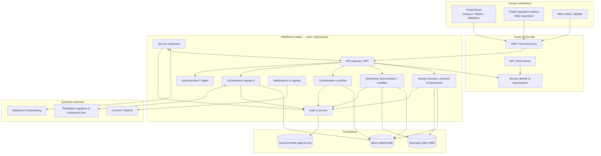

# Architecture de solution et architecture logicielle proposées

> **Statut** : proposition de conception (`PROP`). Les documents IQ exigent des capacités et livrables, mais n'imposent pas Java/Spring Boot, React, microservices ou une base de données particulière.

## 1. Principes
1. Privilégier une architecture modulaire, sécurisée et évolutive; éviter le découpage microservices artificiel.
2. Garder la génération documentaire, le workflow et la preuve dans un domaine cohérent avec transactions et cohérence contrôlées.
3. Utiliser des adaptateurs pour Salesforce Grantmaking, identité, courriel et signature.
4. Toute transition métier est validée côté serveur et auditée.
5. Les documents signés et leurs preuves sont immuables; une correction crée une nouvelle version/processus.
6. Les intégrations sont idempotentes, corrélées et rejouables.
7. Séparer clairement les données de configuration, transactionnelles, documents binaires et événements d'audit.
8. Isoler les environnements et contrôler les accès privilégiés.

## 2. Architecture logique cible


## 3. Architecture logicielle — modules
| Module | Responsabilité | Interfaces principales |
|---|---|---|
| identity-access | SSO, utilisateurs, rôles, groupes, politiques d'accès | OIDC/SAML, REST |
| case-management | Dossiers, trousses, participants, liens Salesforce | REST, événements |
| document-management | Fichiers, versions, métadonnées, stockage | REST, object storage |
| template-management | Modèles, champs, clauses, versions, partage | REST |
| document-generation | Fusion de données, règles conditionnelles, génération PDF/DOCX | REST, service interne |
| workflow-engine | Étapes séquentielles/parallèles/mixtes, transitions, assignations | REST, événements |
| signature-orchestration | Invitations, identité, consentement, signature, certificats | API prestataire / signature native |
| notification-service | Courriels, rappels, échéances, copies | SMTP/API |
| audit-evidence | Journal inviolable, preuve, export | REST, stockage objet |
| integration-adapters | Salesforce, systèmes IQ, mapping, retries, DLQ | REST / webhook |
| administration | Paramètres, règles, modèles, environnements | REST |
| operations | métriques, logs, alertes, sauvegardes, support | observabilité |

### Structure de code recommandée
```text
backend/
  src/main/java/.../
    shared/                 # erreurs, sécurité, événements, audit
    identityaccess/
      domain/ application/ infrastructure/ interfaces/
    casemanagement/
    documentmanagement/
    templating/
    documentgeneration/
    workflow/
    signature/
    notification/
    audit/
    integration/
    administration/
  src/test/
frontend/
  src/
    app/
    features/
      cases/ documents/ templates/ approvals/
      signatures/ tracking/ administration/
    shared/
```
Le découpage est un monolithe modulaire Spring Boot au départ, avec extraction de services uniquement si volume, isolation, disponibilité ou organisation le justifient.

## 4. Architecture de déploiement
- Environnements séparés DEV, INT, ACC/Préproduction et PRD; séparation des secrets, bases, stockage, comptes techniques et données.
- Hébergement Canada et, selon le Cahier, Québec ou autre juridiction admissible après approbation IQ. Le document principal indique Canada; arbitrage juridique requis.
- Base relationnelle haute disponibilité; stockage objet versionné/chiffré; sauvegardes chiffrées et copie de relève.
- Chiffrement TLS en transit et chiffrement au repos avec gestion centralisée des clés.
- SSO pour personnel IQ; accès signataires externes via liens à durée limitée et authentification renforcée selon risque.
- WAF, limitation de débit, validation des entrées, protection API, gestion secrets, MFA administrateurs.
- Supervision disponibilité, latence, files d'attente, échecs d'intégration, erreurs de génération, anomalies de workflow.
- Plan de continuité et reprise avec RTO/RPO à négocier et tester; les valeurs ne sont pas déterminées dans les extraits analysés.

## 5. Intégration Salesforce Grantmaking
### Flux entrant
1. Salesforce crée ou met à jour un dossier admissible.
2. L'adaptateur reçoit une commande via API/webhook ou interroge le système source selon mécanisme autorisé.
3. Vérification d'identité technique, validation de schéma, déduplication/idempotence.
4. Mapping vers un `BusinessCase` et `GenerationRequest`.
5. Données structurées et références source sont conservées; les données personnelles sont minimisées.
6. Génération d'un document prérempli à partir d'un modèle approuvé.

### Flux sortant
1. Événement de signature complétée / rejet / annulation.
2. Mise à jour d'état métier et audit.
3. Adaptateur envoie statut, identifiants, URL ou référence documentaire autorisée vers Salesforce.
4. Salesforce confirme; échec temporaire rejoué; échec permanent mis en file d'exception.
5. Réconciliation périodique des transactions incomplètes.

Ne pas présumer du modèle exact d'API Salesforce, objets, champs, limites, authentification ou webhook : atelier technique nécessaire.

## 6. Sécurité et confidentialité
- RBAC avec attributs de périmètre organisationnel (groupes, unité administrative, domaine d'affaires).
- Séparation initiateur / validateur / approbateur / signataire / administrateur / auditeur.
- Contrôle d'accès à chaque ressource, pas seulement à l'interface.
- Audit append-only : acteur, action, ressource, horodatage UTC, origine, résultat, corrélation, contexte d'authentification.
- Protection contre modification/suppression de preuve; hash du document final et manifeste de preuve.
- Rétention et destruction configurables selon règles d'archives IQ à confirmer.
- Gestion de clés, secrets, certificats, rotation, accès privilégiés.
- Analyse de vulnérabilités, tests d'intrusion, correctifs, SBOM si exigée, rapports indépendants et CAIQ.

## 7. Qualité et résilience
- Tests unitaires des règles de domaine; intégration DB / stockage / Salesforce sandbox; contrats API; E2E.
- Tests de concurrence pour workflow parallèle, signature simultanée et réassignation.
- Tests de charge basés sur 65 000 documents/an, pics horaires à préciser.
- Tests de reprise, sauvegarde/restauration, panne fournisseur et réconciliation.
- Déploiements contrôlés, approbation IQ et retour arrière.
- Idempotence des commandes, outbox transactionnelle, retries exponentiels et file d'échec.

## 8. Architecture de signature — choix à confirmer
Le DAO décrit les capacités de signature et de preuve, sans préciser si la solution doit intégrer un prestataire tiers ou embarquer son propre moteur. Évaluer les deux variantes à l'appel d'offres; isoler le fournisseur par une interface `SignatureProvider`.

## 9. NFR mesurables à préciser
| NFR | Cible / statut |
|---|---|
| Disponibilité | 99,5 % au Cahier; vérifier cohérence avec DAO et SLA contractuels |
| Volume | 55–65k documents/an; environ 1 300 employés potentiels |
| Taille téléversement | 25 Mo minimum |
| RTO / RPO | À confirmer contractuellement |
| Temps de génération | À définir par type de document et volumétrie |
| Latence API | À définir avec IQ / Salesforce |
| Rétention / archivage | À confirmer avec calendrier de conservation |
| Navigateurs et mobiles | Matrice à convenir |
| Accessibilité | À préciser selon politiques IQ et cadre applicable; ne pas inventer un niveau de conformité non cité |

## 10. ADR connexes
Voir `08-ADR/ADR-001-monolithe-modulaire.md` à `ADR-008-preuve-audit.md`.
