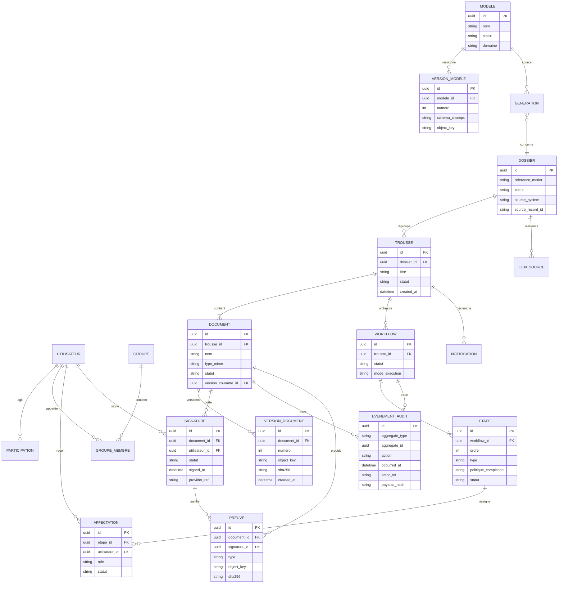
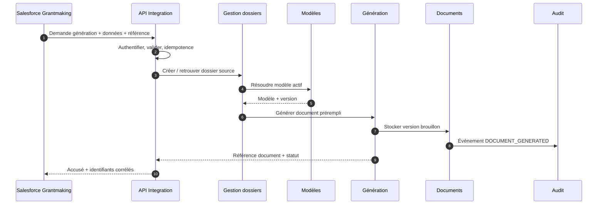
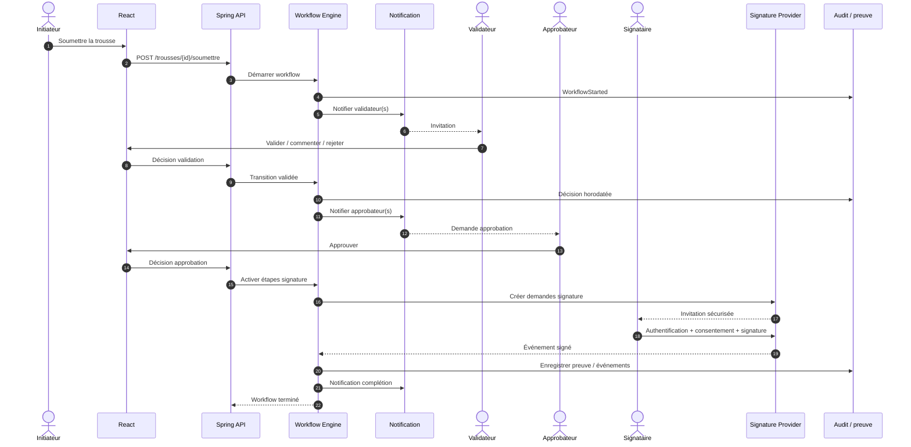
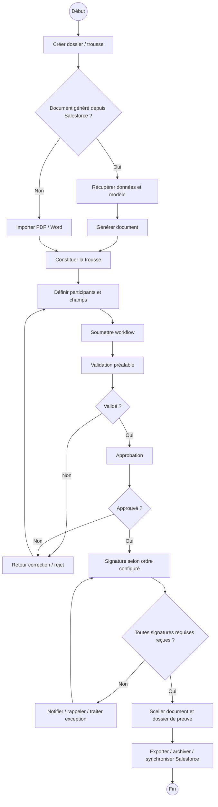
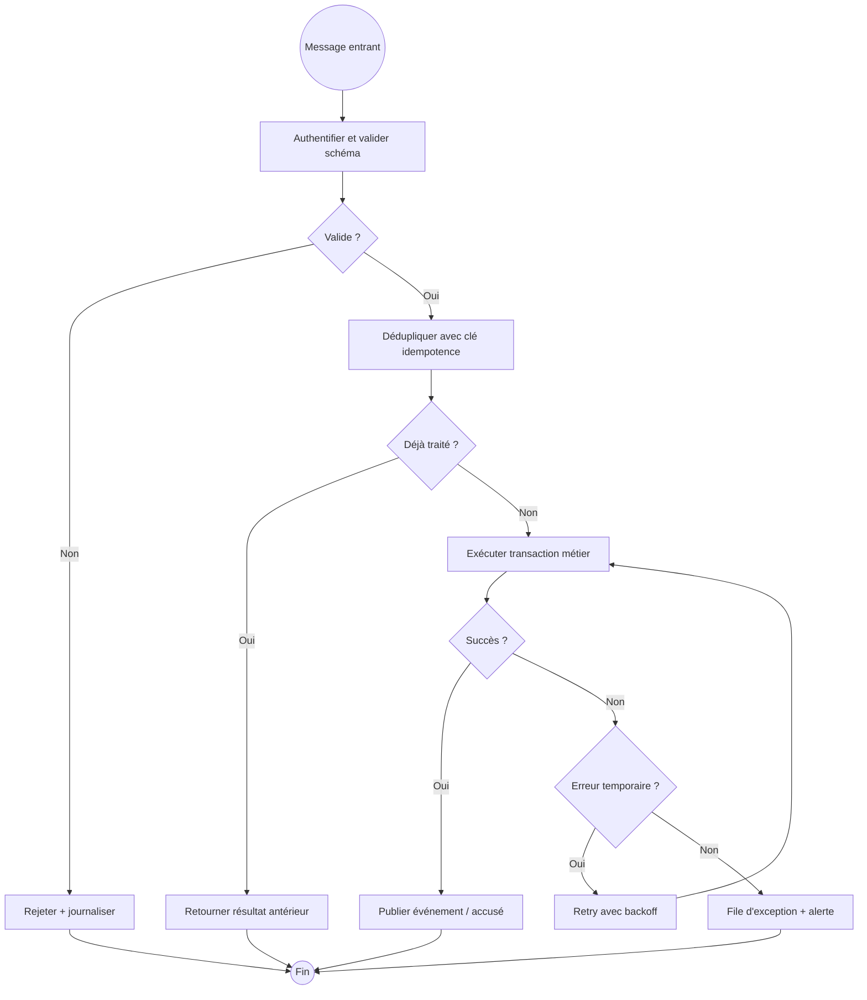

# Modélisation métier et diagrammes

## 1. MCD conceptuel

Ce MCD est une base conceptuelle proposée. Les cardinalités précises, règles de conservation, utilisateurs invités et modèles de données Salesforce doivent être validés.

## 2. Séquence — génération depuis Salesforce


## 3. Séquence — workflow validation / approbation / signature


## 4. Séquence — refus et reprise
```mermaid
sequenceDiagram
  actor Intervenant
  participant UI
  participant API
  participant WF
  participant AUD
  Intervenant->>UI: Refuser + commentaire
  UI->>API: POST décision=REJECTED
  API->>WF: Appliquer transition
  WF->>AUD: Journaliser refus et commentaire
  WF->>WF: Suspendre / rediriger vers étape configurée
  WF-->>API: État mis à jour
  API-->>UI: Afficher motif et prochaine action
  Note over WF: Toute reprise conserve l'historique; aucune suppression d'événement.
```

## 5. BPMN 2.0 — processus principal (notation Mermaid flowchart, équivalent de lecture; le BPMN formel importable doit être produit dans un outil BPMN)


## 6. BPMN — exceptions d'intégration


## 7. États de workflow recommandés
`DRAFT`, `READY`, `VALIDATION_PENDING`, `APPROVAL_PENDING`, `SIGNATURE_PENDING`, `COMPLETED`, `REJECTED`, `CANCELLED`, `EXPIRED`, `ON_HOLD`, `ERROR`.
Transitions permises selon rôle, configuration, version du document et événements externes. Un diagramme d'état détaillé devra être raffiné lors des ateliers.
