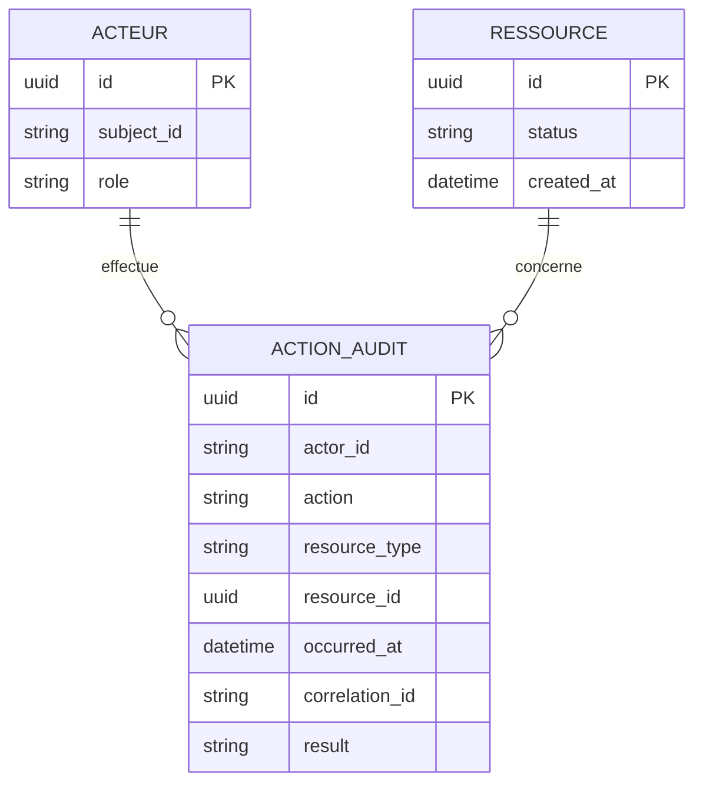
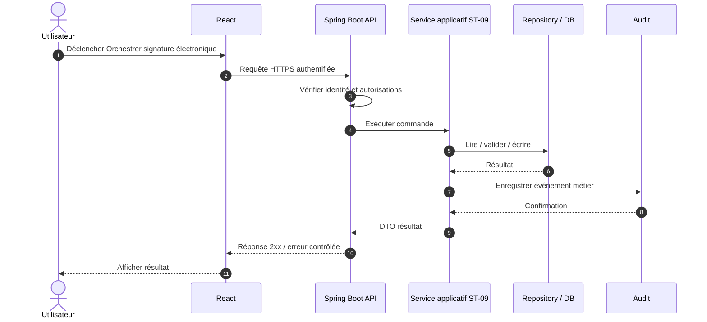
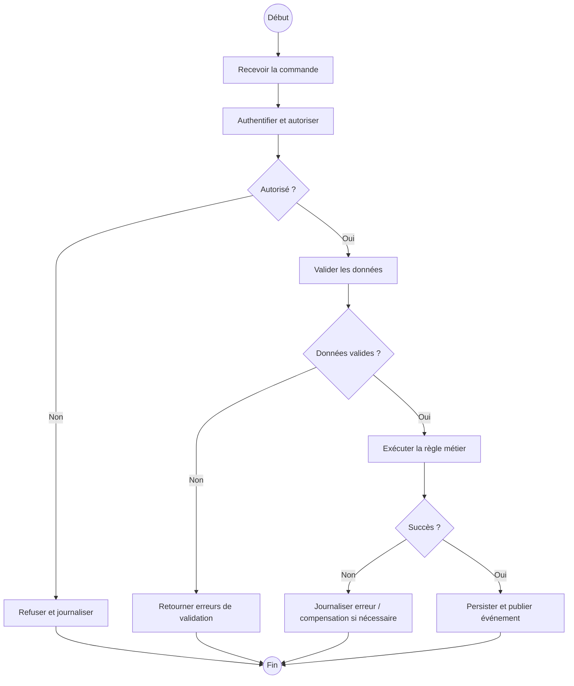

# ST-09 — Orchestrer signature électronique

## 1. Fiche
- **Priorité** : Must
- **Traçabilité** : F-06; F-10
- **User story** : En tant qu'initiateur, je veux faire signer les documents selon un ordre configurable afin d'obtenir les consentements requis.
- **Statut** : à raffiner en atelier métier et technique.

## 2. Contexte et valeur
Cette story met en œuvre une capacité demandée par IQ. Elle doit être livrée en cohérence avec les règles d'accès, la traçabilité et la conservation des preuves. Les comportements détaillés ci-dessous sont une conception proposée lorsqu'ils ne sont pas littéralement spécifiés dans les sources.

## 3. Périmètre fonctionnel
Signatures séquentielles/parallèles; groupes; assignation; modification contrôlée; identité adaptée; callback; statut; expiration.

## 4. Règles métier et cas d'exception
- Refuser toute opération non autorisée côté serveur, même si l'interface masque l'action.
- Journaliser les actions significatives avec acteur, horodatage, ressource, résultat et identifiant de corrélation.
- Préserver l'historique; ne pas écraser les événements ni une version finalisée.
- Gérer les erreurs de dépendance externe sans perdre l'état métier.
- Afficher un message utilisateur compréhensible sans exposer de données sensibles.
- Les règles de rétention et les délais exacts sont à confirmer avec IQ.

## 5. Critères d'acceptation
1. **Étant donné** un utilisateur autorisé, **lorsque** il exécute le parcours nominal, **alors** le résultat attendu est produit et consultable.
2. **Étant donné** un utilisateur non autorisé, **lorsque** il tente l'opération via l'API, **alors** l'accès est refusé et l'événement de sécurité est journalisé.
3. **Étant donné** une donnée invalide ou une dépendance indisponible, **lorsque** le traitement est demandé, **alors** une erreur contrôlée est retournée et aucune donnée partielle incohérente n'est publiée.
4. **Étant donné** une opération réussie, **lorsque** l'historique est consulté, **alors** l'action et son horodatage sont présents.
5. Les tests unitaires, intégration et E2E pertinents passent; documentation et métriques sont mises à jour.

## 6. Modèle de données pertinent

Adapter les entités métier selon le domaine propre à cette story; le diagramme ci-dessus est un sous-modèle générique de traçabilité.

## 7. Diagramme de séquence

## 8. BPMN / processus

## 9. API / événements proposés
- REST sous `/api/v1/`; DTO versionnés; OpenAPI.
- Idempotency-Key pour commandes externes ou non répétables.
- Événements métier nommés `"ST-09.completed"` et `"ST-09.failed"` à adapter au domaine.
- Erreurs structurées : code, message, correlationId, détails de validation sans données personnelles excessives.

## 10. Implémentation Java / Spring Boot
- Domaine : agrégats, value objects, invariants et règles métier.
- Application : commandes, cas d'utilisation, ports.
- Infrastructure : JPA/repositories, adaptateurs API, stockage, notifications.
- Interface : contrôleurs REST, validation DTO, mapping, gestion centralisée des erreurs.
- Sécurité : Spring Security, OIDC/SAML via intégration IdP, politiques d'autorisation.
- Transactions : limites transactionnelles explicites; outbox pour publication fiable d'événements.
- Tests : JUnit 5, tests unitaires domaine, `@SpringBootTest`, Testcontainers si disponible, contrats API et tests E2E.

## 11. Implémentation React
- Feature isolée `src/features/st_09/`.
- Composants accessibles, formulaires avec validation et états de chargement/erreur.
- Client API typé, gestion des sessions et des permissions.
- Ne jamais considérer la visibilité d'un bouton comme contrôle d'accès.
- Tests de composants et parcours avec données anonymisées.

## 12. Tests à prévoir
- Cas nominal et variantes.
- Rôles autorisés / interdits et accès inter-périmètre.
- Validation de données, doublons et répétition de requête.
- Indisponibilité de dépendance, timeout et reprise.
- Vérification de l'audit et absence de fuite de données.
- Performance et tests de charge selon volumétrie applicable.

## 13. ADR local
- **ADR** : appliquer les décisions globales `ADR-001` (architecture modulaire), `ADR-002` (API), `ADR-003` (persistance documentaire), `ADR-004` (intégration), `ADR-005` (IAM), `ADR-006` (workflow), `ADR-007` (résilience) et `ADR-008` (audit), selon pertinence.
- **Décision locale** : privilégier une implémentation configurable et réutilisable; ne pas coder en dur les règles métier qui doivent être administrées.
- **Conséquence** : ajouter des tests de migration/versionnement si le modèle ou les workflows évoluent.

## 14. Dépendances et questions ouvertes
- Dépendances : référent métier, modèle de données, identité, sécurité, environnements et intégrations concernés.
- Confirmer les champs obligatoires, règles de rétention, délais, rôles, exceptions et critères de validation.
- La story ne doit pas être considérée prête au développement tant que ses dépendances bloquantes ne sont pas résolues.
