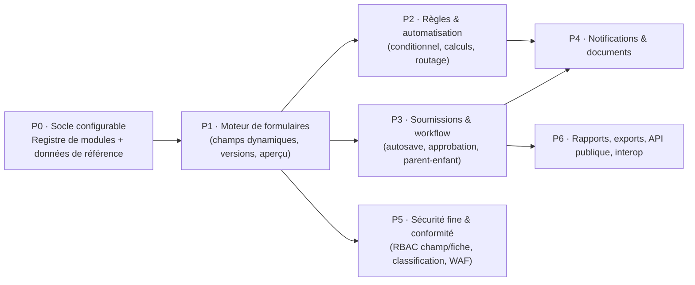

# Feuille de route — Plateforme de formulaires configurables (CHU)

Séquençage par **dépendances** (chaque phase est livrable et démontrable). Tout module est **activable/
désactivable par tenant** depuis l'espace superadmin dès son introduction. Rappel : **aucun champ figé**
— tout passe par des **données de référence / métadonnées**.

## P0 — Socle configurable (fondation)  ·  *réutiliser + porter*

**Objectif** : poser le **registre de modules** (feature flags par tenant, superadmin) et étendre les
**données de référence** pour piloter le reste.

- **Registre de modules** avec **résolution de dépendances** — 🔁 porter `saas/catalogueModules.ts`.
  Superadmin : activer/désactiver par tenant ; refus par défaut côté serveur.
- Environnement **d'acceptation** (3ᵉ environnement) en IaC — 🔨.
- **Dictionnaire de types de champs** et **ensembles d'options** comme données de référence — 🔨 (étend `ReferenceValue`).
- Gestion de la **durée de session** + responsive confirmé — ♻️🔨.

**Jalon** : un superadmin active/désactive un module fictif pour un tenant ; la bascule est effective.

## P1 — Moteur de formulaires (champs dynamiques)  ·  *construire (concept porté)*

**Objectif** : créer/éditer des formulaires **pilotés par métadonnées**, sans schéma figé.

- Modèle **Formulaire → Version → Page → Champ** (JSON/JSONB) — 🔁🔨 (porter `flux/formulaires.ts`).
- **Types de champs** complets : texte, zone-texte, case, radio, liste, date, courriel, hyperlien,
  nombre, décimale, **montant, %**, **fichier** (+ antivirus), **matrice**, valeur **calculée/dynamique**.
- **Versions**, approbation avant mise en ligne, **retour arrière**, **duplication**, **export/import** de structure.
- **Aperçu** avant soumission ; formulaires **multi-pages** ; **multilingue** (libellés par langue).

**Jalon** : un administrateur CHU compose un formulaire multi-pages de bout en bout, le versionne et le publie.

## P2 — Règles, validation et automatisation  ·  *porter + construire*

- **Logique conditionnelle** : afficher/masquer/rendre obligatoire selon les réponses — 🔨.
- **Validation** croisée + format — 🔁 (`validate.ts`).
- **Calculs** par formules avec **détection de cycle** — 🔁 (`formulaires.ts`).
- **Routage** par règles (montant/code/réponse) — 🔁 (`approvals/engine.ts`) ; généraliser `RuleEngine`.
- **Déclencheurs d'événements** (sur saisie/modif) ; **inventaire/capacité** (quotas, inscriptions) — 🔨.

**Jalon** : un formulaire d'inscription ferme à capacité atteinte et route l'approbation selon un montant.

## P3 — Soumissions, workflow et cycle de vie  ·  *réutiliser + porter*

- **Soumission** (fiche) = valeurs JSON clés-par-code ; **brouillon/soumis/validé/rejeté** — 🔁.
- **Sauvegarde automatique** + reprise — 🔨.
- **Fenêtres d'activation** (date, nb max de répondants, plage IP) + **captcha** — 🔨.
- **Workflow d'approbation** daté avec **historique** (retour arrière conservé) — ♻️🔁.
- **Formulaires parent-enfant** (processus multi-niveaux) — 🔨.

**Jalon** : soumission publique protégée par captcha, autosauvegardée, validée via un circuit d'approbation.

## P4 — Notifications et génération documentaire  ·  *porter + réutiliser*

- **Canaux** : courriel (ACS/SMTP), **SMS (Twilio/Telnyx)**, **messagerie interne** — 🔁.
- **Règles de notification** par déclencheur (confirmation au répondant, alerte aux admins) — 🔨.
- **Document PDF/DOCX** généré depuis les données + transmission — ♻️ (rendu existant).

**Jalon** : une soumission déclenche courriel + SMS de confirmation et produit un PDF transmis au répondant.

## P5 — Sécurité fine et conformité  ·  *porter + construire*

- **RBAC granulaire** : utilisateur/groupe/rôle × formulaire/champ/page/fiche/bouton — 🔁🔨
  (`accessPolicy`+`tenantRoles`+`scope`).
- **Groupes/ACL** avec droits lecture/modif/suppression — 🔨.
- **Classification** (public/interne/confidentiel/secret) + **masquage/chiffrement/restriction export** — 🔨.
- **WAF / rate-limit / verrouillage brute-force / antivirus fichiers** — 🔁🔨 (`securite/pareFeu.ts`).
- **Audit** (option chaîné SHA-256) + **rétention/effacement** Loi 25 — ♻️🔁.
- **Test d'intrusion** du portail RH (firme externe) — 🔨 (prestation).

**Jalon** : un champ « secret » est masqué et non exportable pour un rôle donné ; tentative de force brute verrouillée ; audit infalsifiable.

## P6 — Rapports, exports, API publique et interopérabilité  ·  *porter + construire*

- **Recherche** multi-critères + **critères sauvegardés** — ♻️🔨.
- **Export Excel/CSV/PDF** + **tableaux de bord & graphiques** configurables — 🔁🔨 (`bi/`, `export/`).
- **API REST publique** (consulter/créer/compléter des fiches) avec **OAuth2 client_credentials / clé d'API / PAT** — 🔨.
- **Interopérabilité** CHU (échanges formulaires ↔ systèmes externes ; reprise de l'existant) — ♻️🔨.

**Jalon** : un système externe CHU crée une fiche via l'API tokenisée ; un tableau de bord exporte en Excel.

## Vue licences / modules (bloc 9)

Chaque **secteur** (RH, Approvisionnements) et chaque **application Web** = une **activation de module** par
tenant dans le registre (P0). Le soutien L2 (lun–ven 8–17 h), les migrations/tests (environnement
d'acceptation), le pentest et la **banque d'heures** sont des **prestations**, pas des développements.

## Dépendances externes / prestations (non-dév)

- **Pentest** du portail RH : firme externe spécialisée.
- **SMS** : compte Twilio/Telnyx (coût à l'usage, hors hébergement).
- **Courriel** : Azure Communication Services ou SMTP institutionnel.

> Chaque phase respecte les **portes de qualité** du projet (tests ≥ 96 %, accessibilité AA, sécurité
> refus-par-défaut) et introduit ses modules **désactivés par défaut**, activables par le superadmin.