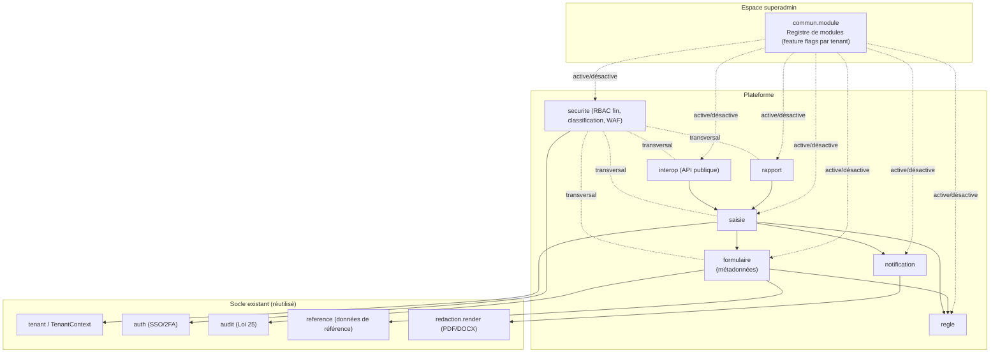

# Architecture — nouveaux modules et principe piloté par métadonnées

S'inscrit dans l'architecture **DDD par contexte** du backend (`qc.levis.contrat.<contexte>.{domain,
application,infrastructure}`, voir ADR-006). Chaque nouveau contexte respecte la **règle de dépendance**
(infrastructure → application → domain) et s'active via le **registre de modules**.

## 1. Nouveaux contextes bornés

| Contexte | Rôle | Réutilise |
|---|---|---|
| `commun.module` | **Registre de modules** + feature flags par tenant (résolution de dépendances) | 🔁 `catalogueModules.ts` |
| `formulaire` | Moteur de formulaires : définitions, pages, champs, versions (métadonnées) | 🔁 `flux/formulaires.ts` + ♻️ `DocumentVersion` |
| `regle` | Moteur de règles : visibilité, obligation, validation, calcul, routage, déclencheurs | ♻️ `RuleEngine` + 🔁 `approvals/engine.ts` |
| `saisie` | Soumissions (fiches), autosave, fenêtres d'activation, parent-enfant | 🔁 `flux/domaine` |
| `notification` | Courriel, SMS, messagerie interne, règles de notification | 🔁 `notifications/` |
| `rapport` | Recherche sauvegardée, exports Excel/CSV/PDF, tableaux de bord | 🔁 `bi/`, `export/` |
| `interop` | API REST publique tokenisée + connecteurs d'échange CHU | ♻️ `integration` |
| `securite` (extension) | RBAC fin, groupes/ACL, classification/masquage, WAF/anti-abus, rétention | 🔁 `accessPolicy`, `pareFeu.ts`, `retention.ts` |

## 2. Registre de modules (superadmin, activable/désactivable)

Principe porté de `catalogueModules.ts` : un **catalogue** de modules (avec familles et **dépendances**),
et un état **par tenant**.

- `ModuleCatalogue` (donnée de référence) : `code`, `nom`, `famille`, `dependances[]`, `vuesAssociees[]`.
- `TenantModule` : `tenant_id`, `module_code`, `actif`, `activeLe`, `activePar`.
- **Résolution de dépendances** : activer un module active ses prérequis ; désactiver retire les
  dépendants (opérateur averti).
- **Refus par défaut côté serveur** : un garde (`@PreAuthorize`/intercepteur) vérifie
  `tenantHasModule(code)` ; sinon **403**. Les vues frontend sont masquées (`vuesMasquees`).
- **Licences bloc 9** : « RH », « Approvisionnements » et chaque application Web = des modules du
  catalogue, activés par tenant.

## 3. Principe « piloté par métadonnées » (aucun champ figé)

La structure des formulaires n'est **jamais** une table métier à colonnes fixes. Elle est décrite par
des **données** :

- **Types de champs** et **ensembles d'options** → `reference` (extensible sans migration).
- **Définition de formulaire** → JSON/JSONB (pages, champs, propriétés, i18n).
- **Règles** (visibilité/obligation/validation/calcul/routage) → JSON (`champ/opérateur/valeur` + action).
- **Valeurs de soumission** → JSON clés-par-code **+** une **table d'index générique** (EAV) pour la
  recherche/export performants (patron `customFields.ts`).
- **Classification & masquage** → attribut de champ (référence `NiveauConfidentialite`), appliqué au
  rendu, à l'export et à l'API.

Conséquence : **ajouter un champ, une règle, un type ou une classification = configuration**, pas de
changement de schéma ni de déploiement.

## 4. Sécurité et conformité (transversal)

- **RBAC fin** : capacité × portée (`formulaire/champ/page/fiche/bouton`), rôles **par tenant**
  personnalisables (porté de `accessPolicy`+`tenantRoles`+`scope`).
- **Classification** : `public/interne/confidentiel/secret` ; masquage/chiffrement/restriction d'export
  selon rôle et contexte.
- **Anti-abus** : WAF (signatures OWASP), rate-limit par IP, verrouillage brute-force, antivirus fichiers
  (porté de `securite/pareFeu.ts`) — en complément du WAF cloud.
- **Audit & rétention** : journal (option **chaîné SHA-256**), durée de conservation et effacement
  (Loi 25), résidence **au Québec**.

## 5. Interopérabilité (bloc 8)

- **API REST publique** (`interop`) : CRUD de fiches, auth **OAuth2 client_credentials / clé d'API / PAT**,
  quotas, journalisation, documentée en OpenAPI.
- **Connecteurs** configurables (réutilise `integration` M365/SAP) ; **reprise** des échanges/automatisations
  existants du CHU (compatibilité ascendante).

## 6. Ce qui reste strictement du socle existant (réutilisé tel quel)

Multi-tenant (`TenantContext`), SSO OIDC/SAML, 2FA TOTP, audit Loi 25, rendu PDF/DOCX, données de
référence, thèmes/branding, i18n FR/EN. Aucune réécriture — on **étend**.