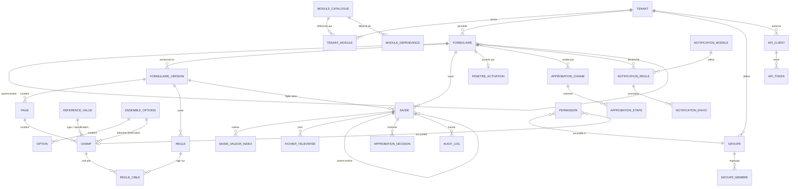

# MCD — Moteur de formulaires piloté par métadonnées

Modèle **conceptuel** de données. Point central : **la structure des formulaires est une donnée**
(métadonnées + JSON), pas un schéma figé. Les tables sont **génériques et stables** ; ce sont leurs
**lignes** qui décrivent formulaires, champs, règles, classifications, etc. Tout est **tenant-scopé**
(les lignes « globales » ont `tenant_id = null` et sont surchargées par `code`).

## Entités clés (attributs conceptuels)

| Entité | Attributs principaux | Rôle |
|---|---|---|
| **MODULE_CATALOGUE** | code, nom, famille | Catalogue des modules activables |
| **MODULE_DEPENDANCE** | module_code, requiert_code | Résolution de dépendances |
| **TENANT_MODULE** | tenant_id, module_code, actif, active_le/par | Feature flag par tenant (superadmin) |
| **REFERENCE_VALUE** | categorie, code, libelle_i18n, tenant_id, ordre, actif | **Types de champs**, **niveaux de classification**, listes diverses |
| **FORMULAIRE** | id, tenant_id, code, nom_i18n, parent_id, statut, actif | Formulaire (mono/multi-pages, parent-enfant) |
| **FORMULAIRE_VERSION** | id, formulaire_id, numero, statut (brouillon/en_approbation/publié), snapshot_json, publie_le | Versionnage + retour arrière |
| **PAGE** | id, version_id, ordre, titre_i18n | Page du formulaire |
| **CHAMP** | id, page_id, code, type_code→REF, libelle_i18n, ordre, obligatoire, **proprietes_json** (décimales, min/max, options_ref, format, calcul), classification→REF | **Champ configurable** — aucune colonne métier figée |
| **ENSEMBLE_OPTIONS / OPTION** | code, tenant_id / code, libelle_i18n, ordre | Listes d'options configurables |
| **REGLE** | id, version_id, type (visibilité/obligation/validation/calcul/routage/événement), **condition_json**, **action_json** | Logique configurable |
| **FENETRE_ACTIVATION** | formulaire_id, date_debut, date_fin, max_repondants, ip_allowlist, captcha_requis | Ouverture/fermeture |
| **SAISIE** | id, tenant_id, formulaire_id, version_id, statut, **donnees_json**, parent_saisie_id, cree_par, maj_le (autosave) | Fiche/soumission |
| **SAISIE_VALEUR_INDEX** | saisie_id, champ_code, valeur_texte/num/date | **Index EAV** pour recherche/export performants |
| **FICHIER_TELEVERSE** | saisie_id, champ_code, nom, taille, type, statut_antivirus, uri | Pièces jointes (analyse antivirus) |
| **APPROBATION_CHAINE / ETAPE / DECISION** | — | Routage daté + historique (réutilise workflow) |
| **NOTIFICATION_MODELE / REGLE / ENVOI** | canal (courriel/SMS/interne), gabarit_i18n / déclencheur, destinataires_json / statut | Notifications + journal |
| **GROUPE / GROUPE_MEMBRE / PERMISSION** | — / — / sujet (user/groupe/rôle), portée (formulaire/champ/page/fiche/bouton), action (lire/modifier/supprimer) | RBAC granulaire + classification |
| **API_CLIENT / API_TOKEN** | client_id, secret_hash, scopes / jeton, expiration | API publique tokenisée |

## Notes de conception

- **Double stockage des valeurs** : `SAISIE.donnees_json` (source de vérité, fidèle au formulaire) **+**
  `SAISIE_VALEUR_INDEX` (EAV dénormalisé) pour recherche, filtres et export Excel efficaces — patron
  `customFields.ts`.
- **i18n partout** : les libellés (`*_i18n`) portent les variantes de langue (FR/EN) → formulaires
  multilingues sans table par langue.
- **Classification** : `CHAMP.classification` pointe une `REFERENCE_VALUE` (public/interne/confidentiel/
  secret) ; le masquage/chiffrement/restriction d'export est appliqué au rendu, à l'export et à l'API.
- **Zéro migration pour un nouveau champ** : créer un `CHAMP` (ligne) et, au besoin, un type ou un
  ensemble d'options (lignes de référence). Aucune DDL.