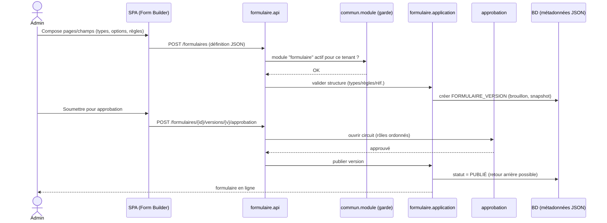
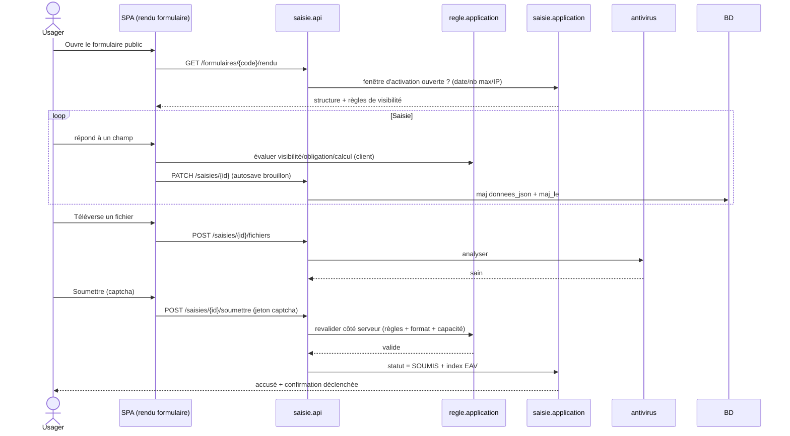
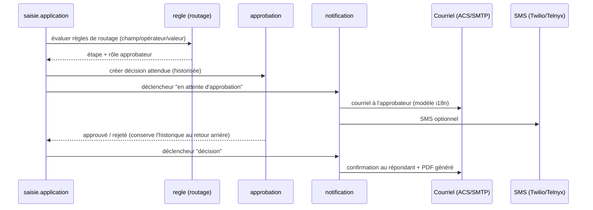
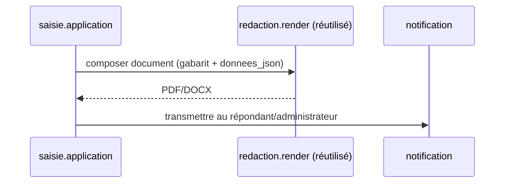
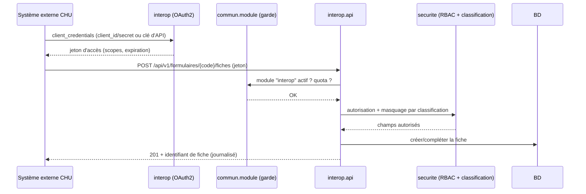
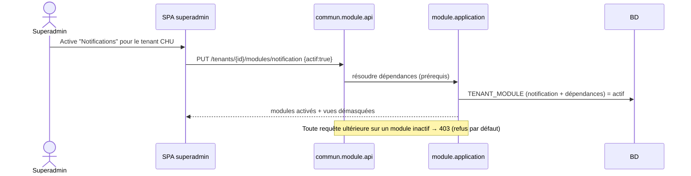

# Diagrammes de séquence — flux clés

Diagrammes Mermaid des principaux parcours. Tous passent par le **garde de module** (refus par défaut si
le module n'est pas activé pour le tenant) et le **contexte tenant**.

## 1. Composer, versionner et publier un formulaire

## 2. Remplir un formulaire (logique conditionnelle, autosave, captcha, soumission)

## 3. Routage d'approbation + notification multicanal

## 4. Génération d'un document PDF depuis les données

## 5. Accès par API publique tokenisée (système externe CHU)

## 6. Activer/désactiver un module depuis le superadmin

