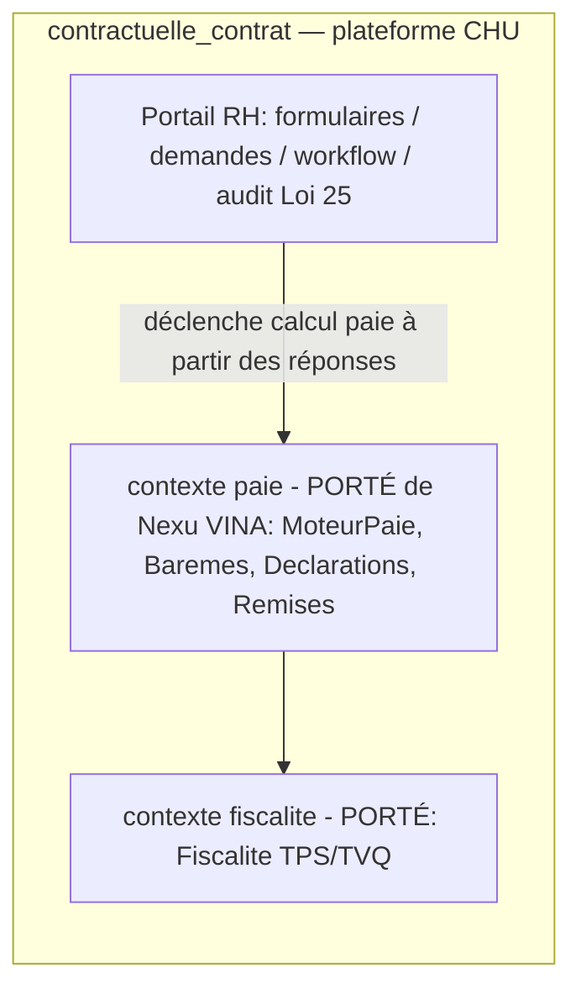

# Validation des spécifications · Plan Approvisionnement · Intégration RH

> Référence : `maquettes_ui_plateforme_CHU.md` (spécification fonctionnelle + 17 écrans) et
> `architecture_solution_plateforme_CHU_java_spring_react.md` (MCD, API, ADR, 25 stories).
> Ce document **valide** les deux spécifications au regard de la plateforme existante
> (`contractuelle_contrat`, moteur de formulaires P0→P6 déjà livré), **planifie** la partie
> **Approvisionnement** en réutilisant le moteur, et **propose** l'intégration de la partie **RH**
> avec `~/Projects/freelance-invoicing` au lieu d'un nouveau module.

---

## A. Validation des deux documents

### A.1 Cohérence interne — conforme

Les deux documents sont **cohérents entre eux** : le MCD (architecture §5.2) couvre bien les écrans des
maquettes (catalogue, concepteur, workflow, demandes, tâches, fiches, rapports). Les états métier
(architecture §15) correspondent aux statuts affichés dans les écrans 6/7/8. Les ADR-001→007 justifient
les choix (monolithe modulaire, PostgreSQL, JSON Schema versionné, identité fédérée, stockage objet,
workflow piloté par états, outbox notifications) — alignés avec notre socle.

### A.2 Alignement avec l'existant — ce qui est déjà couvert

| Besoin CHU (docs) | Couvert par l'existant | Contexte |
|---|---|---|
| `FORM_DEFINITION` + `FORM_VERSION` versionnés, schéma JSON | ✅ `Formulaire` + `FormulaireVersion` (`structure_json`) | `formulaire` (P1) |
| Concepteur de formulaires, bibliothèque de champs, aperçu | ✅ `FormulaireBuilder` + `FormulaireRenderer` (16 types en données de référence) | front |
| Règles d'affaires (visibilité/obligation/validation/calcul/routage) | ✅ `MoteurRegles` + `/evaluer` | `regle` (P2) |
| `REQUEST` + `response_json` + brouillon/soumission/autosave | ✅ `Saisie` (`donnees_json`) + autosave + captcha + fenêtre d'activation | `saisie` (P3) |
| Notifications multi-canaux + modèles + journal | ✅ `notification` (COURRIEL/SMS/INTERNE, gabarits, journal) | `notification` (P4) |
| Sécurité fine (permissions par champ/fiche, refus par défaut), WAF/limiteur | ✅ `securite` (`MoteurAcces`, `Masquage`, `LimiteurDebit`, `PareFeuFilter`) | `securite` (P5) |
| Rapports, recherche sauvegardée, export Excel | ✅ `rapport` (résumé, critères, export POI) | `rapport` (P6) |
| API tokenisée pour intégrations | ✅ `interop` (OAuth2 client_credentials simplifié) | `interop` (P6) |
| Modules activables/désactivables par domaine/tenant | ✅ Registre de modules + superadmin | `commun.module` (P0) |

### A.3 Écarts à combler (le cœur de la présente demande)

Le moteur générique est là ; il **manque la couche « demande gouvernée » et la séparation par domaine**
qu'exigent les maquettes pour l'Approvisionnement (et, symétriquement, la RH) :

1. **`DOMAINE`** (RH / APPROVISIONNEMENT) — absent. Les maquettes l'exigent partout (filtre catalogue,
   fiches, tâches ; séparation logique §9.2). → **à ajouter** comme donnée de référence + rattachement
   du `Formulaire` à un domaine, avec cloisonnement d'accès par rôle/domaine.
2. **`request_number`** lisible (`AP-2026-052`, `RH-2026-104`) — absent de `Saisie`. → à générer côté
   serveur, sans donnée personnelle (contrainte §5.3).
3. **États de demande enrichis** — notre `StatutSaisie` (BROUILLON/SOUMIS/VALIDE/REJETE) est un
   sous-ensemble de l'état cible (§15.1 : + `IN_REVIEW`, `WAITING_FOR_REQUESTER`/« à compléter »,
   `CLOSED`, `CANCELLED`). → à étendre.
4. **Workflow explicite + Tâches + Décisions** — `WORKFLOW_VERSION`/`WORKFLOW_STEP`/`TASK`/
   `APPROVAL_DECISION` (routage par **montant > seuil**, écran 5). Nous avons un circuit d'approbation
   côté `dossier/approbation` mais **pas** le concepteur de workflow piloté par données ni les tâches
   assignées génériques. → à ajouter (réutiliser l'esprit de `MoteurRegles` pour le routage).
5. **Documents de demande** (`DOCUMENT`) + **Commentaires/demande de complément** (`COMMENT`) — à ajouter.
6. **Applications / catalogue** (écran 2) — regroupement de formulaires+workflows+thème par domaine et
   environnement. → vue + entité légère `Application`.
7. **Portail utilisateur** (« Mes demandes », « Tâches et approbations », « Documents disponibles ») —
   à exposer côté front (les API `saisie` existent déjà en grande partie).

### A.4 Points à faire trancher par le CHU (déjà listés dans les docs — on les relaie)

- Séparation RH/Appro : **logique** (un déploiement, cloisonnement par domaine) ou **technique** (deux
  déploiements) ? → impacte l'infra. Recommandation : logique d'abord (ADR-001 monolithe modulaire),
  option technique documentée.
- Stockage objet des pièces jointes (ADR-005) : fournisseur et région (hébergement Québec).
- Identité fédérée (ADR-004) : nos connecteurs OIDC/SAML existants suffisent-ils ?

> **Conclusion de validation** : les deux documents sont **valides et implémentables sur le socle
> existant** sans réécriture. Le travail restant est une **couche de gouvernance des demandes + la
> dimension domaine**, pas un nouveau produit.

---

## B. Plan d'implémentation — Approvisionnement (réutilisation du moteur)

L'Approvisionnement **n'est pas un nouveau module technique** : c'est le moteur générique + une dimension
`domaine` + des formulaires/workflows configurés. Phases :

| Phase | Contenu | Front | Back |
|---|---|---|---|
| **AP-1 (socle domaine)** | `DOMAINE` en donnée de référence ; `Formulaire.domaine` ; filtrage par domaine ; cloisonnement d'accès ; `request_number` ; semence domaine APPROVISIONNEMENT + formulaire « Demande d'achat » | filtre Domaine, catalogue | migration + seed + service |
| **AP-2 (portail demandes)** | « Mes demandes » (Brouillons/Soumises/À compléter/Terminées), détail + historique + numéro | pages portail | réutilise `saisie` + états étendus |
| **AP-3 (workflow + tâches)** | `WORKFLOW_VERSION`/`STEP`, routage par montant (seuil), `TASK` assignées, `APPROVAL_DECISION` (approuver/refuser/retourner) | concepteur workflow, « Tâches et approbations » | nouveau contexte `processus` |
| **AP-4 (documents + compléments)** | pièces jointes de demande, commentaires, « demande de complément » (`WAITING_FOR_REQUESTER`) | onglets Documents/Historique | `DOCUMENT`/`COMMENT` |
| **AP-5 (applications + versions/publications)** | catalogue d'applications, écrans Versions/Publications | écrans 2 et 14 | entité `Application` |

Chaque phase est **gardée par un module** (`@modules.actif('x')`) et **cloisonnée par domaine**, conforme
aux principes imposés (tout configurable, rien de figé, activable/désactivable depuis le superadmin).

---

## C. Proposition — Intégration RH en RÉUTILISANT le Java de `freelance-invoicing`

### C.1 Constat (analyse du dépôt `backend-java/` + `frontend/`)

`~/Projects/freelance-invoicing/backend-java/` **n'est pas** une petite appli de facturation : c'est le
mono-dépôt **« Nexu VINA »**, un back-office **Spring Boot 4 / Java 25, en DDD hexagonal**, dont la
convention de packages `ca.vina.nexu.<contexte>.{domaine,application,infrastructure}` **correspond 1:1** à
la nôtre (`qc.levis.contrat.<contexte>.{domain,application,infrastructure}`), avec **1 record DTO par
fichier** déjà respecté. Il contient un contexte **`paie`** complet, conforme Revenu Québec, dont les
**moteurs de calcul sont PURS** (classes `final` à méthodes `static`, records immuables, **aucun import
`org.springframework`**, zéro I/O) — donc portables tels quels. Il contient aussi des contextes
`fiscalite`, `rh` et **`approvisionnement`**.

→ La bonne stratégie n'est donc **pas** d'appeler un service Node par HTTP, mais de **PORTER les classes de
domaine pures** dans notre projet (réutilisation maximale, exigence de l'utilisateur), et de réécrire
seulement la coquille (contrôleurs, persistance) selon nos conventions.

### C.2 Briques à porter telles quelles → `qc.levis.contrat.paie.domain` / `fiscalite.domain`

| Classe (source `ca.vina.nexu.paie.domaine`) | Rôle | Pur ? |
|---|---|---|
| `MoteurPaie` | Moteur de retenues : impôt féd.+QC, RRQ/RRQ2, AE, RQAP, CNESST, FSS, parts employé/employeur, net, YTD | ✅ |
| `Baremes` | Tables **2025** (tranches, plafonds RRQ/AE/RQAP, CNESST, FSS) — prévoir versionnage annuel | ✅ |
| `ImpotSurLeRevenu` | Impôt sociétés / autonome / salarié, DPA/CCA, bureau, km | ✅ |
| `Declarations` | FPZ-500 (TPS/TVQ), rapport retenues (TPZ-1015.R.14 / PD7A), synthèse **Relevé 1 + T4** | ✅ |
| `Remises` | Échéancier, **XML TPZ-1015.R.14 / PD7A (T619)**, fichier paiement **CPA-005** | ✅ |
| `ElementsDeduction`, `AvantagesSociaux`, `Depenses`, `CompteEmploye` | Éléments de paie, avantages, dépenses, compte employé | ✅ |
| `fiscalite.domaine.Fiscalite` | TPS/TVQ en `BigDecimal` (plus rigoureux que `Depenses`) → contexte `fiscalite` | ✅ |

**Opération de portage** : renommer le package (`…nexu.paie.domaine` → `…contrat.paie.domain`), recréer
l'exception noyau `HorsPerimetreException` dans notre shared-kernel `commun`, puis réimplémenter les **ports**
(`Bulletins`, `Depot`, `PiecesJointes`, `Comptables`…) avec **nos** adaptateurs (JPA/Liquibase) — on ne
reprend PAS les adaptateurs SQLite/JDBC ni les contrôleurs d'origine (ils servent de **spécification des
endpoints**, préfixe `/api/payroll`). À **laisser** : `retenues` (retenues contractuelles, pas de la paie),
`varpay`/`effectifs`/`absences`/`horaires` (volumineux, hors périmètre immédiat).

### C.3 Front : porter les écrans RH/paie en adaptant 4 conventions

Les écrans `.tsx` (`Payroll.tsx`, `Remittances.tsx` + `RetenuesALaSource.tsx`, `Fiscalite.tsx`,
`DossierEmploye.tsx`, `Personnel.tsx`, `MasseSalariale.tsx`…) sont réutilisables en structure/logique moyennant
4 adaptations systématiques : `fetch` → **axios (`api`)**, `useOnglet` → **react-router-dom 6**, `useT()` →
**`useI18n`/`t`**, classes CSS `card/field/grid-form` → **`panel/table/form/cmp-row`**.

### C.4 Architecture d'intégration

La demande RH reste gouvernée par notre moteur (formulaire + workflow + Loi 25) ; le **calcul** RH/paie est
délégué au **domaine porté** (pur, testable à 100 %), pas à un service externe. Réversibilité assurée par les
ports ; conformité Loi 25 préservée (hébergement Québec, données sensibles sous contrôle d'accès renforcé).

### C.5 À confirmer

- Périmètre RH exact attendu par le CHU (paie complète ? seulement dossiers/demandes ?).
- Versionnage annuel des barèmes (`Baremes` est figé 2025).
- Licence / propriété du code Nexu VINA réutilisé (interne VINA — à confirmer).

### C.6 État de réalisation — RH-1 LIVRÉ (preuve de la stratégie de portage)

La première étape du portage est **faite et vérifiée**, démontrant que la réutilisation fonctionne :

- **Portés tels quels** dans `qc.levis.contrat.paie.domain` : `Baremes` (barèmes 2025) et le **cœur de calcul
  pur** de `MoteurPaie` (`calculer`, `impotProgressif`, records `Taux`/`Ytd`/`ElementResolu`/`Entree`/
  `Bulletin`). Seule la queue couplée (bulletins émis, absences, ports de persistance) a été laissée.
- **Coquille ajoutée selon nos conventions** : `PaieService` + `PaieController` (`/api/paie/apercu`,
  `/api/paie/taux`, `/api/paie/frequences`), module `paie` (famille RH), front `Paie.jsx` (menu
  Administration), i18n FR/EN.
- **Tests** : `MoteurPaieTest` (5 tests purs) **vert** — net < brut, plafond RRQ au cumul, sans-retenues,
  impôt progressif, fréquence invalide rejetée.
- **Vérifié bout-en-bout** : brut 2000 $ aux deux semaines → impôt féd 172,80 $ · impôt QC 182,78 $ ·
  RRQ 119,38 $ · AE 26,20 $ · RQAP 9,88 $ · **net 1488,96 $** · coût employeur 2238,50 $.
- **Reste à porter (mêmes modalités)** : `ImpotSurLeRevenu`, `Declarations` (TPZ-1015.R.14/PD7A/Relevé 1/T4),
  `Remises` (XML T619, CPA-005), `ElementsDeduction`, `AvantagesSociaux`, `Depenses`, `Fiscalite` ; écrans
  RH `.tsx` (`Payroll`, `Remittances`, `Fiscalite`, `DossierEmploye`) à adapter (axios/react-router/useI18n/CSS).

---

## D. Cartographie des menus manquants → implémentation

### D.1 Console d'administration (maquettes §4.2)

| Entrée de menu | État | Action |
|---|---|---|
| Tableau de bord | ✅ `Stats` | — |
| Applications | ❌ | AP-5 : vue catalogue d'applications |
| Formulaires › Catalogue | ✅ `Formulaires` | ajouter filtre **Domaine** |
| Formulaires › Concepteur | ✅ `FormulaireBuilder` | — |
| Formulaires › Versions | ⚠️ partiel (historique en API) | AP-5 : écran Versions |
| Formulaires › Publications | ⚠️ partiel | AP-5 : écran Publications |
| Processus › Workflows / Tâches / Règles | ⚠️ Règles ✅ ; Workflows/Tâches ❌ | AP-3 : concepteur + tâches |
| Données › Fiches / Recherche / Exports / Conservation | ✅ Fiches ; ⚠️ reste | AP-2/AP-5 |
| Rapports / Notifications / Intégrations / Sécurité & audit | ✅ | — |
| Environnements / Paramètres / Soutien | ⚠️ selon besoin | hors périmètre immédiat |

### D.2 Portail utilisateur (maquettes §4.1)

| Entrée | État | Action |
|---|---|---|
| Accueil | ✅ `Dashboard` | — |
| Mes demandes (Brouillons/Soumises/À compléter/Terminées) | ❌ | AP-2 |
| Nouveau formulaire | ⚠️ via liste | AP-2 : catalogue par domaine |
| Tâches et approbations | ❌ | AP-3 |
| Documents disponibles | ❌ | AP-4 |
| Notifications | ⚠️ journal admin seulement | AP-2 : centre de notifications utilisateur |
| Aide et soutien | ⚠️ | hors périmètre immédiat |

---

## E. Stratégie de tests e2e avec données JSON

- **Fixtures JSON** (`e2e/fixtures/appro/*.json`) : définition du formulaire « Demande d'achat »
  (structure + règle de routage montant), jeux de réponses (sous seuil / au-dessus du seuil), utilisateurs.
- **Parcours couverts** : (1) superadmin active les modules + domaine ; (2) concepteur publie le
  formulaire Appro depuis la fixture ; (3) employé soumet une demande (numéro `AP-…`) ; (4) routage par
  montant ; (5) gestionnaire approuve ; (6) demande `CLOSED`. Assertions sur statut + numéro + audit.
- **Accessibilité** : `axe-core` sur chaque nouvel écran (zéro violation) — exigence permanente.
- **Harnais** : port 5175 + backend natif frais (cf. mémoire e2e), données **synthétiques** (jamais de
  données réelles en DEV/UAT, §3).

> Les seuils de couverture (≥ 96 %) et le MSI s'appliquent au code ajouté ; le détail par phase est suivi
> dans le backlog `03-BACKLOG-STORIES.md`.
