# Architecture de solution et plan de réalisation
## Plateforme de formulaires, workflows et portail Espace RH — CHU de Québec–Université Laval

**Version :** 1.0  
**Date :** 2026-10-18  
**Statut :** Architecture cible proposée — à valider par Architecture TI, Sécurité, Protection des renseignements personnels, RH, Approvisionnements et Exploitation.  
**Stack cible :** Java 21 + Spring Boot 3.x, React + TypeScript, PostgreSQL, stockage objet privé, OIDC/SAML via fournisseur d'identité institutionnel.  
**Document fonctionnel de référence :** `maquettes_ui_plateforme_CHU.md`.

> Ce document est un dossier d'architecture et un plan d'implémentation. Il ne signifie pas que l'application est déjà déployée ou que les décisions institutionnelles (hébergement, IAM, rétention, intégrations, licences) sont approuvées. Les versions exactes des dépendances devront être fixées et vérifiées au démarrage du projet.

---

## 1. Objectifs et périmètre

### 1.1 Objectifs

- Offrir un portail utilisateur et un portail Espace RH.
- Permettre de concevoir, versionner, publier et exécuter des formulaires dynamiques.
- Gérer les demandes, les pièces jointes, les tâches, les approbations, les commentaires et les notifications.
- Fournir une console d'administration pour les formulaires, workflows, rôles, rapports et intégrations.
- Séparer les domaines RH et Approvisionnements par autorisations, cloisonnement des données et règles d'accès.
- Assurer traçabilité, auditabilité, accessibilité, sécurité et exploitation mesurable.
- Permettre un déploiement contrôlé DEV → UAT → PROD.

### 1.2 Hors périmètre initial

- Remplacement du système RH, de paie ou de gestion documentaire institutionnel.
- Moteur BPMN générique complet dès la première livraison.
- Signature électronique qualifiée ou juridiquement engageante sans choix institutionnel explicite.
- Migration massive de dossiers historiques avant analyse de qualité et de rétention.
- Accès direct à des données de production depuis DEV.

### 1.3 Hypothèses à confirmer

1. L'identité est fournie par le fournisseur institutionnel (OIDC ou SAML); aucun mot de passe institutionnel n'est géré par l'application.
2. L'hébergement et les sauvegardes sont dans une région autorisée au Québec/Canada, selon les exigences institutionnelles.
3. Les pièces jointes sont stockées dans un stockage objet privé, chiffré, avec liens temporaires et antivirus.
4. PostgreSQL est le SGBD relationnel cible.
5. Les formulaires et workflows sont configurés en métadonnées versionnées, pas compilés à chaque changement.
6. Les données RH sensibles font l'objet d'une analyse de confidentialité et d'une matrice de rétention approuvée.
7. Les systèmes externes sont intégrés par API sécurisées, événements ou fichiers contrôlés; pas de dépendance implicite à une API non confirmée.

---

## 2. Vue d'ensemble de l'architecture

### 2.1 Architecture logique

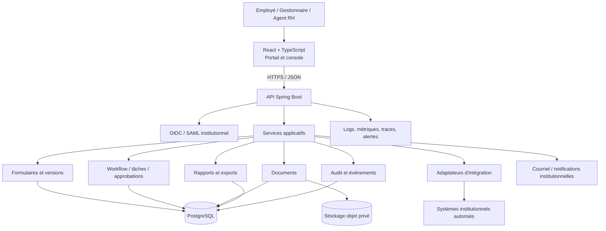

### 2.2 Architecture de déploiement

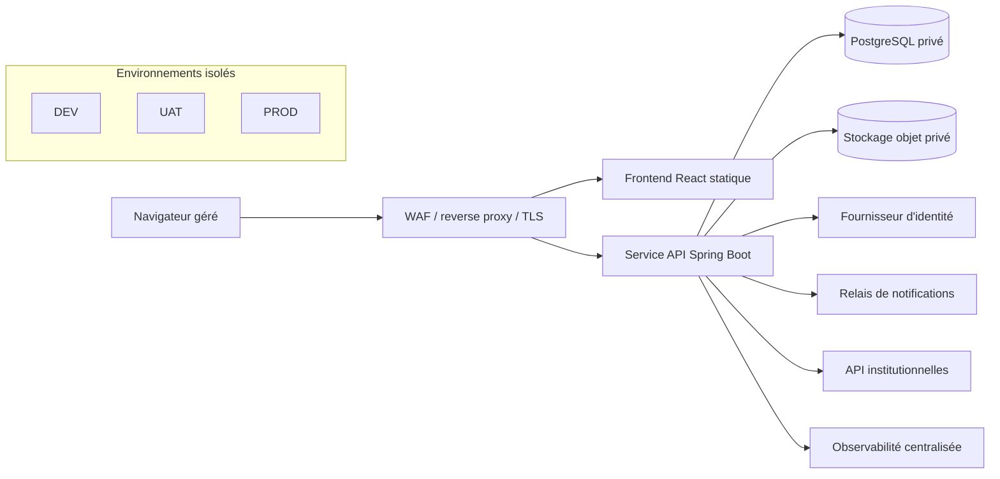

Chaque environnement possède ses propres secrets, bases, stockage et intégrations. Les données de PROD ne sont pas copiées vers DEV/UAT sans processus de dépersonnalisation approuvé.

### 2.3 Choix architectural recommandé

Commencer par un **monolithe modulaire** Spring Boot, avec frontières de modules explicites. Cela réduit le coût opérationnel initial tout en conservant la possibilité d'extraire plus tard un module à forte charge. Ne pas démarrer avec des microservices sans besoin de mise à l'échelle, d'autonomie d'équipe ou d'isolation démontré.

Modules applicatifs proposés :

| Module | Responsabilité |
|---|---|
| `identity-access` | Utilisateur courant, rôles, permissions, groupes et politiques d'accès |
| `form-definition` | Définition, version, validation et publication des formulaires |
| `request-management` | Brouillons, soumissions, données de réponse et statut des demandes |
| `workflow` | Étapes, tâches, approbations, délégations et transitions |
| `document-management` | Métadonnées, téléversement, téléchargement et règles documentaires |
| `notification` | Modèles, préférences, notifications et reprises |
| `reporting` | Requêtes autorisées, exports et agrégats |
| `integration` | Adaptateurs API, webhooks et synchronisations |
| `audit` | Journal d'audit append-only et événements métier |
| `platform-admin` | Paramètres, environnements logiques et publication contrôlée |

---

## 3. Technologies et conventions

| Couche | Proposition | Principes |
|---|---|---|
| Backend | Java 21, Spring Boot 3.x | REST, validation Bean Validation, sécurité Spring, migrations versionnées |
| Frontend | React, TypeScript, Vite | composants accessibles, routes protégées, formulaires déclaratifs |
| UI | bibliothèque de composants approuvée par l'organisation | design system, WCAG 2.2 AA visé |
| API | REST JSON, OpenAPI | contrats versionnés, pagination, erreurs uniformes |
| Persistance | PostgreSQL | transactions, contraintes FK/UNIQUE, index et migrations |
| Migrations | Flyway ou Liquibase | une seule stratégie, scripts revus en PR |
| Authentification | OIDC/SAML via IAM institutionnel | MFA selon politique, session sécurisée |
| Fichiers | stockage objet privé | chiffrement, antivirus, URL présignée courte durée |
| Tests backend | JUnit 5, Spring Boot Test, Testcontainers | tests unitaires, intégration, contrat |
| Tests frontend | Vitest, React Testing Library, Playwright | unités, composants, parcours E2E |
| Qualité | Checkstyle/Spotless, ESLint, Prettier, analyse SAST | règles CI obligatoires |
| Observabilité | logs structurés, métriques, traces distribuées | corrélation par `traceId`, aucune donnée sensible dans les logs |
| Livraison | pipeline CI/CD institutionnel | SBOM, scan dépendances, artefacts immuables, approbation PROD |

Les numéros de versions de Spring Boot, React et des bibliothèques doivent être fixés dans les fichiers de build, vérifiés au lancement et mis à jour selon la politique de soutien.

---

## 4. Organisation du dépôt

```text
chu-forms-platform/
├── README.md
├── docs/
│   ├── architecture.md
│   ├── mcd.md
│   ├── api-conventions.md
│   ├── security-privacy.md
│   ├── adr/
│   │   ├── ADR-001-modular-monolith.md
│   │   ├── ADR-002-postgresql.md
│   │   ├── ADR-003-form-definition-json.md
│   │   ├── ADR-004-oidc-institutional.md
│   │   └── ADR-005-private-object-storage.md
│   ├── stories/
│   │   ├── EPIC-01-identity-access.md
│   │   ├── EPIC-02-form-builder.md
│   │   ├── EPIC-03-rh-requests.md
│   │   └── ...
│   └── runbooks/
├── backend/
│   ├── pom.xml
│   └── src/
│       ├── main/java/ca/qc/chu/forms/
│       │   ├── identityaccess/
│       │   ├── formdefinition/
│       │   ├── requestmanagement/
│       │   ├── workflow/
│       │   ├── documentmanagement/
│       │   ├── notification/
│       │   ├── reporting/
│       │   ├── integration/
│       │   ├── audit/
│       │   └── platformadmin/
│       └── main/resources/db/migration/
├── frontend/
│   ├── package.json
│   └── src/
│       ├── app/
│       ├── components/
│       ├── features/
│       │   ├── auth/
│       │   ├── forms/
│       │   ├── requests/
│       │   ├── tasks/
│       │   ├── documents/
│       │   ├── approvals/
│       │   └── admin/
│       └── api/
├── infra/
│   ├── dev/
│   ├── uat/
│   └── prod/
└── .github/ ou configuration équivalente du CI institutionnel
```

### 4.1 Conventions de code

- Packages Java par domaine fonctionnel, avec `api`, `application`, `domain`, `infrastructure` seulement si cela clarifie réellement la séparation.
- Les contrôleurs REST ne contiennent pas de règles métier.
- Les DTO d'API ne sont pas les entités JPA.
- Les opérations de workflow passent par des services applicatifs transactionnels.
- Toute transition d'état est validée côté serveur; le frontend ne décide jamais seul d'une autorisation.
- Utiliser des identifiants UUID, horodatages UTC en base et fuseau local explicite à l'affichage.
- Chaque mutation importante crée un événement d'audit sans copier le contenu sensible dans les journaux.
- Les endpoints de liste sont paginés, filtrés et triés par liste blanche.
- Les API utilisent une version explicite si une rupture de contrat est possible (`/api/v1/...`).

---

## 5. Modèle conceptuel de données (MCD)

### 5.1 Principes

- Les définitions de formulaire sont versionnées; une demande référence la version exacte utilisée lors de sa soumission.
- Une demande est rattachée à un domaine (`RH`, `APPROVISIONNEMENT`, etc.) et à un propriétaire.
- Les données de réponse sont conservées sous forme JSON validée contre le schéma de la version du formulaire, avec métadonnées relationnelles normalisées pour les objets à gouverner.
- Les tâches et décisions sont relationnelles pour permettre audit, requêtes et contraintes.
- Les documents sont des métadonnées en base; le binaire reste dans le stockage objet privé.
- Les permissions sont vérifiées à chaque lecture et écriture, pas seulement au niveau de l'interface.

### 5.2 Diagramme MCD — Mermaid ER

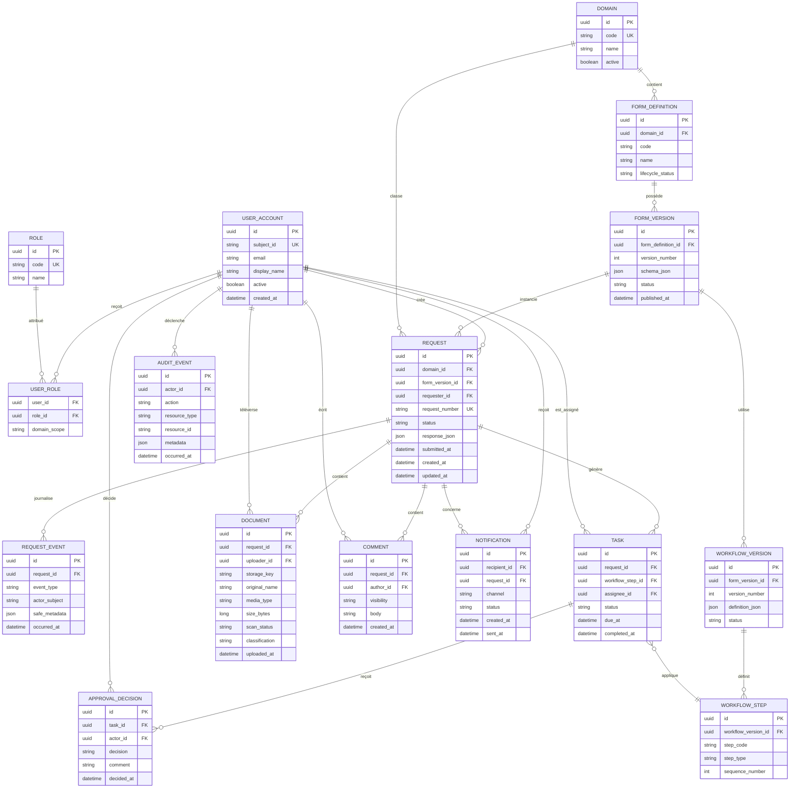

### 5.3 Contraintes à mettre en œuvre

- `FORM_VERSION`: contrainte unique `(form_definition_id, version_number)`.
- `REQUEST.request_number`: unique, généré côté serveur, sans donnée personnelle.
- `USER_ACCOUNT.subject_id`: unique et stable, issu du fournisseur d'identité.
- `TASK`: index sur `(assignee_id, status, due_at)` et `(request_id, status)`.
- `REQUEST`: index sur `(requester_id, created_at)`, `(domain_id, status, created_at)`.
- `DOCUMENT`: ne jamais exposer `storage_key` au navigateur.
- `APPROVAL_DECISION`: décisions append-only; correction par événement complémentaire, pas par effacement silencieux.
- `AUDIT_EVENT` et `REQUEST_EVENT`: accès restreint, rétention définie et intégrité surveillée.
- Les règles d'unicité et de concurrence sont garanties en base, pas seulement par le code Java.

### 5.4 Modèle de réponse de formulaire

Exemple de `response_json` (données fictives) :

```json
{
  "schemaVersion": 3,
  "fields": {
    "requestType": "ATTESTATION_EMPLOI",
    "deliveryMethod": "PORTAIL",
    "language": "FR"
  }
}
```

Ne pas placer dans ce JSON des secrets, jetons d'accès, données d'authentification ou champs non nécessaires. Les champs très sensibles peuvent nécessiter un stockage séparé, des contrôles d'accès renforcés et une politique de conservation spécifique.

---

## 6. Diagrammes de séquence

### 6.1 Authentification et chargement du portail

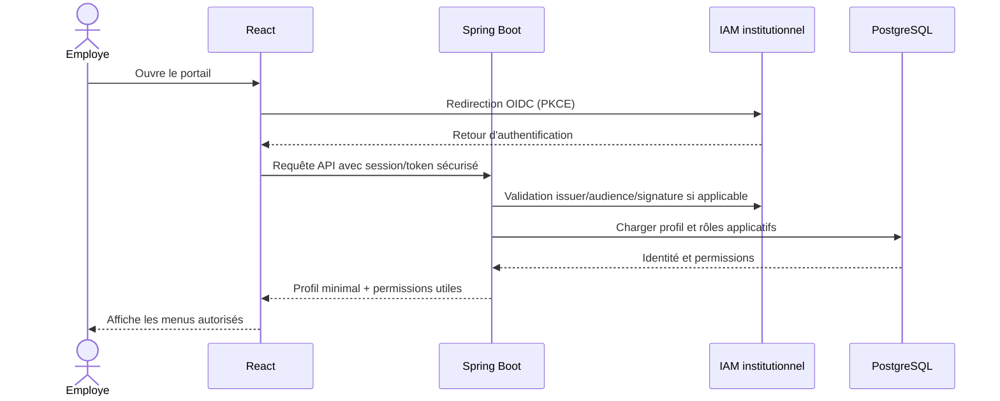

Le choix entre session BFF/cookie `HttpOnly` et SPA avec jeton en mémoire doit être tranché avec l'équipe sécurité. Éviter de stocker des jetons à longue durée dans `localStorage`.

### 6.2 Soumission d'une demande RH

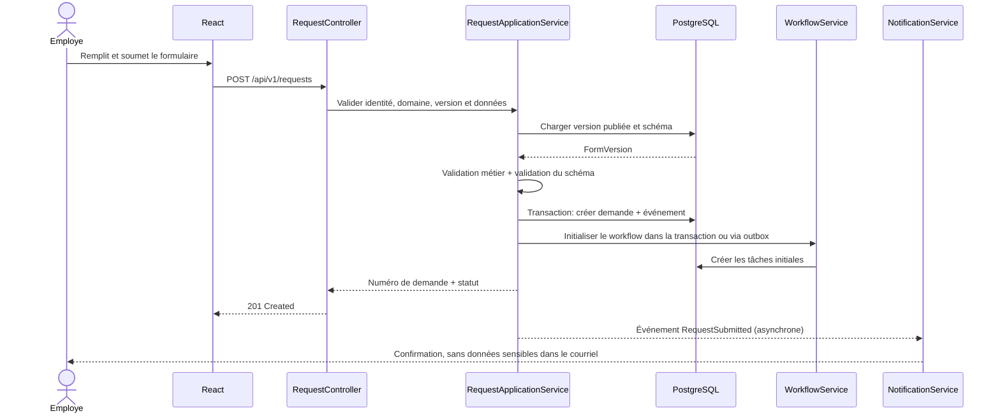

### 6.3 Approbation ou demande de correction

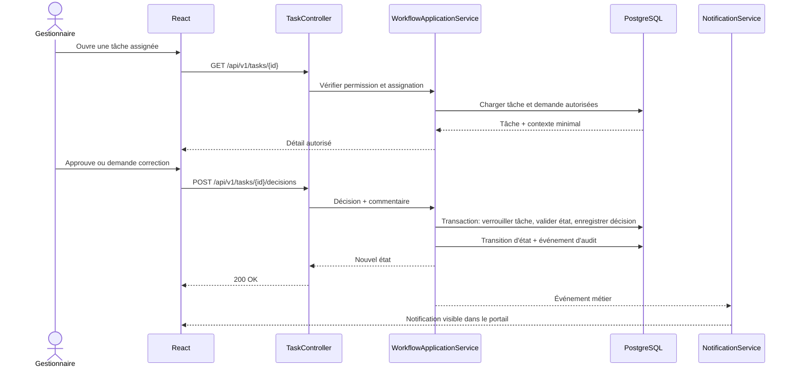

### 6.4 Téléversement sécurisé d'un document

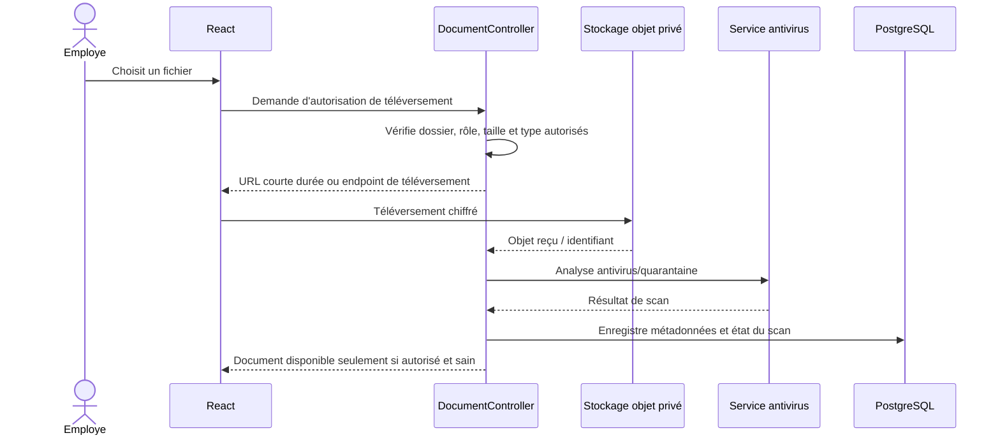

---

## 7. Contrats API initiaux

Les noms sont proposés; ils devront être alignés sur les conventions API institutionnelles.

| Méthode | Route | Fonction |
|---|---|---|
| `GET` | `/api/v1/me` | Profil courant et permissions utiles |
| `GET` | `/api/v1/forms?domain=RH` | Catalogue des formulaires publiés accessibles |
| `GET` | `/api/v1/forms/{formId}/versions/{version}` | Schéma de formulaire publié |
| `POST` | `/api/v1/requests` | Créer un brouillon ou soumettre selon le contrat retenu |
| `GET` | `/api/v1/requests/mine` | Mes demandes, pagination et filtres |
| `GET` | `/api/v1/requests/{id}` | Détail si autorisé |
| `PATCH` | `/api/v1/requests/{id}` | Enregistrer un brouillon ou corriger une demande autorisée |
| `POST` | `/api/v1/requests/{id}/submit` | Soumettre un brouillon |
| `GET` | `/api/v1/tasks/mine` | Tâches assignées à l'utilisateur |
| `POST` | `/api/v1/tasks/{id}/decisions` | Approuver, refuser ou demander correction |
| `POST` | `/api/v1/requests/{id}/documents/upload-intent` | Obtenir les conditions de téléversement |
| `GET` | `/api/v1/requests/{id}/documents` | Liste des documents autorisés |
| `GET` | `/api/v1/documents/{id}/download` | Télécharger après contrôle d'accès |
| `GET` | `/api/v1/notifications/mine` | Notifications de l'utilisateur |
| `GET` | `/api/v1/admin/forms` | Console d'administration, permission dédiée |
| `POST` | `/api/v1/admin/forms/{id}/versions` | Créer une version de formulaire |
| `POST` | `/api/v1/admin/forms/{id}/publish` | Publier après contrôles et approbation |

### 7.1 Format d'erreur

```json
{
  "type": "https://example.invalid/problems/validation",
  "title": "Validation échouée",
  "status": 400,
  "code": "FORM_VALIDATION_FAILED",
  "traceId": "opaque-correlation-id",
  "errors": [
    { "field": "deliveryMethod", "code": "REQUIRED", "message": "Ce champ est obligatoire." }
  ]
}
```

L'URL d'exemple est illustrative et ne doit pas être utilisée comme domaine de production. Ne pas retourner les traces de pile, requêtes SQL, jetons ou données confidentielles au client.

---

## 8. ADR — Architecture Decision Records

Un ADR documente une décision, son contexte, les options, les conséquences et le statut. Les ADR ci-dessous sont des décisions proposées en attente de validation.

### ADR-001 — Monolithe modulaire plutôt que microservices

- **Statut :** Proposé.
- **Contexte :** Plusieurs domaines fonctionnels mais équipe et charge initiales à confirmer.
- **Décision :** Démarrer avec un monolithe Spring Boot organisé en modules métier.
- **Options :** microservices dès le départ; plateforme low-code externe; monolithe non modulaire.
- **Motifs :** transactions simples pour demande/tâche/audit, déploiement plus simple, coût opérationnel réduit.
- **Conséquences positives :** livraison plus rapide, observabilité et tests intégrés.
- **Conséquences négatives :** déploiement commun; discipline nécessaire pour préserver les frontières.
- **Réexamen si :** besoins d'échelle, équipes autonomes ou contraintes réglementaires imposent une séparation.

### ADR-002 — PostgreSQL comme base relationnelle

- **Statut :** Proposé.
- **Contexte :** Besoin de relations fortes, transactions, audit et données structurées plus réponses de formulaires.
- **Décision :** PostgreSQL pour les données métier; JSONB uniquement pour la réponse flexible et les définitions versionnées.
- **Options :** base documentaire uniquement; SGBD institutionnel existant.
- **Conséquences :** migrations strictes, sauvegardes et restauration testées; index adaptés aux requêtes.
- **À valider :** standard SGBD de l'organisation, disponibilité managée et contraintes d'hébergement.

### ADR-003 — Définition de formulaire versionnée en JSON Schema

- **Statut :** Proposé.
- **Décision :** Stocker chaque version publiée comme schéma immuable validé, avec une représentation JSON pour l'interface.
- **Conséquences :** les demandes gardent le lien vers la version exacte; les formulaires publiés ne sont pas édités en place.
- **Risques :** migrations de données et compatibilité d'anciens formulaires à planifier.
- **Contrôles :** liste blanche des types de champs, validation serveur, taille maximale, règles conditionnelles limitées et versionnées.

### ADR-004 — Identité institutionnelle fédérée

- **Statut :** Proposé.
- **Décision :** Authentification par IAM institutionnel, OIDC de préférence si supporté, SAML si c'est le standard local.
- **Conséquences :** l'application ne conserve pas de mot de passe; le mapping des rôles applicatifs reste sous contrôle.
- **À valider :** protocole, claims disponibles, MFA, déconnexion, durée de session et processus de désactivation.

### ADR-005 — Stockage objet privé pour les documents

- **Statut :** Proposé.
- **Décision :** Stocker les binaires hors PostgreSQL; conserver les métadonnées et les droits en base.
- **Contrôles :** chiffrement, accès privé, antivirus, quarantaine, limite de taille, types autorisés, liens à durée courte, journal d'accès.
- **À valider :** solution approuvée, région, rétention, sauvegarde, immutabilité et exigences légales.

### ADR-006 — Workflow explicite piloté par états

- **Statut :** Proposé.
- **Décision :** Première version avec transitions d'états explicites et tâches relationnelles; envisager BPMN si la complexité l'exige.
- **Conséquences :** comportement testable et simple à auditer; les règles de transition doivent être centralisées.
- **À éviter :** transitions pilotées uniquement par le frontend ou mises à jour SQL libres.

### ADR-007 — Événements/outbox pour les notifications

- **Statut :** Proposé.
- **Décision :** Enregistrer l'événement métier dans la même transaction que le changement d'état, puis traiter la notification de façon asynchrone.
- **Motif :** éviter la perte de notifications si le service de courriel est indisponible.
- **Conséquences :** reprise, idempotence, statut de livraison et supervision à implémenter.

---

## 9. Sécurité, confidentialité et conformité

### 9.1 Contrôles minimaux

- OIDC/SAML, MFA selon la politique institutionnelle et gestion des sessions sécurisées.
- RBAC avec portée de domaine, complété par des règles d'accès à chaque dossier (propriétaire, assignation, rôle et besoin de savoir).
- Contrôle d'accès côté serveur sur chaque lecture, export, pièce jointe et décision.
- TLS en transit et chiffrement au repos pour base, stockage et sauvegardes.
- Secrets hors du dépôt, rotation et accès selon le moindre privilège.
- Validation serveur de toutes les entrées, protection CSRF si cookies, CORS restrictif, en-têtes de sécurité et limitation de débit.
- Protection contre injection, XSS, IDOR/BOLA, téléversement malveillant et export abusif.
- Journal d'audit horodaté et protégé; pas de contenu sensible dans les logs applicatifs.
- Règles de conservation, gel légal et suppression approuvés par le propriétaire des données.
- Évaluation des facteurs relatifs à la vie privée et analyse de menace avant production.
- Tests d'intrusion et revue des dépendances avant mise en service.

### 9.2 Séparation RH / Approvisionnement

1. Toute demande possède un `domain_id`.
2. Les rôles sont limités à un domaine quand nécessaire.
3. Les requêtes de service appliquent le filtre de domaine et l'autorisation sur le dossier.
4. Les exports et rapports appliquent les mêmes règles que les écrans.
5. Les clés de stockage objet ne sont jamais considérées comme un contrôle d'accès.
6. Les tests incluent des scénarios d'accès croisé négatifs entre RH et Approvisionnement.

### 9.3 Disponibilité et reprise

La cible fonctionnelle initiale mentionne une disponibilité de 99,8 %. Cette cible doit être confirmée par les équipes d'exploitation et traduite en SLO mesurables, fenêtres de maintenance et exclusions contractuelles. Prévoir :
- sondes de santé et alertes;
- sauvegardes chiffrées et restauration testée;
- objectifs RPO/RTO approuvés;
- déploiement progressif et retour arrière;
- surveillance des erreurs 5xx, latence, saturation et files de notification;
- procédure d'incident et contacts d'escalade.

---

## 10. Stratégie de tests et critères de qualité

| Niveau | Contenu | Seuil/critère proposé |
|---|---|---|
| Unitaire backend | services, transitions, règles de validation | règles métier critiques couvertes |
| Intégration backend | PostgreSQL, migrations, stockage simulé | tests Testcontainers en CI |
| API/contrat | OpenAPI, erreurs, permissions | contrats compatibles et testés |
| Frontend | composants, validations, états d'erreur | Vitest + React Testing Library |
| E2E | parcours employé, agent RH, gestionnaire | Playwright sur environnement UAT |
| Sécurité | SAST, dépendances, secrets, DAST ciblé | aucun défaut critique ouvert |
| Accessibilité | clavier, focus, lecteurs d'écran, contraste | cible WCAG 2.2 AA à valider |
| Performance | charge représentative et exports | objectifs à définir après volumétrie |
| Résilience | panne courriel, stockage, API externe | reprise/idempotence vérifiées |
| Exploitation | sauvegarde/restauration, alertes | runbook exécuté avant PROD |

---

## 11. Roadmap proposée

La durée dépend de la disponibilité des équipes et des intégrations. La séquence ci-dessous est un ordre de réalisation, pas un engagement de calendrier.

```mermaid
flowchart LR
    P0[Phase 0<br/>Cadrage et risques] --> P1[Phase 1<br/>Fondations techniques]
    P1 --> P2[Phase 2<br/>Identité et catalogue]
    P2 --> P3[Phase 3<br/>Formulaires et brouillons]
    P3 --> P4[Phase 4<br/>Demandes RH et workflow]
    P4 --> P5[Phase 5<br/>Documents et notifications]
    P5 --> P6[Phase 6<br/>Administration et rapports]
    P6 --> P7[Phase 7<br/>UAT, sécurité et pilote]
    P7 --> P8[Phase 8<br/>Production et amélioration]
```

| Phase | Contenu | Livrable / porte de sortie |
|---|---|---|
| 0. Cadrage | ateliers RH/TI, inventaire des formulaires, classification des données, volumétrie, IAM, hébergement, rétention | exigences validées, risques, backlog priorisé |
| 1. Fondations | dépôt, CI/CD, conventions, migrations, observabilité, environnements | pipeline reproductible, environnements isolés |
| 2. Identité | connexion, profil, rôles, contrôle d'accès, catalogue vide | tests d'accès positifs et négatifs |
| 3. Formulaires | éditeur initial, schéma versionné, aperçu, brouillon, validation | formulaire simple créé et publié |
| 4. Demandes/workflow | soumission, numéro, tâches, décision, correction, historique | parcours RH de bout en bout |
| 5. Documents/notifications | upload sécurisé, antivirus, liste documentaire, notifications | pièce jointe autorisée et traçable |
| 6. Admin/rapports | publication contrôlée, recherche, rapports et exports sécurisés | rapports validés par propriétaires |
| 7. UAT/pilote | tests métier, accessibilité, sécurité, charge, formation | approbation formelle de mise en service |
| 8. Production | déploiement progressif, support, mesure SLO, amélioration | runbooks, suivi des incidents et backlog post-lancement |

---

## 12. Backlog : épics et stories

Priorité : **P0** = indispensable au premier pilote; **P1** = nécessaire pour une première mise en production complète; **P2** = amélioration/extension. Les estimations sont à faire avec l'équipe après les ateliers.

| ID | Epic / Story | Priorité | Dépendances | Résultat attendu |
|---|---|---:|---|---|
| ST-001 | Initialiser le dépôt et la CI/CD | P0 | — | build reproductible |
| ST-002 | Configurer les environnements et la configuration externe | P0 | ST-001 | DEV/UAT/PROD isolés |
| ST-003 | Authentifier l'utilisateur via IAM | P0 | ST-001 | identité institutionnelle vérifiée |
| ST-004 | Appliquer les rôles et l'isolation par domaine | P0 | ST-003 | autorisations testées |
| ST-005 | Afficher le portail et le catalogue de formulaires | P0 | ST-004 | formulaires accessibles |
| ST-006 | Créer et versionner une définition de formulaire | P0 | ST-001 | versions immuables |
| ST-007 | Prévisualiser et publier un formulaire | P0 | ST-006, ST-004 | publication contrôlée |
| ST-008 | Enregistrer un brouillon de demande | P0 | ST-005, ST-006 | reprise du travail |
| ST-009 | Valider et soumettre une demande | P0 | ST-008 | demande traçable |
| ST-010 | Générer et afficher l'historique d'une demande | P0 | ST-009 | suivi du dossier |
| ST-011 | Créer et assigner les tâches de workflow | P0 | ST-009 | boîte de tâches |
| ST-012 | Approuver, refuser ou demander une correction | P0 | ST-011 | décision auditée |
| ST-013 | Téléverser et télécharger les pièces jointes | P1 | ST-009, ST-004 | documents sécurisés |
| ST-014 | Envoyer des notifications idempotentes | P1 | ST-009, ST-012 | notifications fiables |
| ST-015 | Gérer les documents RH personnels | P1 | ST-013, ST-004 | espace Mes documents |
| ST-016 | Permettre aux agents RH de traiter les dossiers | P1 | ST-011, ST-012 | file RH et détails |
| ST-017 | Produire des rapports et exports autorisés | P1 | ST-009, ST-004 | indicateurs contrôlés |
| ST-018 | Administrer les rôles et paramètres fonctionnels | P1 | ST-004 | gestion déléguée et auditée |
| ST-019 | Publier vers UAT/PROD avec approbation | P1 | ST-007, ST-002 | promotion contrôlée |
| ST-020 | Ajouter audit, alertes et runbooks d'exploitation | P0 | ST-001 | exploitation surveillée |
| ST-021 | Rechercher/filtrer les demandes avec pagination | P1 | ST-010 | listes efficaces |
| ST-022 | Gérer les demandes de complément et commentaires | P1 | ST-012 | échanges contextualisés |
| ST-023 | Exporter les données avec contrôle renforcé | P2 | ST-017 | export traçable |
| ST-024 | Ajouter intégrations institutionnelles ciblées | P2 | ST-020 | échange maîtrisé |
| ST-025 | Améliorer accessibilité et parcours mobiles | P1 | ST-005 à ST-016 | parcours accessibles |

---

# 13. Fiches de stories — analyse et implémentation

## Format de chaque fiche

Chaque story doit contenir : objectif et valeur, acteur, critères d'acceptation, règles métier, impact MCD, séquence, API, implémentation backend, implémentation frontend, tests, sécurité et définition de terminé. Les exemples de code sont des squelettes à adapter au code réel; ils ne sont pas un dépôt compilable complet.

---

## ST-001 — Initialiser le dépôt et la CI/CD

**Priorité :** P0  
**En tant que** développeur, **je veux** un dépôt structuré avec des builds automatisés, **afin de** livrer du code vérifiable de façon reproductible.

### Analyse
- Créer le dépôt, les protections de branches, la revue obligatoire et les conventions de commit.
- Mettre en place un backend Spring Boot et un frontend React/TypeScript.
- Le pipeline exécute formatage, compilation, tests, analyse statique, audit des dépendances et génération d'artefacts.
- Aucun secret ne doit être commité.

### Critères d'acceptation
- Un pull request exécute automatiquement les contrôles.
- Le build échoue si compilation, tests ou analyse critique échouent.
- Les artefacts sont versionnés et associés au commit.
- Le README permet à un nouveau développeur de lancer le projet localement.

### MCD
Aucun impact métier. Ajouter les métadonnées techniques de version/build dans le système de livraison, pas dans les tables métier.

### Séquence
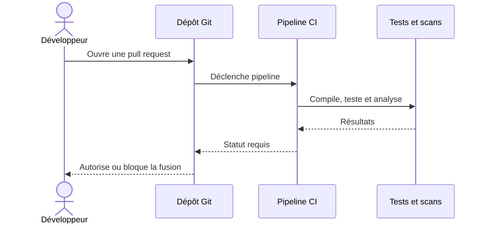

### Implémentation
- Backend : Maven Wrapper, `pom.xml`, profil de test, formatage et tests de démarrage.
- Frontend : `package.json`, lockfile commité, TypeScript strict, ESLint/Prettier, tests Vitest.
- CI : étapes `checkout`, build backend, tests, build frontend, scan dépendances/secrets, publication artefacts.
- Branches : `main` protégée; branches courtes par story; revue par au moins un pair.

### Tests
- Vérifier qu'un test volontairement en échec bloque la fusion.
- Vérifier qu'un secret factice déclenche le scanner.
- Vérifier que les builds utilisent le lockfile et ne dépendent pas de versions flottantes.

### Definition of Done
Pipeline vert, documentation locale, règles de revue activées et artefacts traçables.

---

## ST-002 — Configurer les environnements

**Priorité :** P0  
**En tant que** responsable d'exploitation, **je veux** isoler DEV, UAT et PROD, **afin de** limiter les risques de changement.

### Analyse et règles
- Chaque environnement dispose de sa base, son stockage objet, ses secrets et ses intégrations.
- La configuration est externe à l'artefact.
- Les secrets sont fournis par un gestionnaire de secrets approuvé.
- Les déploiements PROD exigent une approbation explicite.

### Critères d'acceptation
- Un artefact promu est identique entre environnements.
- DEV ne peut pas accéder au réseau ou aux données PROD.
- Les migrations DB sont exécutées avec un compte dédié et audité.
- La restauration est documentée.

### MCD / séquence
Aucun changement au MCD métier. Séquence de livraison :

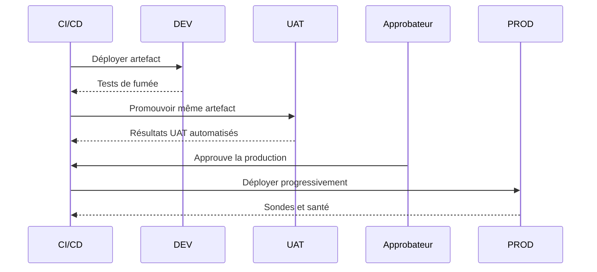

### Implémentation
- Définir profils et variables externes; ne pas inclure de secrets dans YAML commité.
- Provisionner réseau privé, certificats, DNS, base, stockage et observabilité.
- Ajouter health/readiness checks et procédure de rollback.
- Documenter les dépendances et la matrice de connectivité.

### Tests / DoD
Tester les sondes, l'échec de configuration, l'absence d'accès croisé et un retour arrière en UAT.

---

## ST-003 — Authentifier l'utilisateur via IAM

**Priorité :** P0  
**En tant que** employé, **je veux** accéder au portail avec mon identité institutionnelle, **afin de** ne pas créer un compte local.

### Analyse
- Identifier l'issuer, le client ID, les URLs de redirection, les claims fiables et le processus de désactivation.
- Préférer une architecture BFF avec cookie `HttpOnly`, `Secure`, `SameSite` si compatible avec les standards institutionnels; sinon garder les jetons en mémoire et appliquer les recommandations du fournisseur.
- Ne jamais accepter un rôle provenant d'un champ libre du navigateur.

### Critères d'acceptation
- Utilisateur non authentifié redirigé vers IAM.
- Après connexion, le serveur établit une identité locale via un identifiant stable.
- Utilisateur désactivé ou session expirée ne peut plus accéder aux données.
- Les erreurs IAM sont explicites sans exposer de détails internes.

### MCD
`USER_ACCOUNT(subject_id, email, display_name, active, created_at)`; `subject_id` unique et stable. Ne stocker que les attributs nécessaires.

### Séquence
Voir §6.1. La séquence doit être validée avec le choix OIDC/SAML et le modèle de session.

### API
- `GET /api/v1/me`
- `POST /auth/logout` si un endpoint local de déconnexion est requis.
- Les endpoints métiers requièrent une authentification valide.

### Backend
- Configurer Spring Security OAuth2 Resource Server ou client OIDC selon le modèle choisi.
- Créer un composant `CurrentUserProvider` qui expose `subjectId`, sans transmettre le principal brut partout.
- Synchroniser les attributs minimaux à la première connexion.
- Refuser `issuer`, `audience` ou signature non valides.

### Frontend
- Route `/login` ou redirection contrôlée.
- État de chargement, expiration de session et reprise de navigation.
- Le profil affiché provient de `/api/v1/me`, jamais d'une valeur locale non fiable.

### Tests / DoD
Tests d'accès anonyme, token expiré, issuer incorrect, utilisateur désactivé, logout et absence de données personnelles dans les logs.

---

## ST-004 — Appliquer les rôles et l'isolation par domaine

**Priorité :** P0  
**En tant que** responsable de domaine, **je veux** que chaque utilisateur ne voie que les dossiers autorisés, **afin de** protéger les données RH et Approvisionnement.

### Analyse
- Définir les rôles minimum : `EMPLOYEE`, `MANAGER`, `HR_AGENT`, `PROCUREMENT_AGENT`, `FORM_DESIGNER`, `DOMAIN_ADMIN`, `PLATFORM_ADMIN`, `AUDITOR`.
- Le rôle seul ne suffit pas : combiner rôle, domaine, propriétaire, affectation et état du dossier.
- Appliquer une politique « deny by default ».

### Critères d'acceptation
- Un employé ne lit que ses dossiers, sauf partage explicite.
- Un agent RH ne voit pas les demandes Approvisionnement sans permission dédiée.
- Une URL connue ne contourne pas l'autorisation.
- Les exports appliquent les mêmes restrictions.

### MCD
`ROLE`, `USER_ROLE(user_id, role_id, domain_scope)` et `DOMAIN`. Ajouter une table `GROUP_MEMBERSHIP` seulement si l'IAM ou les règles métier l'exigent.

### Séquence
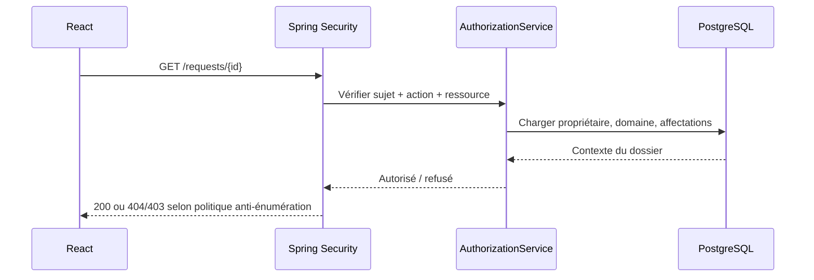

### Implémentation
- Créer `AuthorizationService.canReadRequest(...)` et des méthodes équivalentes pour écrire, télécharger, décider et exporter.
- Utiliser `@PreAuthorize` pour les garde-fous de rôle, plus contrôle objet dans le service.
- Ajouter des tests d'autorisation négatifs à chaque endpoint.
- Ne pas faire confiance à `domainId`, `requesterId` ou `assigneeId` fournis par le client.

### DoD
Matrice de permission approuvée; tests de non-régression couvrant accès horizontal et vertical.

---

## ST-005 — Afficher le portail et le catalogue de formulaires

**Priorité :** P0  
**En tant que** employé, **je veux** voir les formulaires auxquels j'ai accès, **afin de** démarrer une demande.

### Analyse
- Le catalogue ne présente que les formulaires publiés et visibles dans le domaine autorisé.
- Recherche et catégories doivent rester utilisables au clavier et sur mobile.
- Le portail RH affiche « Nouvelle demande RH », « Mes demandes », « Mes documents », « Tâches à traiter » et l'aide selon les permissions.

### Critères d'acceptation
- Les formulaires inactifs ou non publiés ne sont pas visibles.
- Une liste vide affiche un message utile.
- Les erreurs de chargement proposent une reprise.
- Les menus sont générés à partir de permissions serveur, sans remplacer le contrôle serveur.

### MCD
Lecture de `DOMAIN`, `FORM_DEFINITION`, `FORM_VERSION`, avec filtre `status=PUBLISHED` et visibilité.

### Séquence
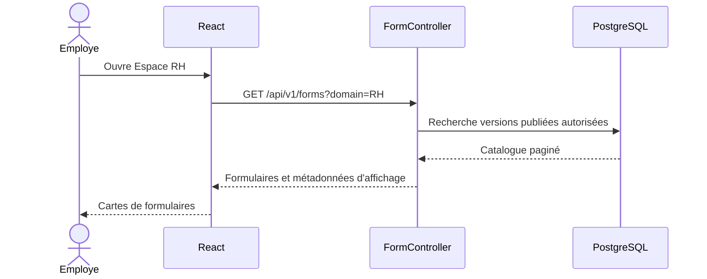

### Implémentation
- Backend : `GET /forms` paginé; DTO minimal `id`, `code`, `name`, `description`, `category`, `currentPublishedVersion`.
- Frontend : composants `PortalHome`, `FormCatalog`, `FormCard`, états loading/empty/error.
- Utiliser une liste blanche des tris et tailles de page.

### Tests / DoD
Tests rôle/domaine, formulaires archivés, liste vide, erreur API, navigation clavier et rendu responsive.

---

## ST-006 — Créer et versionner une définition de formulaire

**Priorité :** P0  
**En tant que** concepteur de formulaires, **je veux** créer une définition versionnée, **afin de** faire évoluer les formulaires sans altérer les demandes déjà reçues.

### Analyse
- Définition composée de champs autorisés, règles, validations, libellés et métadonnées.
- Une version publiée devient immuable.
- Le serveur valide la structure et interdit HTML/script arbitraire.
- Les règles conditionnelles sont déclaratives et interprétées dans un moteur limité.

### Critères d'acceptation
- Création d'une nouvelle définition ou d'une nouvelle version brouillon.
- Chaque champ possède un identifiant stable dans la version.
- Une version publiée ne peut pas être modifiée; une nouvelle version est requise.
- Un schéma invalide ne peut pas être sauvegardé ou publié.

### MCD
`FORM_DEFINITION 1—N FORM_VERSION`; `schema_json` contient la définition versionnée. Contraintes uniques sur numéro de version.

### Séquence
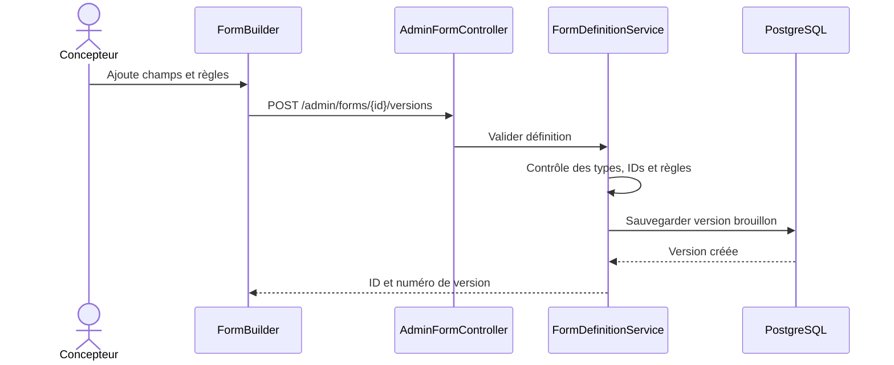

### Exemple de schéma

```json
{
  "schemaVersion": 1,
  "title": "Demande d'attestation",
  "fields": [
    {
      "id": "language",
      "type": "select",
      "label": "Langue du document",
      "required": true,
      "options": [
        {"value": "FR", "label": "Français"},
        {"value": "EN", "label": "Anglais"}
      ]
    }
  ]
}
```

### Backend / frontend
- Backend : `FormDefinitionService`, `FormSchemaValidator`, repository `FormVersionRepository`, DTO distincts des entités.
- Frontend : `FormBuilderPage`, palette de champs autorisés, propriétés du champ, validation immédiate et aperçu.
- Sauvegarder les changements en brouillon; pas d'exécution de code utilisateur.

### Tests / DoD
Schéma invalide, ID dupliqué, type inconnu, version publiée modifiée, accès non concepteur, payload trop volumineux.

---

## ST-007 — Prévisualiser et publier un formulaire

**Priorité :** P0  
**En tant que** responsable de domaine, **je veux** tester et publier une version, **afin de** rendre le formulaire disponible de manière contrôlée.

### Analyse
- La publication vérifie champs, validations, texte d'aide, workflow associé, permissions et version.
- La mise en production est une action privilégiée et auditée.
- Une publication ne change pas la version référencée par les demandes existantes.

### Critères d'acceptation
- Aperçu identique au rendu utilisateur.
- Publication refusée si validation ou workflow incomplet.
- L'auteur et l'approbateur sont journalisés.
- Retour à la version précédente possible selon une procédure explicite, sans réécrire les demandes historiques.

### MCD
`FORM_VERSION.status`, `published_at`; ajouter `published_by` et événement d'audit. Un mécanisme d'approbation de publication peut être ajouté si séparation des tâches exigée.

### Séquence
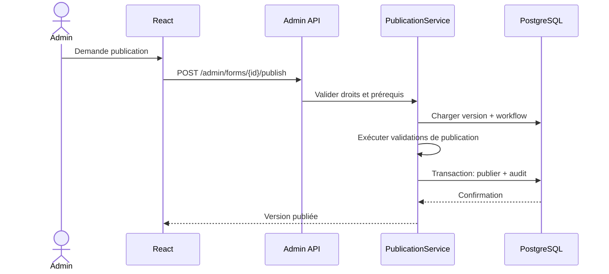

### Implémentation
- Backend : service transactionnel; verrou optimiste; contrôles d'état.
- Frontend : aperçu, rapport de validation, confirmation explicite et affichage de la version.
- Les versions publiées ne sont pas supprimées si utilisées par des demandes.

### Tests / DoD
Publication valide/invalide, droits insuffisants, concurrence entre deux publications, audit et conservation de la version précédente.

---

## ST-008 — Enregistrer un brouillon de demande

**Priorité :** P0  
**En tant que** employé, **je veux** enregistrer ma demande sans la soumettre, **afin de** la terminer plus tard.

### Analyse
- Un brouillon appartient au demandeur et référence la version publiée du formulaire.
- La sauvegarde ne déclenche pas le workflow d'approbation.
- Les champs sont validés partiellement; la validation complète est exécutée à la soumission.
- Une politique d'expiration des brouillons doit être approuvée.

### Critères d'acceptation
- L'employé peut créer, modifier et reprendre son brouillon.
- Un autre employé ne peut pas le lire en changeant l'ID.
- La sauvegarde signale les erreurs de validation immédiates.
- La version du formulaire reste stable ou une migration explicite est proposée si le brouillon devient incompatible.

### MCD
`REQUEST.status=DRAFT`, `requester_id`, `form_version_id`, `response_json`, `updated_at`.

### Séquence
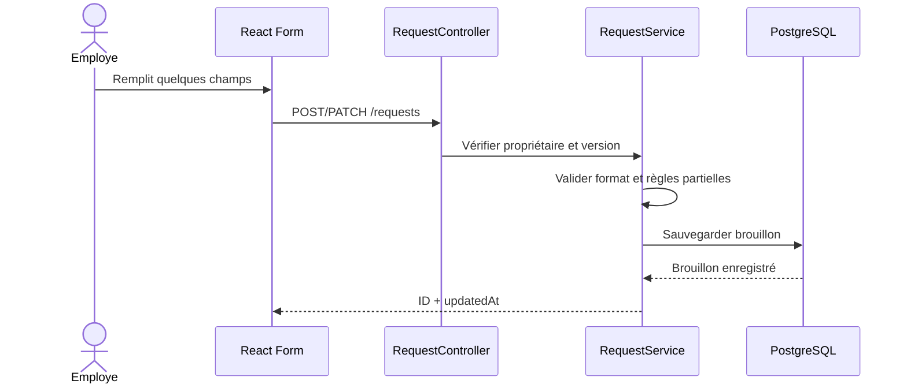

### Backend / frontend
- Backend : méthodes `createDraft`, `updateDraft`; vérifier statut `DRAFT` et propriétaire; utiliser `@Version` ou ETag pour concurrence.
- Frontend : formulaire piloté par schéma, sauvegarde explicite et/ou autosave avec debounce; indicateur « Enregistré » et gestion de conflit.
- Ne pas transmettre les champs en lecture seule comme des valeurs fiables.

### Tests / DoD
Création, reprise, sauvegarde concurrente, brouillon d'autrui, formulaire retiré du catalogue, perte réseau et reprise.

---

## ST-009 — Valider et soumettre une demande

**Priorité :** P0  
**En tant que** employé, **je veux** soumettre une demande complète, **afin de** déclencher son traitement officiel.

### Analyse
- Vérifier que la version est publiée ou encore acceptée pour soumission.
- Valider toutes les règles côté serveur, l'accès au domaine et les pièces requises.
- La soumission est idempotente afin d'éviter les doublons en cas de double clic/reprise réseau.
- Le numéro de demande ne contient aucune donnée personnelle.

### Critères d'acceptation
- Les erreurs sont présentées par champ et accessibles.
- Une demande soumise ne peut pas être modifiée directement par le demandeur, sauf parcours de correction autorisé.
- Un événement `REQUEST_SUBMITTED` est enregistré.
- La création des tâches est atomique ou reprise de façon fiable via outbox.

### MCD
`REQUEST.status`, `submitted_at`, `request_number`; insertion `REQUEST_EVENT`; création des `TASK`.

### Séquence
Voir §6.2.

### Backend
- `RequestApplicationService.submit(requestId, actor, idempotencyKey)`.
- Transaction : verrouiller la demande, valider le statut, valider les données, attribuer le numéro, mettre à jour l'état, enregistrer événement et outbox.
- Ne pas envoyer de courriel directement dans la transaction.
- Répondre `409 Conflict` si le statut a changé ou la clé d'idempotence est réutilisée avec un contenu différent.

### Frontend
- Étape de révision avant soumission, résumé des champs et confirmation.
- Désactiver le bouton pendant l'envoi, mais ne pas compter sur cela pour éviter les doublons.
- Page de confirmation avec numéro, état et prochaine étape.

### Tests / DoD
Champs requis, règles conditionnelles, double soumission, course concurrente, workflow indisponible, audit et confirmation.

---

## ST-010 — Afficher l'historique et le détail d'une demande

**Priorité :** P0  
**En tant que** demandeur, **je veux** consulter l'état et les événements de mon dossier, **afin de** comprendre où en est son traitement.

### Analyse
- Présenter les états compréhensibles et les dates utiles.
- Les événements internes ou commentaires privés RH ne sont pas affichés au demandeur.
- L'historique est ordonné et provient des événements enregistrés côté serveur.

### Critères d'acceptation
- Le demandeur voit ses demandes et uniquement ses demandes.
- L'historique affiche soumission, demande de complément, décision et fermeture autorisées.
- Les commentaires privés sont exclus.
- Les détails sont accessibles par clavier et sur mobile.

### MCD
Lecture `REQUEST`, `REQUEST_EVENT`, `COMMENT` selon `visibility`, `TASK` filtrées selon la politique d'affichage.

### Séquence
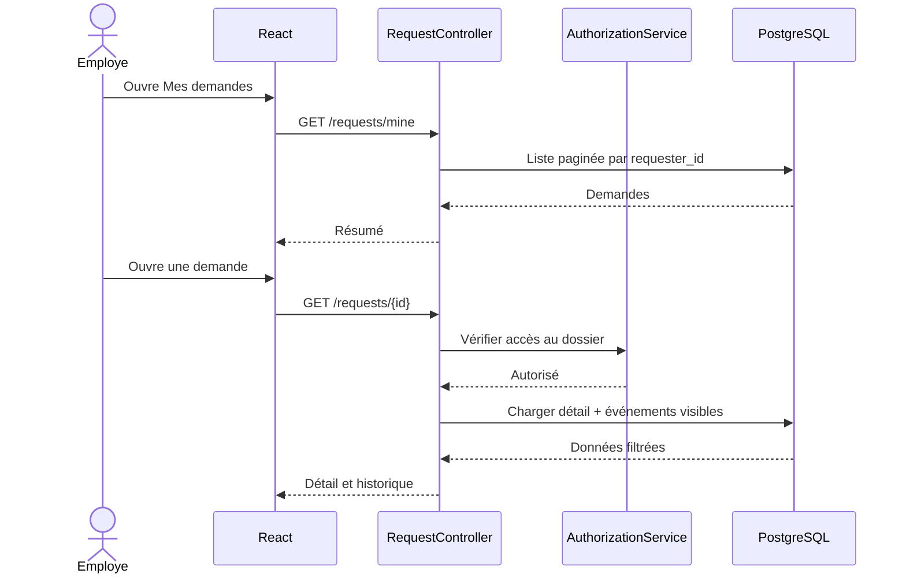

### Implémentation
- Backend : projections DTO, pagination, filtrage des événements par visibilité.
- Frontend : `MyRequestsPage`, `RequestDetailPage`, timeline, badge d'état et liens de documents autorisés.
- Utiliser un vocabulaire d'état cohérent entre API et UI.

### Tests / DoD
Accès par identifiant d'un autre utilisateur, commentaire privé, historique vide, pagination et état inconnu.

---

## ST-011 — Créer et assigner les tâches de workflow

**Priorité :** P0  
**En tant que** gestionnaire ou agent, **je veux** voir les tâches qui me sont assignées, **afin de** traiter les demandes dans le bon ordre.

### Analyse
- Le workflow est une définition versionnée associée au formulaire.
- Les affectations peuvent être à un utilisateur, groupe ou rôle de domaine; les règles exactes sont configurées et auditées.
- Une tâche possède un état, une échéance optionnelle et une transition autorisée.
- Une tâche n'est pas visible uniquement parce que son identifiant est connu.

### Critères d'acceptation
- La soumission crée les tâches initiales attendues.
- Une tâche est assignée à un acteur ou groupe valide.
- La boîte de tâches filtre par assignation et permission.
- Les tâches ne sont pas dupliquées en cas de reprise d'événement.

### MCD
`WORKFLOW_VERSION`, `WORKFLOW_STEP`, `TASK`; ajouter une table d'affectation de groupe si les tâches collectives sont requises.

### Séquence
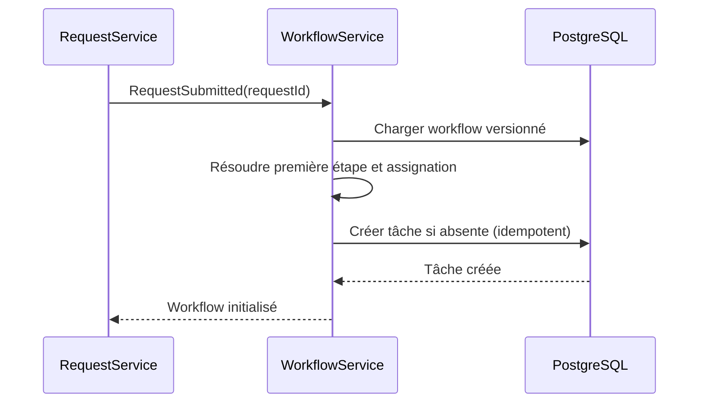

### Backend / frontend
- Backend : `WorkflowEngine` limité à transitions connues, création idempotente, verrouillage de tâche.
- Frontend : `MyTasksPage`, filtres par statut/échéance, compteur de tâches.
- Afficher une erreur exploitable si l'affectation ne peut être résolue; créer une alerte opérationnelle.

### Tests / DoD
Affectation manquante, doublon d'événement, tâche d'un autre domaine, échéance et filtre de liste.

---

## ST-012 — Approuver, refuser ou demander une correction

**Priorité :** P0  
**En tant que** approbateur, **je veux** prendre une décision sur une tâche, **afin de** faire avancer le dossier de manière traçable.

### Analyse
- Décisions autorisées : `APPROVE`, `REJECT`, `REQUEST_CHANGES`.
- Les commentaires sont requis pour un refus et une demande de correction.
- Les transitions sont déterminées par le workflow, pas par le client.
- La concurrence est traitée par verrou optimiste/pessimiste et vérification de statut.

### Critères d'acceptation
- Seul un approbateur autorisé peut décider.
- Une tâche terminée ne peut pas recevoir une seconde décision.
- La décision, le décideur, la date et le commentaire sont conservés.
- La demande passe à l'état correct et une notification est planifiée.

### MCD
Insertion `APPROVAL_DECISION`, mise à jour contrôlée de `TASK` et `REQUEST`, insertion d'un `REQUEST_EVENT` et événement outbox.

### Séquence
Voir §6.3.

### Backend
- `WorkflowApplicationService.decide(taskId, decision, comment, actor)`.
- Valider la transition avec une table de transitions ou une machine à états.
- Transaction : verrouiller tâche/demande, contrôler assignation, enregistrer décision, transition, événement et outbox.
- Idempotence via identifiant de commande ou refus clair des répétitions.

### Frontend
- Écran décision avec résumé du dossier, pièces autorisées et champ commentaire.
- Confirmation avant refus; message d'erreur en cas de tâche déjà traitée.
- Afficher le statut mis à jour après succès.

### Tests / DoD
Approvisionnement vs RH, acteur non assigné, commentaire obligatoire, double décision, conflit concurrent et audit.

---

## ST-013 — Téléverser et télécharger des pièces jointes

**Priorité :** P1  
**En tant que** demandeur autorisé, **je veux** joindre un document à mon dossier, **afin de** fournir les justificatifs requis.

### Analyse
- Vérifier taille, extension, type MIME détecté, classification et nombre maximal.
- Les fichiers sont en quarantaine jusqu'à l'analyse antivirus.
- Les téléchargements repassent par le contrôle d'accès.
- Les noms de fichiers sont nettoyés; la clé de stockage est opaque.

### Critères d'acceptation
- Les fichiers non autorisés sont rejetés.
- Un fichier non scanné ou infecté n'est pas téléchargeable.
- Les événements de téléversement et téléchargement sont journalisés.
- Le navigateur ne reçoit pas une clé permanente de stockage.

### MCD
`DOCUMENT(request_id, uploader_id, storage_key, original_name, media_type, size_bytes, scan_status, classification, uploaded_at)`.

### Séquence
Voir §6.4.

### Backend / frontend
- Backend : `DocumentPolicy`, génération d'intention d'upload, confirmation, vérification antivirus et endpoint de téléchargement.
- Frontend : barre de progression, liste de fichiers, erreurs par fichier, indication de scan en cours.
- Les règles de suppression suivent la politique de conservation, pas un bouton de suppression libre.

### Tests / DoD
Fichier trop gros, faux MIME, virus simulé, téléchargement d'un dossier non autorisé, URL expirée, audit.

---

## ST-014 — Envoyer des notifications idempotentes

**Priorité :** P1  
**En tant que** utilisateur, **je veux** être informé des événements pertinents, **afin de** réagir à temps.

### Analyse
- Les notifications sont déclenchées par des événements métier.
- Le courriel ne contient pas de détails RH sensibles; il indique de se connecter au portail.
- Reprises avec délai progressif, clé d'idempotence, statut d'envoi et file d'échec.
- Les préférences ne peuvent pas supprimer les notifications obligatoires de sécurité ou de traitement.

### Critères d'acceptation
- Une soumission crée une notification de confirmation.
- Une demande de correction notifie le demandeur.
- Une panne du relais n'annule pas la transaction métier.
- Les échecs sont visibles dans les métriques et rejouables de façon contrôlée.

### MCD
`NOTIFICATION` et table `OUTBOX_EVENT` recommandée : `id`, `aggregate_type`, `aggregate_id`, `event_type`, `payload_safe_json`, `created_at`, `processed_at`, `attempt_count`.

### Séquence
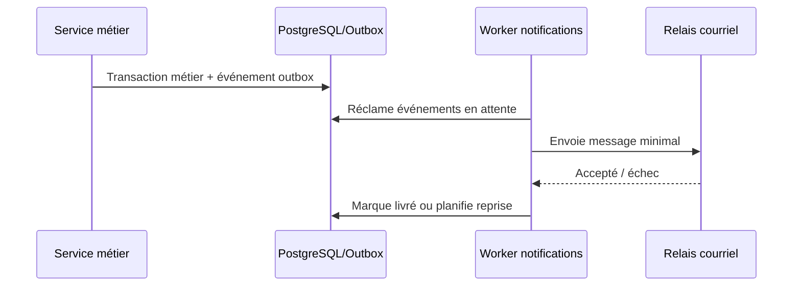

### Implémentation / DoD
Templates versionnés, échappement HTML, URL portail validée, reprise bornée, métriques et tests de panne.

---

## ST-015 — Gérer les documents RH personnels

**Priorité :** P1  
**En tant qu'** employé, **je veux** consulter mes documents RH autorisés, **afin de** retrouver les documents associés à mes dossiers.

### Analyse
- La vue « Mes documents » ne doit pas devenir un dépôt global accessible.
- Les documents proviennent d'une demande, d'un dossier RH ou d'une publication explicitement autorisée.
- Catégorie, date, statut, propriétaire et rétention doivent être visibles selon le type.

### Critères d'acceptation
- L'utilisateur ne voit que ses documents ou ceux explicitement partagés.
- Les documents en quarantaine ou expirés ne sont pas téléchargeables.
- Les téléchargements sont audités.
- Les catégories et métadonnées n'exposent pas de données superflues.

### MCD
Réutiliser `DOCUMENT`; ajouter `document_category`, `owner_id` ou relation vers un dossier RH seulement si le modèle de données métier le requiert. Éviter les duplications de métadonnées.

### Séquence
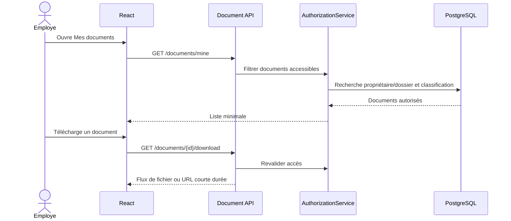

### Implémentation / DoD
Vue React filtrable; endpoint dédié `mine`; téléchargement protégé; tests de cloisonnement RH et journalisation.

---

## ST-016 — Permettre aux agents RH de traiter les dossiers

**Priorité :** P1  
**En tant qu'** agent RH, **je veux** une file de dossiers et une vue de traitement, **afin de** répondre aux demandes selon les procédures RH.

### Analyse
- File limitée au périmètre RH attribué à l'agent.
- Afficher uniquement les champs et documents nécessaires à l'étape courante.
- Séparer commentaires internes et messages visibles au demandeur.
- Chaque changement de statut exige une action métier explicite.

### Critères d'acceptation
- L'agent filtre par statut, date, type et priorité autorisés.
- L'accès à un dossier hors périmètre est refusé.
- L'agent peut demander un complément ou accomplir les actions de son rôle.
- Les actions apparaissent dans l'historique.

### MCD
Réutiliser `REQUEST`, `TASK`, `COMMENT`, `DOCUMENT`, `REQUEST_EVENT`; `COMMENT.visibility` distingue `REQUESTER_VISIBLE` et `INTERNAL`.

### Séquence
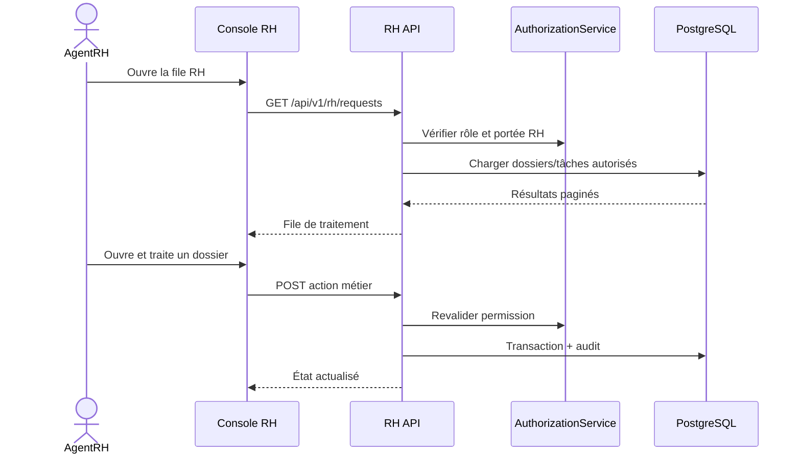

### Implémentation / DoD
Pages `RHWorkQueuePage` et `RHRequestWorkspace`; DTO spécifiques à l'agent; tests sur commentaires privés, champs sensibles et export.

---

## ST-017 — Produire des rapports et exports autorisés

**Priorité :** P1  
**En tant que** responsable de domaine, **je veux** consulter des indicateurs, **afin de** suivre les volumes et délais de traitement.

### Analyse
- Rapports agrégés par domaine, type, statut et période.
- Les données identifiantes ne sont pas incluses par défaut.
- Les exports détaillés nécessitent une permission spécifique, un motif si requis et une trace d'audit.
- Les requêtes sont paramétrées; jamais de SQL arbitraire saisi par l'utilisateur.

### Critères d'acceptation
- Les chiffres concordent avec les définitions métier.
- Les utilisateurs ne voient que leur périmètre.
- Les exports sont limités, audités et expirent selon la politique.
- Les petits groupes susceptibles d'identifier une personne sont traités selon les règles de confidentialité approuvées.

### MCD
Lecture des demandes et événements; envisager des vues matérialisées/agrégats si le volume le justifie.

### Séquence
```mermaid
sequenceDiagram
    actor Admin
    participant UI as React
    participant API as ReportingController
    participant AUTH as AuthorizationService
    participant DB as PostgreSQL
    Admin->>UI: Sélectionne rapport et période
    UI->>API: GET /reports/summary
    API->>AUTH: Vérifier périmètre et permission
    API->>DB: Requête agrégée paramétrée
    DB-->>API: Agrégats
    API-->>UI: Indicateurs
    UI->>API: POST /reports/exports
    API->>AUTH: Vérifier permission export
    API->>DB: Générer export et événement d'audit
    API-->>UI: Identifiant de génération
```

### Implémentation / DoD
Requêtes nommées, pagination/limites, exports asynchrones si volumineux, expiration des fichiers, tests d'accès croisé et exactitude.

---

## ST-018 — Administrer les rôles et paramètres fonctionnels

**Priorité :** P1  
**En tant qu'** administrateur autorisé, **je veux** gérer les paramètres et accès fonctionnels, **afin de** maintenir la plateforme sans intervention technique pour chaque changement.

### Analyse
- Distinguer administration fonctionnelle et administration technique.
- Les comptes d'administration sont protégés par MFA et revue périodique.
- Les changements de rôle sont audités et peuvent nécessiter une approbation à deux personnes.
- Les permissions ne sont jamais modifiées par le simple fait de cacher/afficher un menu.

### Critères d'acceptation
- Seul le rôle dédié peut administrer les accès.
- Les attributions ont une portée et une date de validité si requis.
- Chaque modification est auditée.
- Les droits privilégiés sont revus périodiquement.

### MCD
`ROLE`, `USER_ROLE`, éventuellement `ROLE_PERMISSION` et `ACCESS_REVIEW`. Les permissions détaillées doivent être versionnées/configurées avec gouvernance.

### Séquence
```mermaid
sequenceDiagram
    actor Admin
    participant UI as Admin UI
    participant API as Admin API
    participant AUTH as AuthorizationService
    participant DB as PostgreSQL
    Admin->>UI: Attribue un rôle
    UI->>API: POST /admin/users/{id}/roles
    API->>AUTH: Vérifier privilège et séparation des tâches
    API->>DB: Transaction: changer attribution + audit
    DB-->>API: Succès
    API-->>UI: Confirmation
```

### Implémentation / DoD
Écrans de recherche utilisateur, attribution, révocation, date de validité, confirmation et audit. Tests d'élévation de privilèges, auto-attribution et modification par non-admin.

---

## ST-019 — Publier vers UAT/PROD avec approbation

**Priorité :** P1  
**En tant que** responsable de mise en production, **je veux** promouvoir un artefact approuvé, **afin de** maîtriser les changements.

### Analyse
- L'artefact testé est immuable et promu entre environnements.
- Les migrations sont relues et compatibles avec le déploiement progressif.
- Les secrets et endpoints changent par configuration, pas par recompilation.
- Le plan de retour arrière est explicite.

### Critères d'acceptation
- PROD exige une approbation nominative.
- Le numéro de version et commit sont enregistrés.
- Les sondes de santé valident le service après déploiement.
- Une migration irréversible est identifiée avant l'approbation.

### MCD
Aucun impact métier; journaux de déploiement dans la plateforme CI/CD ou un registre d'exploitation.

### Séquence
Voir ST-002 et la roadmap.

### Implémentation / DoD
Pipeline de promotion, approbation manuelle, scan final, déploiement progressif, vérification des métriques et procédure rollback testée.

---

## ST-020 — Ajouter audit, alertes et runbooks

**Priorité :** P0  
**En tant que** équipe d'exploitation, **je veux** observer la santé et les actions critiques, **afin de** détecter les incidents et répondre rapidement.

### Analyse
- Distinguer audit métier, logs techniques et métriques.
- Corréler les requêtes avec `traceId`.
- Ne pas journaliser les valeurs des formulaires, documents, jetons ou identifiants sensibles non nécessaires.
- Les alertes doivent être actionnables et reliées à un runbook.

### Critères d'acceptation
- Erreurs 5xx, latence, indisponibilité DB, échecs de notification et saturation génèrent des métriques/alertes.
- Les actions sensibles sont auditées.
- Les journaux ont accès restreint et rétention définie.
- Les runbooks couvrent incident, restauration, rollback et rotation de secrets.

### MCD
`AUDIT_EVENT`, `REQUEST_EVENT`, `OUTBOX_EVENT`. Les logs techniques restent dans la plateforme d'observabilité, pas dans les tables métier.

### Séquence
```mermaid
sequenceDiagram
    participant API as API Spring
    participant AUD as AuditService
    participant DB as PostgreSQL
    participant OBS as Observabilité
    API->>AUD: Action sensible
    AUD->>DB: Enregistrer événement d'audit
    API->>OBS: Log structuré + métriques
    OBS->>OBS: Évaluer seuils
    OBS-->>OBS: Alerte si seuil dépassé
```

### Implémentation / DoD
Filtres de logs, métriques Micrometer, health checks, tableaux de bord, alertes, tests d'absence de données sensibles et runbooks validés.

---

## ST-021 — Rechercher et filtrer les demandes

**Priorité :** P1  
**En tant qu'** utilisateur autorisé, **je veux** filtrer mes dossiers ou ma file de travail, **afin de** retrouver rapidement une demande.

### Analyse
- Filtres pris en charge : statut, type, date, numéro de demande et priorité, selon rôle.
- Pagination côté serveur obligatoire.
- Les champs de recherche sont autorisés par liste blanche; ne pas exposer des champs sensibles par recherche globale.

### Critères d'acceptation
- Filtres combinables, pagination stable et tri limité.
- Aucun résultat hors périmètre.
- Les paramètres invalides retournent une erreur contrôlée.
- Les performances sont mesurées sur un volume représentatif.

### MCD / séquence
MCD inchangé; index sur colonnes de filtrage. Séquence : UI → `GET /requests/mine?status=...&page=...` → autorisation et requête paramétrée → DTO paginé.

### Implémentation / DoD
Composant de filtres React, état synchronisé à l'URL sans donnée sensible, repository paginé, tests d'accès et de performance.

---

## ST-022 — Gérer les demandes de complément et commentaires

**Priorité :** P1  
**En tant que** agent RH, **je veux** demander un complément et échanger avec le demandeur, **afin de** compléter le dossier sans courriel contenant des données sensibles.

### Analyse
- Commentaires visibles par le demandeur séparés des notes internes.
- Une demande de complément place le dossier dans un état défini (`WAITING_FOR_REQUESTER`).
- Le demandeur peut modifier seulement les champs ou documents autorisés pendant la fenêtre de correction.
- Chaque échange est daté, attribué et audité.

### Critères d'acceptation
- Le demandeur reçoit une notification minimale.
- Les commentaires internes ne sont jamais envoyés au demandeur.
- Une réponse au complément relance la tâche appropriée.
- Les actions hors fenêtre de correction sont refusées.

### MCD
`COMMENT.visibility`, `COMMENT.author_id`, `REQUEST_EVENT`; éventuellement `CORRECTION_REQUEST` si plusieurs demandes de complément doivent être suivies séparément.

### Séquence
```mermaid
sequenceDiagram
    actor AgentRH
    actor Employe
    participant UI as Portail
    participant API as Request API
    participant DB as PostgreSQL
    AgentRH->>API: Demander complément + message visible
    API->>DB: Transition + commentaire + audit
    API-->>UI: Notification disponible
    Employe->>UI: Ajoute réponse/document
    UI->>API: Soumettre complément
    API->>DB: Valider fenêtre + enregistrer réponse
    API-->>AgentRH: Tâche réactivée
```

### Implémentation / DoD
Contrat API dédié, permissions par visibilité, UI de conversation par dossier, tests de fuite de notes internes et de réouverture.

---

## ST-023 — Exporter les données avec contrôle renforcé

**Priorité :** P2  
**En tant que** responsable autorisé, **je veux** exporter un rapport, **afin de** réaliser une analyse hors plateforme lorsque cela est permis.

### Analyse
- L'export est désactivé par défaut pour les données RH sensibles.
- Permission spécifique, périmètre minimal, motif et expiration du fichier selon politique.
- Les exports sont générés en tâche asynchrone si le volume est important.
- Les fichiers exportés sont supprimés selon une durée courte approuvée.

### Critères d'acceptation
- L'utilisateur ne peut exporter que les colonnes autorisées.
- La génération, le téléchargement et l'expiration sont audités.
- Les exports ne contournent pas le filtre de domaine.
- Les fichiers sont protégés comme des données de même classification.

### MCD / séquence
Ajouter `EXPORT_JOB(id, requested_by, scope_json, status, storage_key, expires_at, created_at)` si les exports sont asynchrones. Séquence : demande → autorisation → job → génération → notification → téléchargement contrôlé → expiration.

### Implémentation / DoD
Service d'export allowlist, limites de lignes, masquage éventuel, stockage privé, expiration et tests de fuite.

---

## ST-024 — Ajouter des intégrations institutionnelles ciblées

**Priorité :** P2  
**En tant que** propriétaire d'un processus, **je veux** intégrer un système institutionnel autorisé, **afin de** réduire la ressaisie et améliorer la qualité des données.

### Analyse
- Chaque intégration a un propriétaire, contrat, justification, classification, identité technique et procédure de panne.
- Pas d'appel réseau synchrone non borné dans une transaction de demande.
- Idempotence, timeout, retries bornés, circuit breaker et traçabilité.
- Le périmètre exact (annuaire, système RH, gestion documentaire, courriel) doit être confirmé.

### Critères d'acceptation
- Le contrat et les champs échangés sont approuvés.
- Les secrets sont stockés hors du dépôt.
- Une indisponibilité externe n'endommage pas les données locales.
- Les erreurs sont visibles et rejouables selon politique.

### MCD / séquence
Ajouter `INTEGRATION_JOB` ou `INTEGRATION_EVENT` seulement si l'intégration nécessite une file persistante. Séquence générique : événement métier → adaptateur → API externe → réponse validée → résultat ou reprise.

### Implémentation / DoD
Interface Java par système, client HTTP configuré avec délais, validation de schéma, métriques et tests de contrat simulés.

---

## ST-025 — Améliorer accessibilité et parcours mobiles

**Priorité :** P1  
**En tant qu'** utilisateur, **je veux** utiliser le portail au clavier, avec lecteur d'écran et sur petit écran, **afin de** compléter mes démarches sans obstacle.

### Analyse
- Cible : WCAG 2.2 AA, sous réserve de validation par l'équipe d'accessibilité.
- Les champs ont un label explicite, une aide liée, une erreur annoncée et un focus visible.
- Les dialogues gèrent le focus et le retour au déclencheur.
- Les tableaux deviennent lisibles sur mobile ou proposent une vue alternative.

### Critères d'acceptation
- Parcours de soumission réalisable au clavier.
- Erreurs annoncées de façon accessible.
- Contraste et zoom testés.
- Tests automatisés complétés par revue manuelle avec technologies d'assistance.

### MCD
Aucun impact MCD.

### Séquence
Pas de séquence métier spécifique; tester les parcours UI et les interactions avec l'API sur plusieurs tailles d'écran.

### Implémentation / DoD
Composants accessibles réutilisables, tests axe ou équivalent, navigation clavier, revue manuelle, correction des défauts bloquants.

---

## 14. Modèle de code de référence

Les extraits suivants illustrent les frontières recommandées. Ils doivent être intégrés dans un projet réel, avec DTO, exceptions, validations et tests adaptés.

### 14.1 Exemple de service de soumission Spring

```java
@Service
@RequiredArgsConstructor
public class RequestApplicationService {
    private final RequestRepository requestRepository;
    private final FormVersionRepository formVersionRepository;
    private final RequestAuthorizationService authorizationService;
    private final RequestValidator requestValidator;
    private final RequestEventRepository eventRepository;

    @Transactional
    public RequestReceipt submit(UUID requestId, CurrentUser actor) {
        RequestEntity request = requestRepository.findByIdForUpdate(requestId)
            .orElseThrow(RequestNotFoundException::new);

        authorizationService.assertCanSubmit(actor, request);

        if (request.getStatus() != RequestStatus.DRAFT) {
            throw new InvalidRequestStateException("La demande n'est pas un brouillon.");
        }

        FormVersionEntity version = formVersionRepository
            .findPublishedVersionForSubmission(request.getFormVersionId())
            .orElseThrow(FormVersionUnavailableException::new);

        requestValidator.validateForSubmission(version, request.getResponseJson());

        request.submit(Instant.now());
        requestRepository.save(request);

        eventRepository.save(RequestEvent.submitted(
            request.getId(), actor.subjectId(), Instant.now()
        ));

        // Le workflow et les notifications sont déclenchés via une outbox
        // transactionnelle pour éviter une perte d'événement.
        return new RequestReceipt(request.getId(), request.getRequestNumber(), request.getStatus());
    }
}
```

**Notes :** `findByIdForUpdate` doit utiliser un verrou approprié; l'heure devrait idéalement venir d'une abstraction `Clock`; le numéro et l'idempotence doivent être traités explicitement; les entités ne doivent pas être exposées directement par l'API.

### 14.2 Exemple de contrôleur REST

```java
@RestController
@RequestMapping("/api/v1/requests")
@RequiredArgsConstructor
public class RequestController {
    private final RequestApplicationService service;
    private final CurrentUserProvider currentUserProvider;

    @PostMapping("/{id}/submit")
    public ResponseEntity<RequestReceipt> submit(@PathVariable UUID id) {
        var receipt = service.submit(id, currentUserProvider.requireCurrentUser());
        return ResponseEntity.ok(receipt);
    }
}
```

Ajouter selon le contrat retenu : `Idempotency-Key`, codes HTTP, gestion d'erreurs standardisée, audit et tests MockMvc.

### 14.3 Exemple de client React/TypeScript

```tsx
type RequestReceipt = {
  id: string;
  requestNumber: string;
  status: "SUBMITTED" | "IN_REVIEW";
};

export async function submitRequest(id: string): Promise<RequestReceipt> {
  const response = await fetch(`/api/v1/requests/${id}/submit`, {
    method: "POST",
    headers: { "Content-Type": "application/json" },
    credentials: "same-origin"
  });

  if (!response.ok) {
    // Le gestionnaire global traduit le format d'erreur API en message accessible.
    throw new Error("La soumission n'a pas pu être effectuée.");
  }

  return response.json() as Promise<RequestReceipt>;
}
```

Si l'application utilise un mécanisme anti-CSRF, le client doit transmettre le jeton selon les conventions institutionnelles. Les erreurs techniques détaillées sont consignées côté serveur avec un `traceId`, pas affichées à l'utilisateur.

### 14.4 Exemple de migration SQL

```sql
CREATE TABLE request (
    id UUID PRIMARY KEY,
    domain_id UUID NOT NULL REFERENCES domain(id),
    form_version_id UUID NOT NULL REFERENCES form_version(id),
    requester_id UUID NOT NULL REFERENCES user_account(id),
    request_number VARCHAR(40) NOT NULL UNIQUE,
    status VARCHAR(40) NOT NULL,
    response_json JSONB NOT NULL DEFAULT '{}'::jsonb,
    submitted_at TIMESTAMPTZ NULL,
    created_at TIMESTAMPTZ NOT NULL DEFAULT now(),
    updated_at TIMESTAMPTZ NOT NULL DEFAULT now()
);

CREATE INDEX idx_request_requester_created
    ON request(requester_id, created_at DESC);

CREATE INDEX idx_request_domain_status_created
    ON request(domain_id, status, created_at DESC);
```

Cette migration suppose que les tables référencées ont déjà été créées. En production, appliquer les conventions de nommage et de migration retenues par l'organisation.

---

## 15. États métier recommandés

### 15.1 Demande

```mermaid
stateDiagram-v2
    [*] --> DRAFT
    DRAFT --> SUBMITTED: soumettre
    SUBMITTED --> IN_REVIEW: prise en charge
    IN_REVIEW --> WAITING_FOR_REQUESTER: complément requis
    WAITING_FOR_REQUESTER --> SUBMITTED: complément soumis
    IN_REVIEW --> APPROVED: approuver
    IN_REVIEW --> REJECTED: refuser
    APPROVED --> CLOSED: clôturer
    REJECTED --> CLOSED: clôturer
    DRAFT --> CANCELLED: annuler brouillon
    CLOSED --> [*]
    CANCELLED --> [*]
```

Les transitions exactes dépendent du type de demande. Un workflow peut avoir des états supplémentaires, mais ceux-ci doivent être explicitement définis et testés.

### 15.2 Tâche

- `OPEN`
- `IN_PROGRESS`
- `COMPLETED`
- `CANCELLED`
- `BLOCKED` si ce statut a une signification opérationnelle précise

Une tâche terminée n'est pas réouverte par mise à jour directe. Une nouvelle tâche ou un événement de correction doit matérialiser le retour en arrière.

---

## 16. Definition of Ready et Definition of Done

### 16.1 Definition of Ready — avant développement

- La story a un objectif métier et un propriétaire.
- Les critères d'acceptation sont testables.
- Le flux UX/UI est identifié.
- Les règles de données, sécurité, rétention et permissions sont connues.
- Le MCD, les contrats API et les dépendances sont suffisamment définis.
- Les erreurs, cas limites et scénarios d'échec sont décrits.
- Les dépendances externes ont un propriétaire et un environnement de test.

### 16.2 Definition of Done — avant clôture

- Code relu et intégré dans la branche principale.
- Tests unitaires, intégration et permissions réussis.
- Contrat OpenAPI mis à jour.
- Migration DB testée sur base vide et version précédente.
- UI accessible, états loading/empty/error traités.
- Logs, métriques, audit et alertes ajoutés si requis.
- Documentation story et runbook mis à jour.
- Analyse de sécurité sans défaut critique ouvert.
- Démonstration et validation par le propriétaire métier.

---

## 17. Risques et décisions à obtenir avant de démarrer

| Risque / question | Pourquoi c'est important | Responsable suggéré |
|---|---|---|
| IAM institutionnel : OIDC ou SAML, claims, MFA | conditionne session et rôles | IAM / Sécurité |
| Hébergement autorisé et localisation des données | confidentialité, contrats et conformité | Architecture / Juridique / PRP |
| Classification des données RH | définit les contrôles d'accès et la rétention | RH / PRP / Sécurité |
| Stockage documentaire approuvé | sécurité, antivirus, sauvegarde | Infrastructure / Sécurité |
| Système source des rôles et gestionnaires | éviter les attributions manuelles non fiables | RH / IAM |
| Volumétrie, simultanéité, taille des fichiers | dimensionnement et performance | Architecture / Exploitation |
| Politique de conservation et suppression | obligations légales et opérationnelles | Propriétaire des données / PRP |
| SLA, RPO/RTO, maintenance | faisabilité de la cible 99,8 % | Exploitation |
| Intégrations réellement nécessaires au MVP | impact sur le calendrier | Propriétaires applicatifs |
| Workflow par type de demande RH | tâches, approbateurs et délais | RH |
| Signature électronique | validité et fournisseur | Juridique / RH |
| Accessibilité et design system institutionnel | conformité et cohérence UX | UX / Accessibilité |

---

## 18. Ordre de démarrage recommandé

1. Organiser des ateliers de cadrage sur les 5 à 10 premiers formulaires RH et leurs workflows.
2. Confirmer IAM, hébergement, classification, rétention et stockage documentaire.
3. Valider les ADR 001 à 005 avec l'architecture et la sécurité.
4. Construire le squelette repo, CI/CD, observabilité et environnements (ST-001, ST-002, ST-020).
5. Implémenter identité et autorisation (ST-003, ST-004) avant toute donnée métier.
6. Livrer un parcours vertical complet sur un seul formulaire RH : catalogue → brouillon → soumission → tâche → décision → historique.
7. Ajouter documents et notifications après sécurisation du parcours principal.
8. Faire l'UAT avec des données synthétiques, puis pilote avec les contrôles et approbations requis.
9. Étendre ensuite le catalogue de formulaires et les intégrations selon le backlog priorisé.

---

## 19. Glossaire

- **ADR** : Architecture Decision Record, document court justifiant une décision d'architecture.
- **MCD** : Modèle conceptuel de données; ici représenté par un diagramme entité-association Mermaid.
- **RBAC** : contrôle d'accès par rôles.
- **BOLA/IDOR** : vulnérabilité permettant d'accéder à un objet en modifiant son identifiant sans autorisation.
- **OIDC** : OpenID Connect.
- **SLO** : objectif de niveau de service mesurable.
- **RPO** : quantité maximale de données qu'on accepte de perdre après incident.
- **RTO** : délai cible de rétablissement après incident.
- **Outbox** : table transactionnelle permettant de publier des événements de façon fiable.
- **UAT** : environnement de recette/acceptation utilisateur.
- **PRP** : protection des renseignements personnels.

---

## 20. Limites et prochaines étapes

Ce document constitue une base de conception détaillée, pas une spécification finale signée ni une application compilable. Avant de convertir toutes les fiches en tickets de développement, il faut :
- faire valider les workflows exacts par RH et Approvisionnements;
- confirmer les standards institutionnels (IAM, CI/CD, observabilité, base, stockage, design system);
- détailler les règles de chaque formulaire réel et ses données obligatoires;
- faire approuver la classification, la rétention et les contrôles de confidentialité;
- compléter les diagrammes de séquence et tests propres à chaque workflow spécialisé;
- estimer les stories avec l'équipe et ajuster la roadmap à la capacité réelle.

La prochaine étape technique utile est de transformer ce plan en squelette de dépôt Java/React exécutable, puis d'implémenter le premier parcours vertical ST-001 à ST-012 avec des données synthétiques et des tests automatisés.
