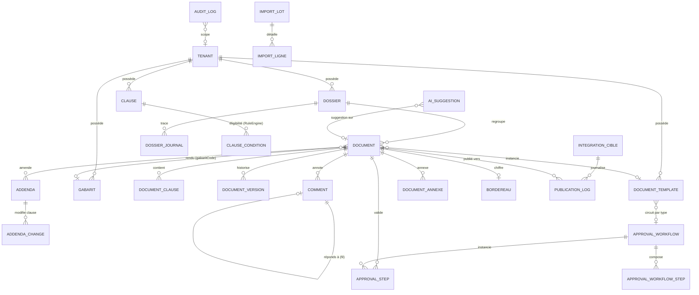
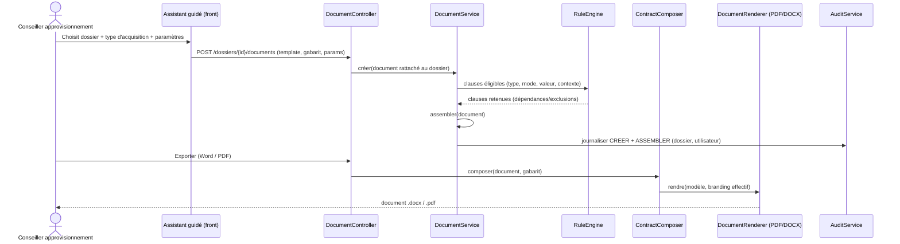
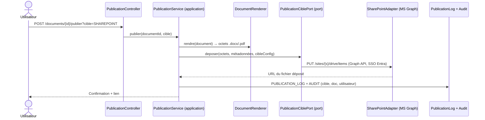
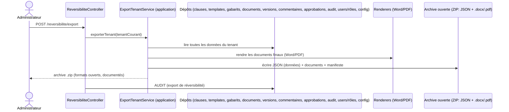
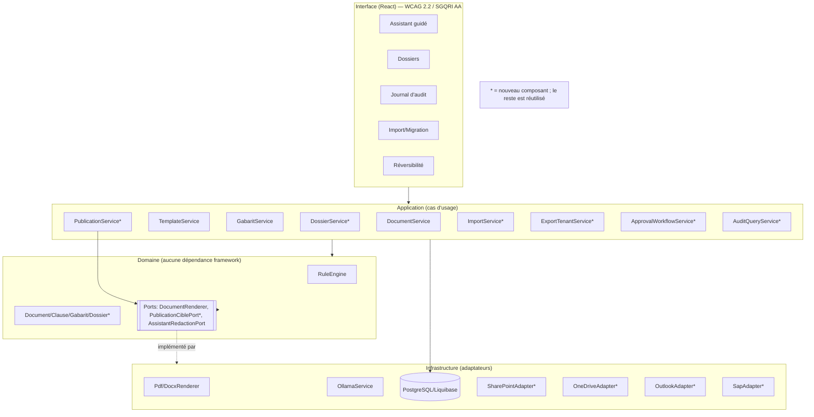

# Conception d'intégration — combler les écarts n° 7000017905 (sans duplication)

> Conçoit l'intégration des besoins de Trois-Rivières (voir
> [02-COMPARAISON-ECARTS.md](02-COMPARAISON-ECARTS.md)) **dans la solution actuelle**, en
> **réutilisant les contextes existants** et en n'ajoutant que des contextes **nouveaux et
> disjoints**. Architecture hexagonale (le domaine ne dépend d'aucun framework), SOLID, multi-tenant.
> **Rien de ce qui suit n'est implémenté** — document soumis à validation.

## 1. Principe directeur — zéro duplication

Chaque écart **étend un contexte métier existant** ou introduit un **nouveau contexte clairement
séparé**. Aucun module n'est recréé : le `Document` (avec ses clauses, versions, addendas, annexes,
bordereau, approbation, commentaires) reste l'unique agrégat de rédaction ; les nouveaux besoins
s'y **rattachent** ou l'**orchestrent**.

| # | Écart | Traitement | Contexte |
|---|-------|-----------|----------|
| 1 | Dossier d'approvisionnement | **Nouveau** agrégat de regroupement ; `Document.dossierId` | `Dossier` (nouveau) |
| 2 | Intégrations M365/SharePoint/OneDrive/Outlook/Teams/SAP | **Nouveau** port `PublicationCiblePort` + adaptateurs ; réutilise la sortie `DocumentRenderer` | `Integration` (nouveau, infrastructure) |
| 3 | Réversibilité (export complet) | **Nouveau** service d'export réutilisant *tous* les dépôts + renderers | `Reversibilite` (nouveau, application) |
| 4 | Import / migration + migration d'essai | **Nouveau** cas d'usage écrivant dans `Clause`/`Template`/`Document` | `Import` (nouveau, application) |
| 5 | Assistant guidé de génération | **Extension** — couche application au-dessus de `RuleEngine`/`TemplateService` | Rédaction (existant) |
| 6 | Diffusion des clauses mises à jour | **Extension** de `ClauseService`/`DocumentService` | Clauses (existant) |
| 7 | Résolution des commentaires + workflow configurable | **Extension** `Comment` + `ApprovalWorkflow` (gabarit de workflow) | Collaboration/Approbation (existant) |
| 8 | Journal d'audit consultable/exportable | **Extension** — read model + export au-dessus de `AuditLog` | Audit (existant) |
| 9 | Traçabilité IA + désactivation | **Extension** `KnowledgeService`/`OllamaService` + `AiSuggestion` | IA (existant) |
| 10 | Recherche enrichie + rapports par dossier | **Extension** `SearchController` / `StatsController` | Recherche/Stats (existant) |

---

## 2. Modèle conceptuel de données (MCD) — existant + ajouts

> En **gras** dans le texte : entités **nouvelles**. Les autres existent déjà.

**Ajouts (nouvelles tables, Liquibase)** :
- **`dossier`** : `id, tenant_id, numero_ao, objet, type_acquisition, mode_sollicitation, statut, responsable, cree_le` — agrégat de regroupement ;
- **`dossier_journal`** *(optionnel)* : vue matérialisée / événements de suivi par dossier ;
- **`approval_workflow`** + **`approval_workflow_step`** : gabarit de circuit d'approbation configurable par type de document/dossier ;
- **`integration_cible`** (config par tenant : SharePoint/OneDrive/Outlook/SAP) + **`publication_log`** (traçabilité des dépôts/envois) ;
- **`import_lot`** + **`import_ligne`** (migration + migration d'essai) ;
- **`ai_suggestion`** (traçabilité des suggestions IA ; + drapeau `ia_activee` sur `tenant`/`modele_document`).

**Champs ajoutés (extension, sans nouvelle table)** :
- `document.dossier_id` (FK nullable → `dossier`) ;
- `document_template.categorie_acquisition` (classement 7.1) ;
- `comment.resolu`, `comment.resolu_par`, `comment.parent_id` (résolution + fil 7.5) ;
- `clause.version` déjà présent → `document_clause.clause_version` pour détecter la diffusion (7.3).

---

## 3. Diagrammes de séquence

### 3.1 Génération guidée d'un document dans un dossier (art. 7.1, 7.2, 15)

### 3.2 Publication vers M365 / SharePoint (art. 9) — port + adaptateur

> Les autres cibles (**OneDrive, Outlook envoi, Teams notification, SAP référence**) sont d'autres
> **adaptateurs du même port** `PublicationCiblePort` (OCP) — aucun changement du domaine.

### 3.3 Réversibilité — export complet du tenant (art. 20)

---

## 4. Diagramme de composants (hexagonal)

`*` = nouveau. Le **domaine** ne connaît ni MS Graph ni SAP : il expose le **port**
`PublicationCiblePort` ; les adaptateurs vivent en infrastructure (DIP).

---

## 5. Décisions d'architecture (ADR / SDR)

- **ADR-001 — Dossier d'approvisionnement comme agrégat de regroupement.**
  *Décision* : introduire `Dossier` et un simple `document.dossier_id` ; ne **pas** dupliquer le
  `Document`. *Écartée* : recréer un « document de dossier » (duplication du cycle de vie clauses/
  versions/approbation). *Conséquence* : les rapports et la traçabilité par dossier agrègent
  l'existant ; migration additive (colonne nullable).

- **ADR-002 — Intégrations externes via port + adaptateurs.**
  *Décision* : un port `PublicationCiblePort` dans le domaine, un adaptateur par cible (SharePoint,
  OneDrive, Outlook, Teams, SAP) en infrastructure ; sortie = octets du `DocumentRenderer` existant.
  *Écartée* : appeler MS Graph/SAP depuis les services applicatifs (couplage, violation DIP).
  *Conséquence* : ajout d'une cible = un adaptateur, zéro changement du domaine (OCP).

- **ADR-003 — Réversibilité par service d'export unifié.**
  *Décision* : `ExportTenantService` lit les dépôts existants + réutilise les renderers pour
  produire une archive ouverte (JSON + Word/PDF + manifeste). *Écartée* : un nouveau format de
  stockage « exportable ». *Conséquence* : réversibilité art. 20 sans dette de stockage.

- **ADR-004 — Assistant guidé = couche application, pas de nouveau moteur.**
  *Décision* : le parcours guidé orchestre `RuleEngine` + `TemplateService` + `DocumentService`.
  *Écartée* : un second moteur de règles côté front. *Conséquence* : une seule source de vérité
  d'éligibilité des clauses.

- **ADR-005 — Circuit d'approbation configurable (gabarit de workflow).**
  *Décision* : `ApprovalWorkflow`/`ApprovalWorkflowStep` paramètrent les étapes par type de
  document/dossier ; `ApprovalStep` reste l'instance d'exécution. *Écartée* : `switch` de rôles en
  dur. *Conséquence* : configurabilité art. 7.5/15 par ajout de données (OCP).

- **ADR-006 — Journal d'audit exposé en lecture seule.**
  *Décision* : read model + export (CSV/JSON) au-dessus de `AuditLog`, sans coupler l'écriture ;
  compléter les types d'événements (export, suppression, changement de droits). *Conséquence* :
  art. 18 satisfait sans risque sur le chemin d'écriture.

- **ADR-007 — Traçabilité et désactivation de l'IA.**
  *Décision* : journaliser chaque suggestion (`AiSuggestion`) et exposer un interrupteur
  `ia_activee` par tenant ; l'IA reste **locale** (Ollama, aucune donnée externe — Loi 25/art. 19,21).

---

## 6. Feuille de route par phases (priorisée valeur / effort)

| Phase | Contenu | Écarts couverts | Effort |
|-------|---------|-----------------|--------|
| **P1** | **Dossier d'approvisionnement** (agrégat + rattachement des documents + vue dossier + rapports par dossier) | 1, 11 | Moyen |
| **P2** | **Assistant guidé** de génération + **classement par type d'acquisition** + **recherche enrichie** | 5, 7.1, 10 | Moyen |
| **P3** | **Journal d'audit consultable/exportable** + **résolution des commentaires** + **workflow configurable** | 8, 7.5 | Moyen |
| **P4** | **Intégrations M365** (dépôt SharePoint/OneDrive, envoi Outlook) via port+adaptateurs (SSO Entra) | 2 (M365) | Élevé |
| **P5** | **Connecteur SAP** (référence dossier, n° AO, montants) + notification Teams | 2 (SAP/Teams) | Élevé |
| **P6** | **Import/migration** (Word/CSV + migration d'essai) + **Réversibilité** (export complet tenant) + **traçabilité/désactivation IA** | 3, 4, 9 | Élevé |

> Les volets **infra/ops** (DR, RTO/RPO, chiffrement au repos, certifications ISO/SOC, SLA de
> disponibilité, processus de gestion des vulnérabilités Annexe A) sont **contractuels et
> d'exploitation** — hors code applicatif — et se traitent dans le déploiement Azure (voir
> `docs/deploiement-azure.md`) et la CI (balayage Trivy déjà en place).

---

## 7. Portes de qualité applicables (rappel, non négociable)

Chaque phase livrée respectera : **tests ≥ 96 % (agrégé et par classe), MSI ≥ 80 %** ;
**accessibilité SGQRI 008 3.0 / WCAG 2.2 AA sans violation** sur chaque nouvel écran et état ;
**aucun chevauchement / débordement** aux largeurs 390/768/1280/1680 px ; règles de dépendance
hexagonale vérifiées ; e2e ajoutés par fonctionnalité critique ; OpenAPI + ces documents
d'architecture mis à jour **dans le même changement**.

---

## 8. Documents d'architecture à mettre à jour (lors de l'implémentation validée)

- `docs/architecture.md` / `docs/architecture-technique.md` — nouveaux contextes `Dossier`,
  `Integration`, `Import`, `Reversibilite` + port `PublicationCiblePort`.
- `docs/doc-fonctionnel.md` — dossier d'approvisionnement, assistant guidé, publication M365.
- `docs/bpmn.md` / `docs/organigramme.md` — processus « dossier → génération → validation →
  publication → archivage ».
- `docs/roadmap.md` — phases P1–P6 ci-dessus.
- `docs/conception-contrats-formels.md` — MCD étendu.
- **Nouvel ADR** par décision (ADR-001…007) au format MADR.

> Ces mises à jour seront faites **au moment de l'implémentation**, après ta validation — elles ne
> sont pas anticipées ici pour éviter de désynchroniser les docs d'avec un code non encore écrit.
