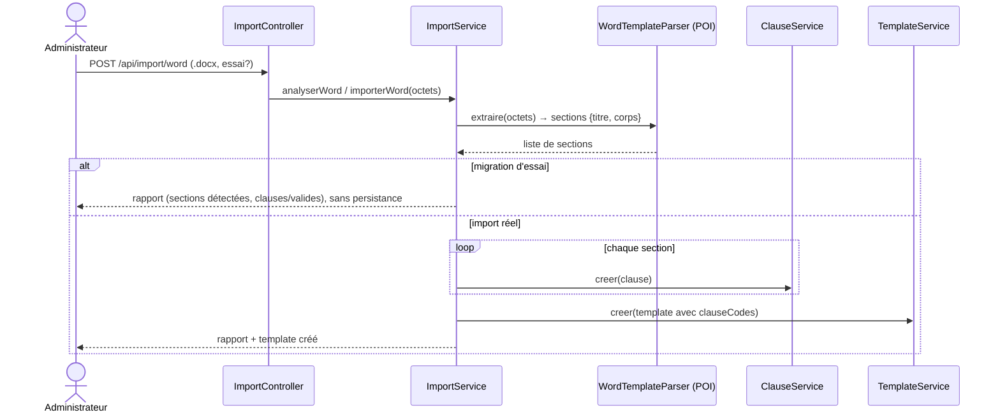

# Conception d'intégration — Addenda n° 1 (sans duplication)

> Conçoit l'intégration des 3 écarts issus de l'[analyse de l'addenda](04-ANALYSE-ADDENDA-1.md) dans
> la solution existante. Architecture hexagonale, DDD, SOLID. Chaque écart **étend un contexte
> existant**. Complète [03-CONCEPTION-INTEGRATION.md](03-CONCEPTION-INTEGRATION.md).

## 1. Cartographie écart → contexte (aucun module dupliqué)

| GAP | Exigence | Traitement | Contexte réutilisé |
|-----|----------|-----------|--------------------|
| A | Import modèles Word (3, 16) | **Extension** de `ImportService` : parseur `.docx` (Apache POI `XWPFDocument`) → crée un `DocumentTemplate` + `Clause` | Import (P6) + Templates + Clauses |
| B | Journal d'accès complet (9) | **Extension** : audit `DECONNEXION` et `CONNEXION_ECHEC` dans `AuthService`/`AuthController` | Audit + Auth (existants) |
| C | Rapports de suivi (22) | **Extension** : `RapportService` (read-model) agrégeant documents/approbations/dossiers/obligations/activité | Documents/Dossiers/Approbation/Audit |

## 2. GAP A — Import de modèles Word (`.docx`)

### Conception
- Nouvel adaptateur de parsing : `WordTemplateParser` (infrastructure) qui lit un `.docx` via
  **Apache POI** (`XWPFDocument.getParagraphs()`), déjà dépendance du projet (utilisée par
  `DocxContractRenderer`). Heuristique : un paragraphe **de style titre** (`Heading*`/`Titre*`) ou en
  **gras seul** ouvre une nouvelle **clause** (titre) ; les paragraphes suivants forment son corps ;
  le reste devient une clause « Contenu ».
- `ImportService.analyserWord(bytes)` (migration d'essai) et `importerWord(bytes, nomModele, utilisateur)`
  (réel) réutilisent `ClauseService.creer` et `TemplateService.creer` — **pas de duplication** de la
  logique de création. Produit un `DocumentTemplate` dont les `clauseCodes` pointent les clauses créées.
- API : `POST /api/import/word?essai=true|false` (multipart `.docx`), rôle `ADMIN`.

### Séquence

## 3. GAP B — Journal d'accès complet

- `AuthController.logout` → `audit.log(utilisateur, "DECONNEXION", "User", id, null)`.
- `AuthService.authentifier` (échec identifiants/MFA) → `audit.log(email, "CONNEXION_ECHEC", "User", null, raison)`.
- Aucune nouvelle table : réutilise `AuditLog`/`AuditService` ; visible et exportable via le journal
  d'audit (P3). Complète l'événement `LOGIN` déjà présent.

## 4. GAP C — Rapports de suivi consolidés

- `RapportService` (application, **read-model** — lecture seule, aucun couplage d'écriture) agrège pour
  le tenant courant :
  - documents **par statut** et **par type** ;
  - nombre d'**approbations en attente** ;
  - **dossiers actifs** ;
  - **obligations à venir** (réutilise `ObligationService`/repo) ;
  - **activité par utilisateur** (comptage sur `AuditLog`).
- API : `GET /api/rapports/suivi` (lecture) → DTO `RapportSuivi`. Écran `Rapports.jsx` (Administration),
  accessible WCAG 2.2 (tableaux `scope`, pas de couleur seule).

## 5. Décisions d'architecture (ADR)

- **ADR-008 — Import Word via un parseur d'infrastructure réutilisant POI.**
  *Décision* : `WordTemplateParser` isolé en infrastructure (dépend de POI) ; `ImportService` (application)
  ne dépend que d'une abstraction de parsing et réutilise `ClauseService`/`TemplateService`.
  *Écartée* : parser le `.docx` dans le contrôleur ou dupliquer la création de clauses. *Conséquence* :
  testable (parseur mocké), et le format d'entrée (Word) est un détail d'infrastructure (DIP).
- **ADR-009 — Journal d'accès étendu sans nouveau chemin d'écriture.**
  *Décision* : réutiliser `AuditService` pour `LOGIN`/`DECONNEXION`/`CONNEXION_ECHEC`. *Conséquence* :
  exigence 9 satisfaite, consultable/exportable via l'UI d'audit existante, zéro schéma ajouté.
- **ADR-010 — Rapports en read-model dédié.**
  *Décision* : `RapportService` en lecture seule au-dessus des dépôts existants, sans dénormalisation ni
  table de reporting. *Écartée* : vues matérialisées/ETL (surdimensionné à ce stade). *Conséquence* :
  cohérence immédiate, coût nul de maintenance de schéma.

## 6. Feuille de route (Addenda 1)

| Phase | Écart | Livrables | Effort |
|-------|-------|-----------|--------|
| **A1** | GAP A — Import Word | `WordTemplateParser`, `ImportService.analyserWord/importerWord`, endpoint `/api/import/word`, écran (onglet import Word) | Moyen |
| **A2** | GAP B — Journal d'accès | audit `DECONNEXION` + `CONNEXION_ECHEC` | Faible |
| **A3** | GAP C — Rapports de suivi | `RapportService`, `RapportController`, écran `Rapports.jsx` | Moyen |

Portes de qualité (chaque phase) : tests unitaires **≥ 96 % (viser 100 %)**, intégration, e2e Playwright,
accessibilité WCAG 2.2 AA, aucun débordement/chevauchement, mise à jour docs/OpenAPI.
