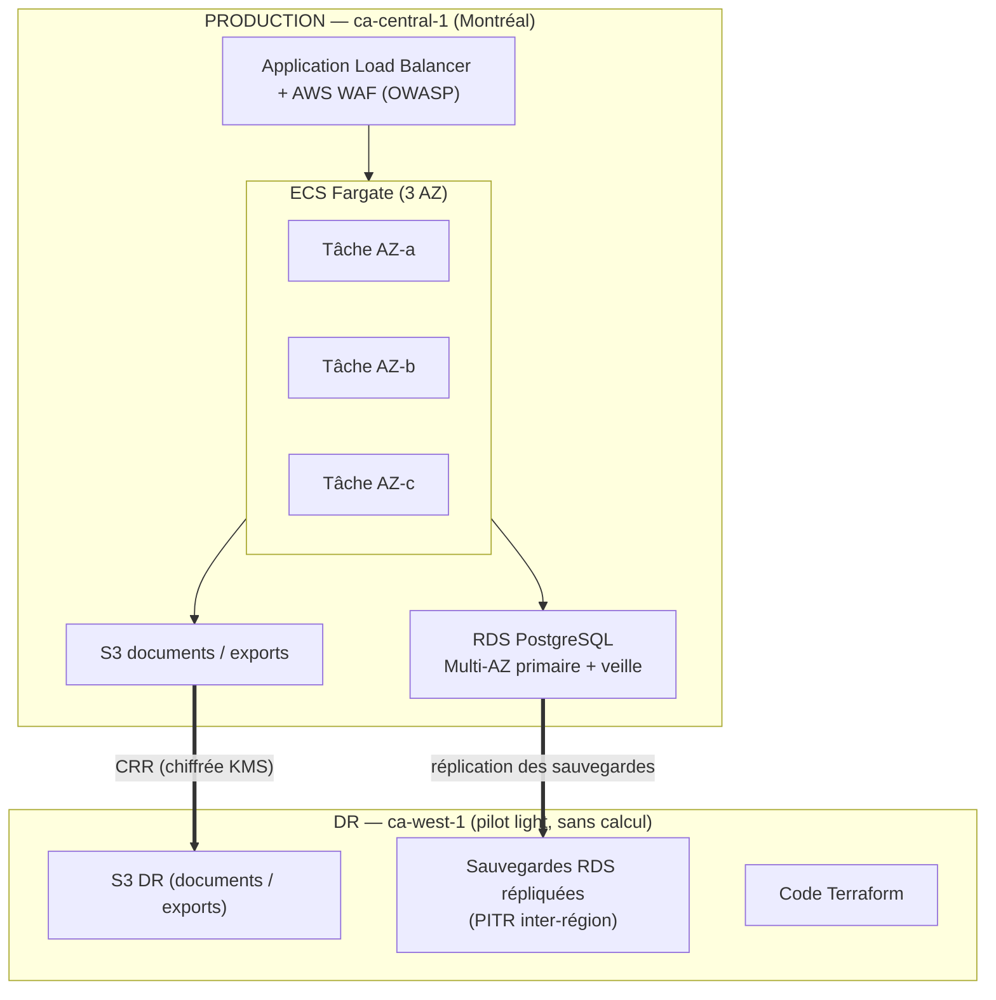
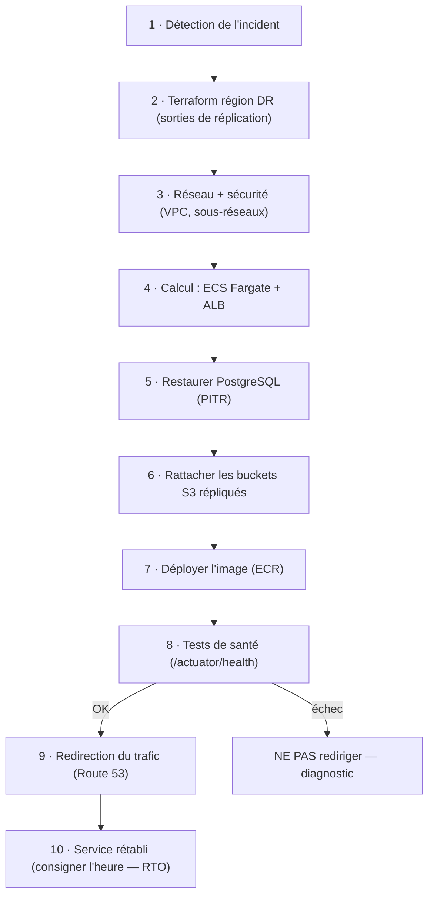

# Plan de reprise après sinistre (PRA) — cibles RPO ≤ 15 min, RTO ≤ 4 h

> Pièce jointe au dépôt (article 16 — sauvegarde, reprise, continuité). Hébergement **Amazon Web
> Services (AWS)**, régions canadiennes. La procédure est **outillée en Terraform** et **automatisée par
> script**.

## 1. Définitions et acronymes

| Terme | Définition |
|---|---|
| **RPO** (*Recovery Point Objective*) | Perte de données maximale tolérée. **Cible : ≤ 15 min.** |
| **RTO** (*Recovery Time Objective*) | Délai maximal de rétablissement après sinistre. **Cible : ≤ 4 h.** |
| **PRA / DR** | Plan et moyens de reprise après un sinistre affectant une région entière. |
| **PITR** (*Point-In-Time Recovery*) | Restauration d'une base à un instant précis, via sauvegardes et journaux de transactions. |
| **Pilot light** | Posture où seules la **donnée et les images** sont maintenues à chaud dans la région de reprise ; le calcul est instancié à la bascule (coût minimal en régime nominal). |
| **Zone de disponibilité (AZ)** | Centre de données isolé au sein d'une région. |
| **Région primaire** | **`ca-central-1`** (Montréal, Québec) — trois zones de disponibilité. |
| **Région de reprise** | **`ca-west-1`** (Calgary) — **données maintenues au Canada**. |
| **Route 53 / CloudFront** | DNS géré / diffusion assurant la **redirection du trafic** vers la région active. |

## 2. Deux niveaux de résilience

| Événement | Réponse | Cible |
|---|---|---|
| Panne d'une **zone** (AZ) | **Automatique** : HA multi-zone (ECS Fargate sur 3 AZ, RDS PostgreSQL Multi-AZ primaire + veille, ALB redondé). Aucune intervention. | **SLA 99,99 %** |
| Sinistre d'une **région complète** | **PRA** : bascule vers **`ca-west-1`** (ce document). | **RPO ≤ 15 min, RTO ≤ 4 h** |

Le **SLA 99,99 %** est tenu par la redondance **multi-zone dans la région `ca-central-1` (Montréal)** ;
la bascule inter-région n'intervient qu'en cas de **sinistre régional complet** (événement rare).

## 3. Posture de reprise permanente (« pilot light »)

En régime nominal, la région de reprise (`ca-west-1`) ne porte **aucun calcul** ; seules la donnée et les
images y sont répliquées en continu.

| Élément répliqué | Mécanisme (AWS) | Contribution au RPO |
|---|---|---|
| Documents / exports S3 | Cross-Region Replication (chiffrée KMS) | ~secondes |
| Base PostgreSQL | Réplication des sauvegardes RDS (PITR inter-région) | **≤ 5 min** |
| Images de conteneur | ECR (réplication de registre) | image déjà présente au failover |
| Infrastructure | code Terraform versionné | reconstruction en une commande |

## 4. Procédure de bascule vers `ca-west-1`

En cas de sinistre régional, la séquence suivante rétablit le service. Elle est **automatisée** et
**journalisée** (mesure du RTO).

| Étape | Durée typique |
|---|---:|
| Préparation / sorties | ~5 min |
| Réseau + ECS Fargate | ~15-25 min |
| Restauration PostgreSQL (PITR) | ~30-90 min |
| Stockage + démarrage conteneurs | ~10 min |
| Tests de santé | ~5-10 min |
| Redirection Route 53 (TTL 60 s) | ~2-5 min |
| **Total** | **~1 h 15 – 2 h 30** (< 4 h, avec marge) |

## 5. Bascule inverse

Une fois `ca-central-1` rétablie : reconstruire la production, resynchroniser la base et le stockage,
tester, puis rebasculer Route 53. `ca-west-1` redevient « pilot light ».

## 6. Validation et exercices

- **Exercice de reprise semestriel** (mode simulation, sans rediriger le trafic) : le RTO réel est mesuré et consigné.
- **Surveillance continue** du retard de réplication (CloudWatch) avec alertes.
- **Rapport post-exercice** : écarts au budget de temps, actions correctives.
