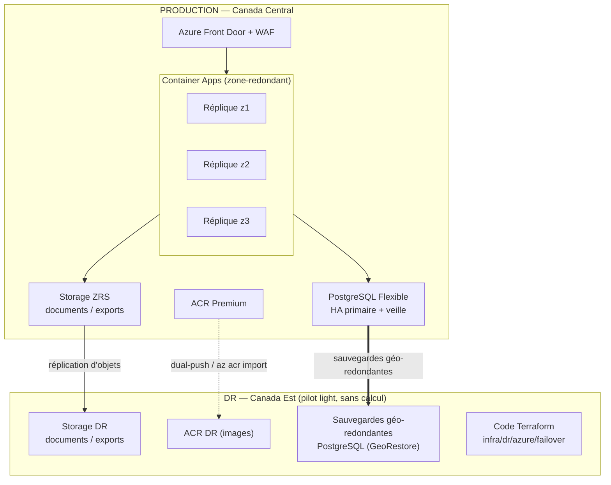
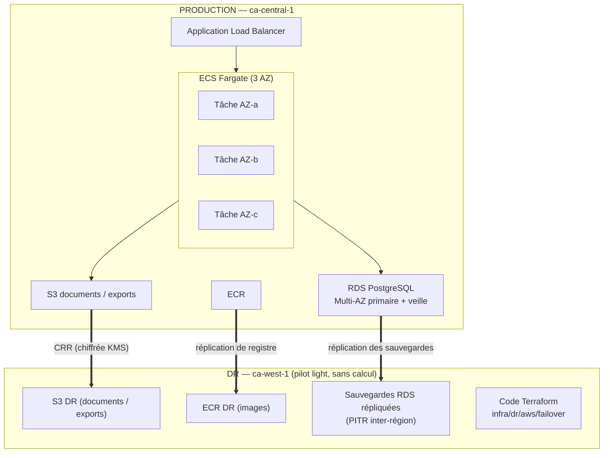
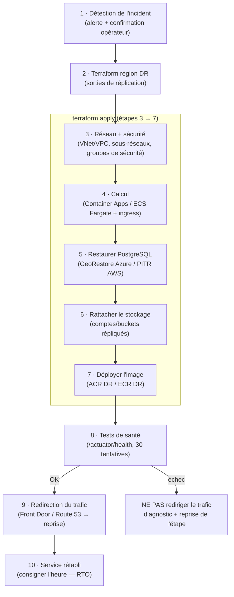

# Plan de reprise après sinistre (PRA) — cibles RPO ≤ 15 min, RTO ≤ 4 h

> Pièce jointe au dépôt (article 16 — sauvegarde, reprise, continuité). Décrit la posture de reprise
> permanente, la procédure de bascule et sa validation. La procédure est **outillée en Terraform**
> (`infra/dr/`) et **automatisée par script** (`infra/dr/scripts/dr-failover.sh`).

## 1. Définitions et acronymes

| Terme | Définition |
|---|---|
| **RPO** (*Recovery Point Objective*) | Perte de données maximale tolérée, mesurée en temps. **Cible : ≤ 15 min.** |
| **RTO** (*Recovery Time Objective*) | Délai maximal de rétablissement du service après un sinistre. **Cible : ≤ 4 h.** |
| **PRA / DR** (*Disaster Recovery*) | Plan et moyens de reprise après un sinistre affectant une région entière. |
| **PITR** (*Point-In-Time Recovery*) | Restauration d'une base à un instant précis, à partir des sauvegardes et des journaux de transactions. |
| **Pilot light** | Posture DR où seules la **donnée et les images** sont maintenues à chaud dans la région de reprise ; le calcul est instancié à la bascule (coût minimal en régime nominal). |
| **CRR** (*Cross-Region Replication*) | Réplication d'objets S3 d'une région vers une autre. |
| **Région primaire** | **Canada Central** (Azure) / **`ca-central-1`** (AWS, Montréal). |
| **Région de reprise** | **Canada Est** (Azure) / **`ca-west-1`** (AWS, Calgary) — **données maintenues au Canada**. |
| **AZ** (*Availability Zone*) | Zone de disponibilité (centre de données isolé) au sein d'une région. |
| **ALB** | *Application Load Balancer* (répartiteur de charge applicatif AWS). |
| **Front Door / Route 53** | Point d'entrée mondial (Azure) / DNS géré (AWS) assurant la **redirection du trafic** vers la région active. |

## 2. Deux niveaux de résilience

| Événement | Réponse | Cible |
|---|---|---|
| Panne d'une **zone** (AZ) | **Automatique** : HA multi-zone (calcul sur 3 AZ, base primaire + veille synchrone, entrée réseau redondée). Aucune intervention. | **SLA 99,99 %** |
| Sinistre d'une **région complète** | **PRA** : bascule vers la seconde région canadienne (ce document). | **RPO ≤ 15 min, RTO ≤ 4 h** |

Le **SLA 99,99 %** est tenu par la redondance **multi-zone dans une seule région** ; la bascule
inter-région n'intervient qu'en cas de **sinistre régional complet** (événement rare), pour lequel
s'appliquent les cibles RPO/RTO.

## 3. Posture de reprise permanente (« pilot light ») — Terraform `infra/dr/aws/replication`

En régime nominal, la région de reprise ne porte **aucun calcul** ; seules la donnée et les images y
sont répliquées en continu.

### 3.1 Azure (production de l'AO) — `infra/dr/azure/replication`

| Élément répliqué | Mécanisme (Terraform Azure) | Contribution au RPO |
|---|---|---|
| Documents / exports | `azurerm_storage_object_replication` (compte DR) | ~minutes |
| Base PostgreSQL | `geo_redundant_backup_enabled` → **GeoRestore** au failover | **≤ 15 min** (sauvegarde géo) |
| Images de conteneur | ACR DR (`azurerm_container_registry`) alimenté par le CI / `az acr import` | image déjà présente au failover |
| Infrastructure | code Terraform versionné (`infra/dr/azure/failover`) | reconstruction en une commande |

> **Prérequis de la réplication d'objets** : le compte de stockage de production doit avoir le
> **versionnage de blobs** et le **change feed** activés (activation non intrusive, sans recréation).
> Variante : passer le compte de production en **RA-GZRS** (géo-redondance native).

### 3.2 AWS — `infra/dr/aws/replication`

| Élément répliqué | Mécanisme (Terraform AWS) | Contribution au RPO |
|---|---|---|
| Documents / exports S3 | `aws_s3_bucket_replication_configuration` (CRR, chiffrée KMS) | ~secondes (quasi temps réel) |
| Base PostgreSQL | `aws_db_instance_automated_backups_replication` (PITR inter-région) | **≤ 5 min** (journaux de transactions) |
| Images de conteneur | `aws_ecr_replication_configuration` | image déjà présente au failover |
| Infrastructure | code Terraform versionné (`infra/dr/aws/failover`) | reconstruction en une commande |

**RPO garanti ≤ 15 min** sur les deux clouds : la contrainte dominante (journaux/sauvegardes) reste
bornée avec marge sous 15 min.

## 4. Procédure de bascule (Azure et AWS)

En cas de sinistre de la région primaire, la séquence suivante rétablit le service dans la région de
reprise. Elle est **automatisée** et **journalisée** (mesure du RTO). La logique est **identique sur les
deux clouds** ; seul l'outillage diffère :

| Cloud | Stack Terraform de bascule | Script d'orchestration |
|---|---|---|
| **Azure** (production de l'AO) | `infra/dr/azure/failover` | `infra/dr/scripts/dr-failover-azure.sh` |
| **AWS** | `infra/dr/aws/failover` | `infra/dr/scripts/dr-failover.sh` |

**Budget de temps (RTO ≤ 4 h)** — ordres de grandeur observés :

| Étape | Durée typique |
|---|---:|
| 2 — préparation / sorties | ~5 min |
| 3-4 — réseau + calcul (Container Apps / ECS) + ingress | ~15-25 min |
| 5 — restauration PostgreSQL (GeoRestore Azure / PITR AWS) | ~30-90 min (selon volume) |
| 6-7 — stockage + démarrage des conteneurs | ~10 min |
| 8 — tests de santé | ~5-10 min |
| 9 — redirection (Front Door / DNS TTL 60 s) | ~2-5 min |
| **Total** | **~1 h 15 – 2 h 30** (< 4 h, avec marge) |

## 5. Bascule inverse (retour à la région primaire)

Une fois la région primaire rétablie : reconstruire la production (`terraform apply` du stack de
production), **répliquer en sens inverse** la base et le stockage, resynchroniser, tester, puis rebasculer
le DNS. La région de reprise redevient « pilot light ».

## 6. Validation et exercices

- **Exercice de reprise semestriel** en mode `--drill` : la bascule est exécutée jusqu'aux tests de
  santé **sans** rediriger le trafic de production ; le RTO réel est mesuré et consigné.
- **Vérification continue** de la réplication : métriques de retard de réplication S3/RDS surveillées et
  alertées (Azure Monitor / CloudWatch).
- **Rapport post-exercice** : écarts au budget de temps, actions correctives.

## 7. Correspondance des services Azure ↔ AWS

La production de l'AO est **hébergée sur Azure** ; le stack AWS fournit une reprise équivalente. Les
cibles **RPO ≤ 15 min / RTO ≤ 4 h** et la séquence de bascule (§4) sont **identiques** ; seuls les
services et l'outillage diffèrent.

| Fonction | Azure (`infra/dr/azure/`) | AWS (`infra/dr/aws/`) |
|---|---|---|
| Régions primaire → reprise | **Canada Central → Canada Est** | **`ca-central-1` → `ca-west-1`** |
| Calcul (conteneurs) | Azure **Container Apps** (zone-redondant) | **ECS Fargate** (3 AZ) |
| Base de données | **PostgreSQL Flexible** — sauvegardes **géo-redondantes** + **GeoRestore** | **RDS** — réplication des sauvegardes automatiques + **PITR** |
| Stockage documents | **Storage** + réplication d'objets | **S3** + **CRR** (chiffrée KMS) |
| Registre d'images | **ACR** DR (dual-push / `az acr import`) | **ECR** replication |
| Redirection du trafic | **Azure Front Door** (bascule d'origine) | **Route 53** (UPSERT CNAME) |
| Secrets | **Key Vault** (region DR) | **Secrets Manager** (region DR) |
| Orchestration | `dr-failover-azure.sh` | `dr-failover.sh` |

Résidence des données **au Canada** dans les deux cas (les deux régions sont canadiennes).
