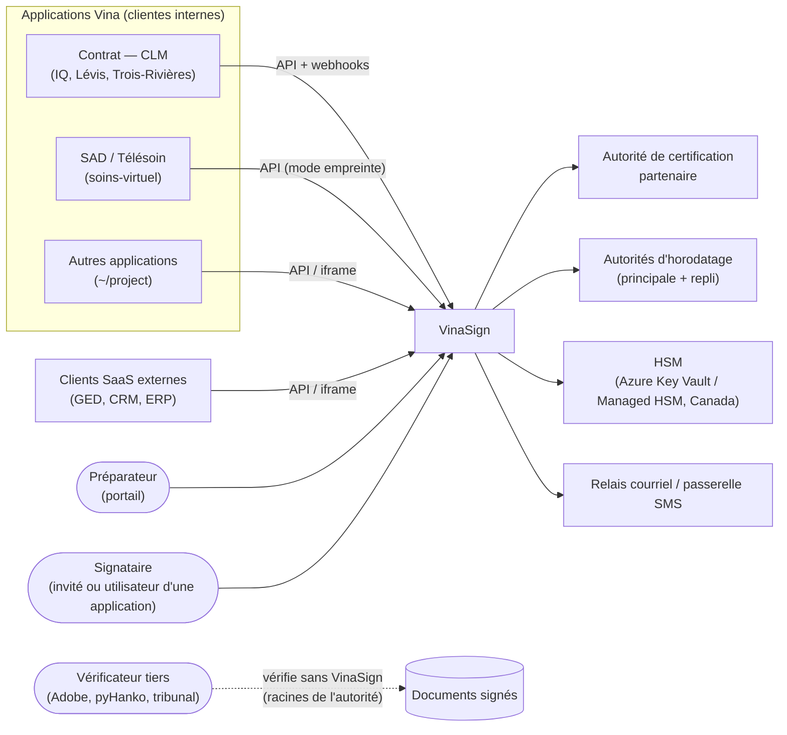
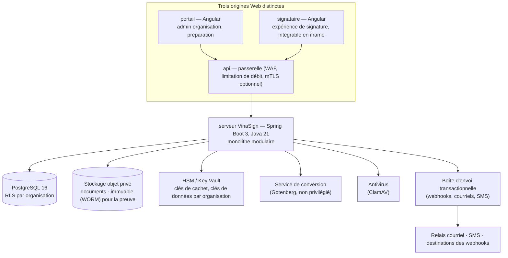
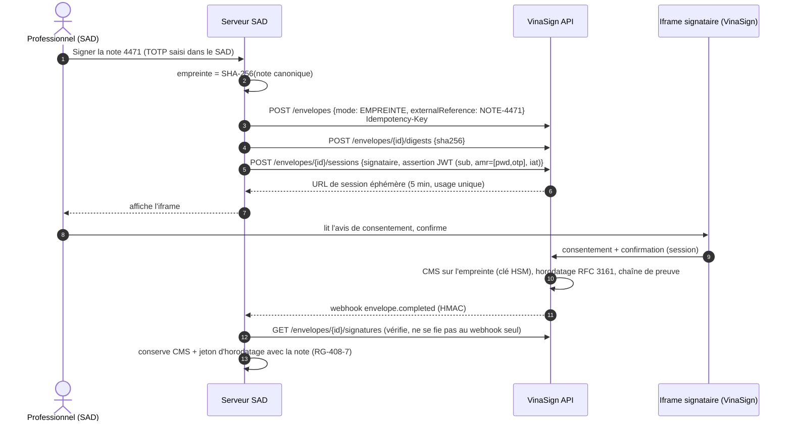

# VinaSign — Dossier d'architecture cible

- **Date** : 22 novembre 2026
- **Statut** : proposé, à valider en phase 0
- **Décisions** : [VS-ADR-001 à VS-ADR-007](adr/)

## 1. Contexte (vue C4, niveau 1)

## 2. Conteneurs (niveau 2)

**Choix techniques** :

| Élément | Choix | Motif |
|---|---|---|
| Serveur | Java 21, Spring Boot 3.5, Spring Authorization Server, Spring Security | Alignement sur Télésoin ; serveur d'autorisation intégré pour les applications clientes |
| Signature PDF | Apache PDFBox et Bouncy Castle (portés du CLM) | Déjà validés PAdES-B-LTA ; signature externe d'une plage `ByteRange` |
| Interfaces | Angular (portail, signataire) ; PDF.js ; Pointer Events | Dossier 1 ; une seule technologie Web côté VinaSign |
| Intégration navigateur | `@vinasign/embed` : iframe et `postMessage`, sans framework | Utilisable depuis React (contrat) comme Angular (Télésoin) |
| Base | PostgreSQL 16, Liquibase, RLS | Isolation en profondeur ([VS-ADR-006](adr/VS-ADR-006-isolation-multi-organisation.md)) |
| Asynchrone | Boîte d'envoi transactionnelle, planification avec verrou en base | Pas de Redis au MVP |
| Hébergement | Azure, régions Canada Central et Canada East (reprise) | Résidence des données ; aligné sur l'ADR-020 du contrat |

## 3. Contextes métier du serveur

Découpage par contexte, chacun en `domain / application / infrastructure` (règle de dépendance vérifiée par ArchUnit) :

| Contexte | Responsabilité | Ports principaux | Origine |
|---|---|---|---|
| `organisation` | Organisations, plans, quotas, marque | `Organisations` | nouveau |
| `acces` | Utilisateurs du portail (OIDC), applications clientes, identifiants, scopes | `ApplicationsClientes`, `EmetteurJetons` | CLM `ClientsIntegrationService`, refondu |
| `enveloppe` | Enveloppe, documents, versions, signataires, champs, ordre, états | `DepotDocuments`, `AnalyseAntivirus`, `ConversionPdf` | CLM `Trousse`, allégé |
| `session` | Liens, sessions intégrées, consentement, authentification du signataire | `CanalCode`, `VerificateurAssertion`, `WebAuthn` | CLM `Invitation`, `Identite`, `PortailService` |
| `signature` | PAdES, CAdES, signature d'empreinte, horodatage, données de validation | `CleDeSignature`, `AutoriteHorodatage` | CLM `CachetX509`, `SignatureProbanteCachet`, `AutoriteHorodatage` |
| `confiance` | Clés, certificats, rotation, révocation, cachets par organisation | `CleDeSignature` (HSM), `AutoriteCertification` | nouveau |
| `preuve` | Journal chaîné, ancrage, certificat de réalisation, dossier de preuve, vérification publique | `StockageImmuable` | CLM `ChaineScellee`, `PreuveService` |
| `notification` | Courriels, SMS, modèles français et anglais, relances | `Courriel`, `Sms` | CLM `MessagerieClm`, `Relances` |
| `integration` | Webhooks, idempotence, MCP | `DestinationWebhook` | CLM `RappelsExternesService`, `ServeurMcp` |
| `facturation` | Mesure de l'usage, plans, rapports | `PrestatairePaiement` (page hébergée) | CLM `Enveloppes` |
| `conservation` | Durées, purge, gel pour litige | — | CLM `RegleConservation` |

Un contexte n'accède jamais aux entités d'un autre : il passe par un port de lecture qui rend un DTO, ou par un
événement de domaine.

## 4. Modèle de données

Il reprend les entités du dossier 1 (§ 8.1) et du dossier 2 (§ 11), avec les ajouts suivants :

| Entité | Champs clés | Remarque |
|---|---|---|
| `client_application` | id, tenant_id, nom, environnement (`SANDBOX`, `PRODUCTION`), cle_publique_jwks, scopes, statut | `private_key_jwt` ; plus de secret partagé en production |
| `envelope` | id (UUID v7), tenant_id, client_application_id, external_reference, mode (`DOCUMENT`, `EMPREINTE`), niveau_requis, statut, expire_le | `(client_application_id, external_reference)` unique |
| `idempotency_key` | client_application_id, cle, empreinte_requete, reponse, expire_le | Une même clé avec un autre corps rend 422 |
| `document_version` | id, envelope_id, nature (`ORIGINAL`, `PREPARE`, `FINAL`), cle_objet, sha256 | Immuable |
| `digest_request` | id, envelope_id, sha256, algorithme, titre_non_nominatif | Mode empreinte : aucun contenu |
| `signer` | id, envelope_id, ordre, nom, courriel, telephone_chiffre, type (`INVITE`, `UTILISATEUR_APPLICATION`), sujet_externe | `sujet_externe` : identifiant de l'utilisateur dans l'application cliente |
| `signing_session` | id, signer_id, origine (`LIEN`, `INTEGREE`), actions, expire_le, consommee_le, niveau_atteint, amr | À usage unique |
| `consent_record` | id, session_id, version_texte, empreinte_texte, accepte_le | Texte versionné |
| `signature` | id, signer_id, type (`PADES`, `CADES_EMPREINTE`), cms (ou référence), jeton_horodatage, certificat_id | — |
| `evidence_event` | id, tenant_id, envelope_id, sequence, type, acteur, horodatage, donnees, empreinte_precedente, empreinte | Chaîne ; ajout seul ; écrit dans le stockage immuable |
| `evidence_anchor` | id, tenant_id, empreinte_tete, jeton_horodatage, ancre_le | Ancrage périodique de la chaîne par horodatage |
| `seal_certificate` | id, tenant_id, cle_hsm_id, certificat_pem, emetteur, valide_du, valide_au, statut | Un cachet par organisation |
| `webhook_endpoint` / `webhook_delivery` | url, secret_reference (Key Vault), evenements ; tentative, statut, code, prochaine_tentative | — |
| `usage_record` | tenant_id, client_application_id, type, mois, quantite | Enveloppe comptée une fois, au premier envoi (règle du CLM) |

**États** : ceux du dossier 1 (§ 8.3), contrôlés par le domaine (`Enveloppe.envoyer()`, `Signataire.signer()`…).
Aucune API ne modifie un statut directement.

## 5. API v1 (extrait)

Préfixe `/api/v1`. Le contrat complet sera dans OpenAPI.

| Méthode | Route | Scope | Rôle |
|---|---|---|---|
| POST | `/oauth2/token` | — | Jeton d'application (client credentials, `private_key_jwt`) |
| POST | `/envelopes` | `envelopes:create` | Créer (mode `DOCUMENT` ou `EMPREINTE`), avec clé d'idempotence obligatoire |
| POST | `/envelopes/{id}/documents` | `documents:upload` | Demander une URL de dépôt présignée, puis confirmer |
| PUT | `/envelopes/{id}/signers` | `signers:manage` | Signataires, ordre, niveau |
| PUT | `/envelopes/{id}/fields` | `envelopes:create` | Champs (coordonnées normalisées ou ancres textuelles) |
| POST | `/envelopes/{id}/digests` | `envelopes:create` | Mode empreinte : empreinte à signer |
| POST | `/envelopes/{id}/send` | `envelopes:send` | Démarrer le parcours (invitations) |
| POST | `/envelopes/{id}/sessions` | `sessions:create` | Session intégrée pour un signataire, avec assertion de l'utilisateur de l'application |
| POST | `/envelopes/{id}/cancel` | `envelopes:send` | Annuler |
| GET | `/envelopes/{id}` | `envelopes:read` | Statut, signataires, événements |
| GET | `/envelopes/{id}/documents/final` | `documents:download` | PDF final (mode `DOCUMENT`) |
| GET | `/envelopes/{id}/signatures` | `envelopes:read` | CMS et horodatages (mode `EMPREINTE`) |
| GET | `/envelopes/{id}/evidence` | `evidence:read` | Dossier de preuve (ZIP signé) |
| POST | `/verifications` | public, limité en débit | Vérifier un document ou une empreinte et une signature |
| POST, GET, DELETE | `/webhooks` | `webhooks:manage` | Destinations |
| POST | `/mcp` | `envelopes:read` | Connecteur MCP en lecture seule |

**Erreurs** : RFC 9457 (`application/problem+json`), avec des types stables (`/problemes/niveau-insuffisant`,
`/problemes/ordre-de-signature`…).

## 6. Séquences clés

### 6.1 Professionnel du SAD qui signe sa note (mode empreinte, utilisateur authentifié)

### 6.2 Contrat multi-signataires (mode document, invités)

Création, dépôt présigné, champs (ancres), envoi. Chaque invité reçoit un courriel, ouvre le lien, saisit un code (si
le niveau est renforcé), consent et signe au doigt. VinaSign finalise : PDF final PAdES-B-LTA scellé par le cachet de
l'organisation, puis certificat de réalisation. Le webhook `envelope.completed` part. L'application récupère le PDF et
la preuve.

## 7. Clés et confiance

| Clé | Où | Usage | Rotation |
|---|---|---|---|
| Cachet de l'organisation (RSA 3072 ou ECDSA P-256) | HSM, non exportable | PAdES du PDF final, CMS du mode empreinte | Au renouvellement du certificat (1 à 3 ans) ; les anciennes signatures restent vérifiables (règle `reconnait` du CLM) |
| Clé de données par organisation | Key Vault (chiffrement d'enveloppe) | Chiffre documents et champs sensibles (téléphone, réponses) | Annuelle ; rechiffrement progressif |
| Clés de signature des jetons (JWT) | Key Vault | Jetons d'application et sessions | Trimestrielle, publiées en JWKS |
| Secrets des webhooks | Key Vault | HMAC | À la demande ; deux secrets actifs pendant la transition |
| Clé de l'autorité d'horodatage Vina (V2) | HSM | Horodatage interne | Selon la politique d'horodatage |

## 8. Exigences non fonctionnelles

| Domaine | Cible MVP | Mesure |
|---|---|---|
| Latence API (hors traitement PDF) | p95 < 300 ms | Harnais JMeter (porté de `perf/` du contrat) |
| Signature d'empreinte, de bout en bout | p95 < 1,5 s, horodatage compris | Idem |
| Finalisation d'un PDF de 50 pages | p95 < 8 s, asynchrone | Idem |
| Disponibilité | 99,9 % au pilote ; 99,95 % visé pour l'offre SaaS | Sondes synthétiques |
| RPO / RTO | 15 min / 4 h | Restauration testée chaque trimestre |
| Accessibilité | SGQRI 008 3.0 et WCAG 2.2 AA, axe-core sans violation dans chaque état, cibles ≥ 44 px (grand public) | e2e aux quatre largeurs |
| Couverture | ≥ 96 % par classe et agrégé ; MSI ≥ 80 % (≥ 90 % sur le domaine) | JaCoCo `check`, PIT |
| Journalisation | Aucun renseignement personnel ni secret | Test d'architecture et revue |

## 9. Déploiement

- **Environnements** : développement (Docker Compose, bacs à sable du contrat), intégration, préproduction, production
  et bac à sable client (sandbox), qui est un environnement de production isolé avec des certificats de test.
- **Production** : AKS ou Container Apps dans Canada Central, PostgreSQL Flexible Server en haute disponibilité de
  zone, stockage avec politique d'immuabilité pour la preuve, Key Vault Premium, Front Door et WAF.
  - Reprise dans Canada East : réplique en lecture et stockage répliqué par géoredondance.
- **Infrastructure en code** (Terraform) ; images signées (cosign) ; SBOM publiée ; aucune connexion administrative
  sans PIM ni journal.
