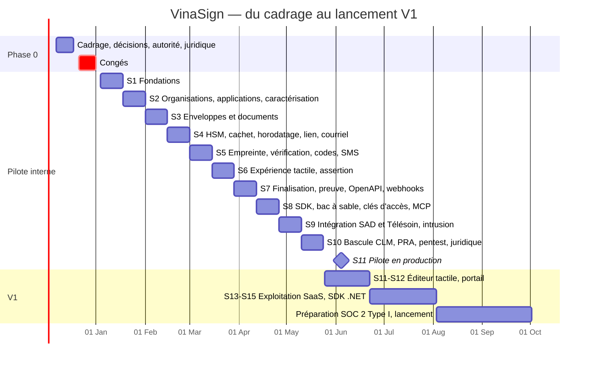

# VinaSign — Planning

- **Date** : 22 novembre 2026
- **Hypothèses** :
  - démarrage après le dépôt de la soumission IQ (4 décembre 2026) ;
  - sprints de deux semaines ;
  - vélocité d'environ 36 points par sprint, à recalibrer après le sprint 2 ;
  - réutilisation du moteur du CLM ([VS-ADR-002](adr/VS-ADR-002-extraction-du-moteur-clm.md)).

## 1. Jalons

| Jalon | Date | Critère de passage |
|---|---|---|
| **J0 — Décisions** | 18 déc. 2026 | ADR VS-001 à 007 acceptés ; autorité partenaire et prestataire SMS présélectionnés ; équipe nommée ; dépôt `vinasign` créé |
| **J1 — Moteur extrait** | 12 mars 2027 | En intégration, une application de test signe par l'API en mode document (PAdES-B-LTA, pyHanko « VALID ») et en mode empreinte (CMS vérifié par `openssl`) ; clé dans Key Vault |
| **J2 — Prêt à intégrer** | 23 avr. 2027 | SDK Java et TypeScript, iframe et bac à sable publiés au registre privé ; webhooks signés ; OpenAPI figé en v1 |
| **J3 — Décision de pilote** | 21 mai 2027 | Test d'intrusion indépendant sans constat élevé ouvert ; avis juridique reçu ; PRA éprouvé ; EFVP signée ; SAD et Télésoin au vert en préproduction |
| **J4 — Pilote interne en production** | 4 juin 2027 | SAD (notes) et Télésoin (consentements) signent en production pour un groupe pilote |
| **J5 — V1 fonctionnelle** | 30 juil. 2027 | Éditeur tactile, portail autonome, facturation, libre-service, SDK .NET |
| **J6 — Lancement commercial V1** | 30 sept. 2027 | Rapport SOC 2 Type I ; conditions d'utilisation, politique de confidentialité et offre relues par le conseiller juridique ; bascule du CLM pour Lévis faite |
| **V2** | T4 2027 à T2 2028 | Signature avancée, vérification d'identité, apport de clé par le client, instance dédiée, SOC 2 Type II |

## 2. Calendrier des sprints

| Sprint | Dates | Stories | Points | Démonstration de fin de sprint |
|---|---|---|---:|---|
| S1 | 4–15 janv. | VS-001 à VS-005 | 34 | Construction verte avec les portes ; RLS prouvée par un test |
| S2 | 18–29 janv. | VS-010 à VS-015, VS-030 | 34 | Une application obtient un jeton `private_key_jwt` ; la suite de caractérisation passe contre le CLM |
| S3 | 1–12 févr. | VS-020 à VS-025 | 29 | Enveloppe créée, PDF déposé et analysé, machine d'états |
| S4 | 15–26 févr. | VS-031, 032, 033, 040, 041, 080 | 34 | PDF scellé PAdES-B-LTA avec une clé Key Vault ; invitation reçue dans Mailpit |
| S5 | 1–12 mars | VS-034, 035, 036, 042, 046, 081, 082 | 36 | **J1** : signature d'empreinte vérifiée par `openssl` ; vérification publique |
| S6 | 15–26 mars | VS-044, VS-050 à VS-055 | 36 | Signature au doigt sur tablette ; session intégrée par assertion ; axe-core au vert |
| S7 | 29 mars–9 avr. | VS-070 à VS-073, 090, 091 | 36 | Dossier de preuve vérifié hors VinaSign ; webhook signé reçu (lundi de Pâques férié) |
| S8 | 12–23 avr. | VS-043, 045, 092 à 095, 110 | 35 | **J2** : SDK publiés ; exemple Spring Boot et React de bout en bout |
| S9 | 26 avr.–7 mai | VS-100, 101, 111, 112 | 29 | SAD et Télésoin signent en intégration ; tests d'intrusion automatisés au vert |
| S10 | 10–21 mai | VS-102, 103, 113, 114, 115 et stabilisation | 24 | **J3** : décision de pilote |
| S11 | 25 mai–4 juin | Mise en production du pilote ; VS-060, 061 | 11 | **J4** : pilote en production |
| S12 | 7–18 juin | VS-062, 063, 064 | 18 | Portail autonome |
| S13 | 21 juin–2 juill. | VS-120, 123, 124 | 13 | Consommation et marque (Fête nationale et fête du Canada fériées) |
| S14 | 5–16 juill. | VS-121, 122 | 16 | Libre-service et paiement hébergé |
| S15 | 19–30 juill. | VS-125 et stabilisation | 5 | **J5** |

La capacité laissée libre en S9 à S15 absorbe le retour du pilote, la dette et la préparation SOC 2. Elle n'est pas du
temps mort.

## 3. Phase 0 — travaux du 7 au 18 décembre 2026

| Travail | Responsable | Livrable |
|---|---|---|
| Valider les ADR VS-001 à 007 | Direction technique | ADR « Accepté » |
| Présélectionner l'autorité de certification (cachets d'organisation, puis certificats à la volée en V2) | Architecte et direction | Grille comparative et devis (Notarius et au moins une autre autorité) |
| Choisir l'autorité d'horodatage principale et celle de repli, le relais courriel et la passerelle SMS | Architecte | Décision et estimation des coûts unitaires |
| Mandater le conseiller juridique (LCCJTI, renseignements de santé, terminologie) | Direction | Mandat signé, échéance au S10 |
| Fixer les objectifs de niveau de service, le RPO et le RTO du pilote avec le SAD et Télésoin | Architecte et produit | Annexe au dossier d'architecture |
| Créer le dépôt `vinasign`, y transférer ces documents et réserver les domaines | Responsable technique | Dépôt initialisé |
| Réserver la capacité de l'équipe `soins-virtuel` pour S9 (intégration) | Direction | Engagement écrit |

## 4. Équipe

| Rôle | Charge | Remarque |
|---|---|---|
| Architecte, responsable technique | 50 % | Garant des ADR, des revues de sécurité et de l'extraction du CLM |
| Développeur·se backend Java (2) | 2 × 100 % | L'un connaît le module CLM, ce qui est un prérequis à VS-030 |
| Développeur·se frontend Angular | 100 % | Interface du signataire, iframe, puis portail |
| QA et automatisation | 50 % | Bacs à sable, e2e, BDD, intrusion |
| DevSecOps | 25 % | Terraform, Key Vault, CI, supervision |
| Conseiller·ère juridique, auditeur·rice SOC 2, testeur·se d'intrusion | Externe | Mandats ponctuels |
| **Total interne** | **≈ 4,25 équivalents temps plein** | |

## 5. Budget de cadrage

- **Réalisation jusqu'au pilote (S1 à S11)** :
  - 22 semaines × 4,25 équivalents temps plein ≈ 94 semaines-personnes, soit environ 470 jours-personnes ;
  - à 900–1 200 $ CA par jour-personne, cela fait **≈ 420 000 à 565 000 $ CA**.
- **Réalisation de la V1 (S12 à S15)** :
  - environ 34 semaines-personnes, soit environ 170 jours-personnes ;
  - à 900–1 200 $ CA par jour-personne, cela fait **≈ 155 000 à 205 000 $ CA**.
- **Écart avec le dossier 1** (126 000 à 264 000 $ CA) : il s'explique par ce que ce dossier ne comptait pas.
  - la plateforme de confiance opérée (HSM, clés, autorité partenaire) ;
  - les SDK ;
  - deux intégrations internes ;
  - la bascule du CLM ;
  - les portes de qualité (couverture, mutation, intrusion).
  La réutilisation du CLM est, elle, déjà déduite.
- **Variante réduite** (≈ 7 sprints, ≈ 270 000 à 360 000 $ CA) : mode empreinte et pilote SAD seulement, sans
  expérience tactile ni mode document. Elle valide le moteur et l'intégration, mais ne produit rien de vendable.
- **Coûts externes et récurrents**, à chiffrer en phase 0 :
  - Key Vault Premium, puis Managed HSM ;
  - certificats de cachet ;
  - horodatage ;
  - SMS et relais courriel ;
  - hébergement Azure pour deux régions ;
  - test d'intrusion indépendant ;
  - avis juridique ;
  - audit SOC 2 ;
  - assurance cyber.

## 6. Risques du planning

| Risque | Probabilité | Impact | Mesure |
|---|---|---|---|
| L'équipe est mobilisée par l'appel d'offres IQ ou le CLM en production (questions d'IQ, attribution) | Élevée | Élevé | Phase 0 après le 4 décembre ; un des deux développeurs backend dédié sans interruption |
| Délai de contractualisation avec l'autorité de certification | Moyenne | Élevé (bloque la production) | Démarrer en phase 0 ; certificat de démonstration jusqu'à J3 |
| L'avis juridique impose le mode document ou un niveau plus élevé pour la santé | Moyenne | Moyen | Mode empreinte et niveaux déjà prévus ; l'avis est attendu avant J3 |
| L'équipe `soins-virtuel` n'est pas disponible en S9 | Moyenne | Élevé (pilote décalé) | Capacité réservée en phase 0 ; exemples fournis par le SDK dès J2 |
| Le portage du moteur du CLM révèle un couplage plus fort que prévu | Faible | Moyen | VS-030 en S2 ; ports déjà isolés (`CachetElectronique`, `FournisseurSignature`) |
| IQ refuse la bascule de son CLM | Moyenne | Faible pour VinaSign | IQ reste sur le moteur local ; le retrait est retardé et documenté |
| Vélocité réelle inférieure de 20 % | Moyenne | Moyen | J4 glisse d'un sprint ; le périmètre V1 (E12, E13) absorbe le décalage, jamais les portes de qualité |
