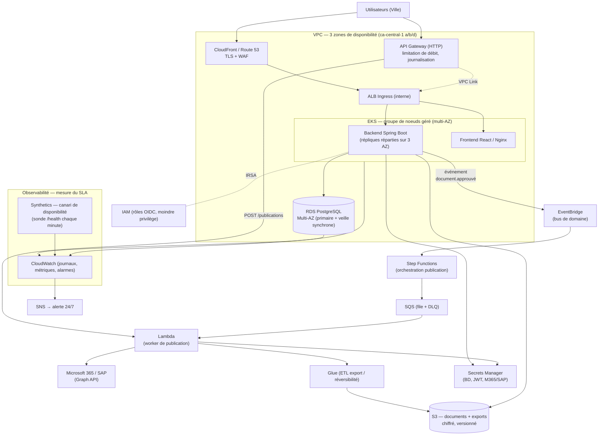

# Déploiement de l'infrastructure sur AWS avec Terraform (IaC)

Ce document explique **tout ce qui est déployé sur AWS**, **comment**, et **pourquoi**, pour la
solution `contractuelle_contrat` (backend Spring Boot, frontend React, PostgreSQL, traitements
asynchrones de publication Microsoft 365 / SAP). Il est le pendant AWS de
[`azure-terraform-integration.md`](azure-terraform-integration.md).

Toute l'infrastructure est décrite en **Terraform** (`infra/terraform/aws/`) et déployée par le
pipeline CI/CD (`infra/cicd/github-actions/deploy-aws.yml`). Aucun clic manuel n'est requis :
l'infrastructure est **reproductible, versionnée et auditable**.

---

## 1. Architecture de déploiement (haute disponibilité multi-AZ, SLA 99,99 %)



**Ce qui soutient le SLA 99,99 %** : EKS sur **3 AZ**, RDS **Multi-AZ** (bascule automatique),
NAT et ALB redondés par AZ, et surtout la **mesure indépendante** par le **canari CloudWatch
Synthetics** qui sonde `/actuator/health` chaque minute et alimente l'alarme de disponibilité.

---

## 2. Composants AWS et leur rôle

| Service | Fichier Terraform | Rôle dans la solution |
|---|---|---|
| **VPC** (3 AZ, NAT par AZ) | `vpc.tf` | Réseau isolé, sous-réseaux publics (ALB/NAT) et privés (EKS, RDS). |
| **EKS** (multi-AZ) | `eks.tf` | Exécute le backend et le frontend en conteneurs, répliques sur 3 zones. |
| **RDS PostgreSQL** (Multi-AZ) | `rds.tf` | Base de données, veille synchrone + bascule automatique, chiffrée. |
| **ECR** | `ecr.tf` | Registres d'images (scan de vulnérabilités à l'envoi). |
| **S3** | `s3.tf` | Documents générés + exports (réversibilité), chiffrés et versionnés. |
| **IAM** (IRSA + rôles de service) | `iam.tf`, `eks.tf` | Identités par pod via OIDC, moindre privilège (aucune clé statique). |
| **Secrets Manager** | `secrets.tf` | Identifiants BD, JWT, clés de chiffrement, connecteurs M365/SAP. |
| **SQS** (+ DLQ) | `sqs.tf` | File de publication asynchrone, lettres mortes après 5 échecs. |
| **Lambda** | `lambda.tf` | Worker qui consomme SQS et dépose vers Microsoft 365 / SAP. |
| **EventBridge** | `eventbridge.tf` | Bus d'événements de domaine + planification (rapport SLA mensuel). |
| **Step Functions** | `stepfunctions.tf` | Orchestration de la publication (mise en file → traitement → journalisation). |
| **Glue** | `glue.tf` | ETL d'export et alimentation des rapports (réversibilité, exigences 19/36). |
| **API Gateway** (HTTP) | `apigateway.tf` | Edge managé : API publique, limitation de débit, journalisation, VPC Link. |
| **CloudWatch** (+ Synthetics, SNS) | `cloudwatch.tf` | Journaux, alarmes, **canari de disponibilité (SLA)**, alertes 24/7. |

---

## 3. Prérequis

- Compte AWS avec droits d'administration sur la région **ca-central-1** (Canada — résidence des données).
- Outils : `terraform >= 1.6`, `awscli v2`, `kubectl`, `helm`, `docker`.
- Un fournisseur d'identité **OIDC GitHub** configuré dans IAM (pour le CI/CD sans clés statiques).

## 4. Bootstrap de l'état distant (une fois)

```bash
aws s3api create-bucket --bucket vina-contrat-tfstate --region ca-central-1 \
  --create-bucket-configuration LocationConstraint=ca-central-1
aws s3api put-bucket-versioning --bucket vina-contrat-tfstate \
  --versioning-configuration Status=Enabled
aws dynamodb create-table --table-name vina-contrat-tflock \
  --attribute-definitions AttributeName=LockID,AttributeType=S \
  --key-schema AttributeName=LockID,KeyType=HASH --billing-mode PAY_PER_REQUEST \
  --region ca-central-1
```
Puis décommenter le bloc `backend "s3"` dans `versions.tf`.

## 5. Déploiement de l'infrastructure

```bash
cd infra/terraform/aws
cp terraform.tfvars.example terraform.tfvars   # adapter au besoin
terraform init
terraform plan
terraform apply
```

Sorties utiles (`terraform output`) : `eks_configure_kubectl`, `ecr_backend_url`, `rds_endpoint`,
`api_gateway_endpoint`, `db_secret_arn`, `publication_queue_url`.

## 6. Déploiement de l'application (Helm)

```bash
aws eks update-kubeconfig --region ca-central-1 --name vina-contrat-prod-eks
# Annoter le ServiceAccount du backend avec le rôle IRSA (sortie backend_irsa_role_arn)
helm upgrade --install contrat infra/k8s/chart -n contrat --create-namespace \
  --values infra/k8s/values-aws.yaml \
  --set image.registry=$(terraform -chdir=infra/terraform/aws output -raw ecr_backend_url | cut -d/ -f1)
```
Le déploiement Kubernetes répartit les répliques sur les 3 AZ (anti-affinité de zone) et lit ses
secrets depuis **Secrets Manager** via IRSA.

## 7. CI/CD

L'orchestrateur [`cd-aws.yml`](cicd/github-actions/workflows/cd-aws.yml) enchaîne des **workflows
réutilisables** : **test** (Maven + npm) → **build & push** images vers ECR → **approbation**
(environnement `prod-aws`) → **terraform apply** → **déploiement Helm** sur EKS, le tout authentifié
par **OIDC** (rôle `AWS_DEPLOY_ROLE_ARN`, aucune clé statique). Tag d'image = SHA du commit ;
déploiement en *rolling update*. Mise en place détaillée et bonnes pratiques :
[`cicd/ci-cd-integration.md`](cicd/ci-cd-integration.md).

## 8. Garantie du SLA 99,99 %

1. **Redondance multi-AZ** : EKS, RDS, NAT et ALB sur 3 zones ; aucune défaillance de zone n'interrompt le service.
2. **Mesure indépendante** : le **canari CloudWatch Synthetics** sonde `/actuator/health` chaque minute ; l'**alarme de disponibilité** notifie l'équipe (SNS) en cas de baisse — c'est cette mesure qui **atteste le taux** servant au calcul du SLA.
3. **Rejeu et DLQ** : les publications échouées sont retentées puis isolées (aucune perte silencieuse).

## 9. Coût du monitoring (déjà inclus)

CloudWatch (journaux + métriques) et **Synthetics** (canari 1/min) représentent
**~900–1 500 $/an**, absorbés dans le coût récurrent d'hébergement (voir l'analyse de prix de l'AO).

## 10. Destruction

```bash
cd infra/terraform/aws && terraform destroy
```
> `deletion_protection` est actif sur RDS ; le désactiver avant `destroy` en production.

---

## Annexe — Glossaire des services AWS (acronyme, définition, rôle ici)

| Service | Acronyme / nom complet | Ce que c'est | Rôle dans la solution |
|---|---|---|---|
| **EKS** | *Elastic Kubernetes Service* | Kubernetes **managé** : AWS exploite le plan de contrôle, vous gérez vos conteneurs. | Orchestre le backend Spring Boot et le frontend React, répliqués sur 3 zones. |
| **VPC** | *Virtual Private Cloud* | Réseau **privé isolé** dans AWS (vos propres plages d'adresses, sous-réseaux, routage). | Cloisonne l'infrastructure : sous-réseaux publics (entrée) et privés (EKS, base). |
| **AZ** | *Availability Zone* (zone de disponibilité) | Centre(s) de données **isolé(s)** au sein d'une région (panne indépendante). | ≥ 3 AZ = aucune panne de zone n'interrompt le service (SLA 99,99 %). |
| **RDS** | *Relational Database Service* | Base de données relationnelle **managée** (sauvegardes, correctifs, bascule). | PostgreSQL en **Multi-AZ** (primaire + veille synchrone). |
| **ECR** | *Elastic Container Registry* | Registre **privé** d'images Docker (avec scan de vulnérabilités). | Stocke les images backend/frontend construites par le CI. |
| **S3** | *Simple Storage Service* | Stockage **objet** durable et illimité (fichiers, versions). | Documents générés et exports (réversibilité), chiffrés et versionnés. |
| **IAM** | *Identity and Access Management* | Gestion des **identités et permissions** (qui peut faire quoi). | Rôles à moindre privilège pour pods, Lambda, Glue, Step Functions. |
| **IRSA** | *IAM Roles for Service Accounts* | Association d'un **rôle IAM à un ServiceAccount** Kubernetes via OIDC. | Les pods obtiennent des droits AWS **sans clé statique**. |
| **OIDC** | *OpenID Connect* | Protocole d'**authentification fédérée** au-dessus d'OAuth 2.0. | Fédère GitHub Actions et les pods EKS avec IAM (aucun secret). |
| **Secrets Manager** | — | Service de **stockage et rotation de secrets** chiffrés. | Identifiants BD, JWT, clés de chiffrement, connecteurs M365/SAP. |
| **KMS** | *Key Management Service* | Gestion des **clés de chiffrement** managées. | Chiffrement au repos de S3, RDS, ECR. |
| **SQS** | *Simple Queue Service* | File de **messages** managée (découplage, tampon). | Met en file les demandes de publication asynchrone. |
| **DLQ** | *Dead Letter Queue* (file de lettres mortes) | File recevant les messages **non traités** après N échecs. | Isole les publications en échec (aucune perte silencieuse). |
| **Lambda** | — | Fonctions **sans serveur** (*serverless*) : code exécuté à la demande. | Worker qui consomme SQS et dépose vers Microsoft 365 / SAP. |
| **EventBridge** | — | **Bus d'événements** (routage par règles) + planification. | Événements de domaine (« document approuvé ») et rapport SLA mensuel. |
| **Step Functions** | — | Orchestrateur de **workflows** (machine à états, rejeu intégré). | Orchestre publication : mise en file → traitement → journalisation. |
| **Glue** | — | Service **ETL** (*Extract, Transform, Load*) managé (Spark). | Export des données (réversibilité) et alimentation des rapports. |
| **API Gateway** | — | **Passerelle d'API** managée (limitation de débit, auth, journaux). | Edge public de l'API + route asynchrone /publications ; VPC Link vers EKS. |
| **CloudWatch** | — | Plateforme d'**observabilité** : journaux, métriques, alarmes. | Journaux/alarmes de tous les services ; base du suivi SLA. |
| **Synthetics** | — | **Canaris** : sondes synthétiques qui simulent un utilisateur. | Sonde `/health` chaque minute → **mesure indépendante de la disponibilité**. |
| **SNS** | *Simple Notification Service* | Service de **notifications** (publication/abonnement). | Envoie les alertes aux responsables (courriel) 24/7. |
| **ALB** | *Application Load Balancer* | Équilibreur de charge **niveau 7 (HTTP)**. | Ingress de l'application dans EKS, réparti sur les AZ. |
| **NAT** | *Network Address Translation* | Passerelle de **sortie Internet** pour sous-réseaux privés. | Une passerelle par AZ (pas de point de défaillance unique). |
| **EBS** | *Elastic Block Store* | **Volumes de bloc** persistants (via le pilote CSI). | Volumes persistants des pods, répartis par zone. |
| **WAF** | *Web Application Firewall* | **Pare-feu applicatif** (règles OWASP). | Filtre le trafic (via CloudFront/API Gateway) contre les attaques web. |
