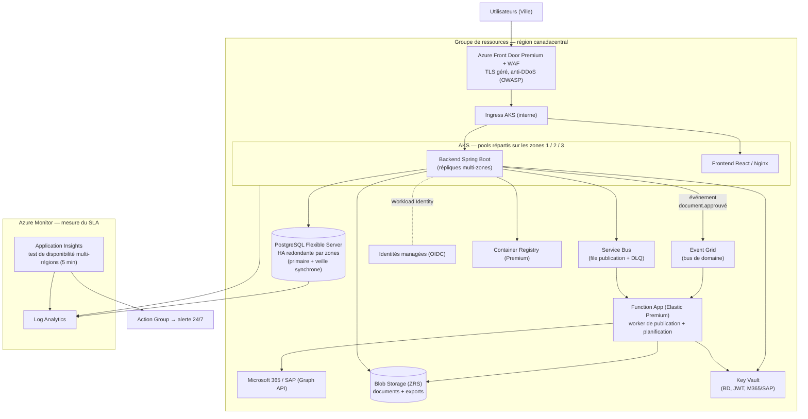

# Déploiement de l'infrastructure sur Azure avec Terraform (IaC)

Ce document explique **tout ce qui est déployé sur Azure**, **comment**, et **pourquoi**, pour la
solution `contractuelle_contrat`. Il est le pendant Azure de
[`aws-terraform-integration.md`](aws-terraform-integration.md).

L'infrastructure est décrite en **Terraform** (`infra/terraform/azure/`) et déployée par le pipeline
CI/CD (GitHub Actions `deploy-azure.yml` **ou** Azure DevOps `azure-pipelines.yml`).

---

## 1. Architecture de déploiement (haute disponibilité multi-zone, SLA 99,99 %)



**Ce qui soutient le SLA 99,99 %** : AKS avec noeuds sur **3 zones**, PostgreSQL **HA redondante par
zones** (bascule automatique), Front Door redondé mondialement, et la **mesure indépendante** par le
**test de disponibilité Application Insights** (sondes multi-régions toutes les 5 min) qui alimente
l'alerte de disponibilité.

---

## 2. Composants Azure et leur rôle

| Service | Fichier Terraform | Rôle dans la solution |
|---|---|---|
| **VNet + sous-réseaux** | `network.tf` | Réseau privé, sous-réseau AKS et sous-réseau délégué à PostgreSQL. |
| **AKS** (zones 1/2/3) | `aks.tf` | Exécute backend + frontend, autoscaler, Workload Identity. |
| **PostgreSQL Flexible Server** (HA zones) | `postgres.tf` | Base de données, veille synchrone inter-zones + bascule automatique. |
| **Container Registry (ACR)** | `registry.tf` | Registre d'images privé (Premium, géo-réplication possible). |
| **Front Door + WAF** | `frontdoor.tf` | Entrée mondiale redondée, TLS, pare-feu OWASP, anti-DDoS. |
| **Key Vault** | `keyvault.tf` | Secrets (BD, JWT, chiffrement, M365/SAP) ; accès pods via Workload Identity. |
| **Log Analytics + Application Insights** | `monitoring.tf` | Journaux, télémétrie, **test de disponibilité (SLA)**, alertes. |
| **Storage (Blob, ZRS)** | `storage.tf` | Documents générés + exports (réversibilité), redondance inter-zones. |
| **Service Bus** (+ DLQ) | `messaging.tf` | File de publication asynchrone vers M365/SAP. |
| **Event Grid** | `messaging.tf` | Bus d'événements de domaine. |
| **Function App** (Elastic Premium) | `messaging.tf` | Worker de publication + tâches planifiées (rapport SLA). |

---

## 3. Prérequis

- Abonnement Azure, droits `Owner`/`Contributor` sur la souscription.
- Outils : `terraform >= 1.6`, `az cli`, `kubectl`, `helm`, `docker`.
- Pour le CI/CD : une **inscription d'application** avec **fédération d'identité** (OIDC) — aucun secret statique.

## 4. Bootstrap de l'état distant (une fois)

```bash
az group create -n vina-contrat-tfstate-rg -l canadacentral
az storage account create -n vinacontrattfstate -g vina-contrat-tfstate-rg -l canadacentral --sku Standard_ZRS
az storage container create -n tfstate --account-name vinacontrattfstate
```
Puis décommenter le bloc `backend "azurerm"` dans `versions.tf`.

## 5. Déploiement de l'infrastructure

```bash
cd infra/terraform/azure
cp terraform.tfvars.example terraform.tfvars
az login
terraform init
terraform plan
terraform apply
```

Sorties utiles : `aks_get_credentials`, `acr_login_server`, `postgres_fqdn`, `key_vault_uri`,
`frontdoor_endpoint_hostname`, `aks_oidc_issuer_url`.

## 6. Déploiement de l'application (Helm)

```bash
az aks get-credentials -g vina-contrat-prod-rg -n vina-contrat-prod-aks
helm upgrade --install contrat infra/k8s/chart -n contrat --create-namespace \
  --values infra/k8s/values-azure.yaml \
  --set image.registry=$(terraform -chdir=infra/terraform/azure output -raw acr_login_server)
```
Les pods lisent leurs secrets dans **Key Vault** via **Workload Identity** (fédération du
ServiceAccount avec l'émetteur OIDC d'AKS — sortie `aks_oidc_issuer_url`). Les répliques sont
réparties sur les 3 zones (contraintes de topologie).

## 7. CI/CD

Deux options fournies (structure **modulaire** : orchestrateurs + briques réutilisables) :

- **GitHub Actions** [`cd-azure.yml`](cicd/github-actions/workflows/cd-azure.yml) — OIDC (`AZURE_CLIENT_ID`, `AZURE_TENANT_ID`, `AZURE_SUBSCRIPTION_ID`).
- **Azure DevOps** [`azure-pipelines.yml`](cicd/azure-devops/azure-pipelines.yml) + templates — connexion de service ARM, portes d'approbation par environnement.

Étapes : **test** (Maven + npm) → **build & push** images vers ACR → **approbation** (`prod-azure`)
→ **terraform apply** → **déploiement Helm** sur AKS. Tag d'image = SHA du commit. Mise en place
détaillée et bonnes pratiques : [`cicd/ci-cd-integration.md`](cicd/ci-cd-integration.md).

## 8. Garantie du SLA 99,99 %

1. **Redondance multi-zone** : AKS (zones 1/2/3), PostgreSQL HA redondante par zones, Front Door redondé.
2. **Mesure indépendante** : le **test de disponibilité Application Insights** (multi-régions, 5 min) alimente l'**alerte de disponibilité** (Action Group) — c'est cette mesure qui **atteste le taux** servant au calcul du SLA.
3. **Rejeu et DLQ** : Service Bus retente puis isole les publications échouées.

## 9. Coût du monitoring (déjà inclus)

Azure Monitor + Application Insights (dont le test de disponibilité) ≈ **~900–1 500 $/an**, absorbé
dans le coût récurrent d'hébergement (voir l'analyse de prix de l'AO).

## 10. Destruction

```bash
cd infra/terraform/azure && terraform destroy
```
> `purge_protection` est actif sur Key Vault ; la purge complète suit la période de rétention.

---

## Annexe — Glossaire des services Azure (acronyme, définition, rôle ici)

| Service | Acronyme / nom complet | Ce que c'est | Rôle dans la solution |
|---|---|---|---|
| **AKS** | *Azure Kubernetes Service* | Kubernetes **managé** : Azure exploite le plan de contrôle. | Orchestre le backend Spring Boot et le frontend React, noeuds sur 3 zones. |
| **VNet** | *Virtual Network* | Réseau **privé isolé** (plages d'adresses, sous-réseaux, routage). | Cloisonne AKS et le sous-réseau délégué à PostgreSQL. |
| **Zone de disponibilité** | *Availability Zone* | Centre(s) de données **isolé(s)** dans une région Azure. | ≥ 3 zones = aucune panne de zone n'interrompt le service (SLA 99,99 %). |
| **PostgreSQL Flexible Server** | — | PostgreSQL **managé** avec déploiement flexible et HA par zones. | Base de données, veille synchrone inter-zones + bascule automatique. |
| **ACR** | *Azure Container Registry* | Registre **privé** d'images Docker (Premium = géo-réplication). | Stocke les images construites par le CI ; tiré par AKS (rôle AcrPull). |
| **Front Door** | *Azure Front Door* | **Point d'entrée mondial** (CDN + équilibrage L7 + TLS) redondé. | Achemine le trafic public vers l'ingress AKS ; TLS géré, anti-DDoS. |
| **WAF** | *Web Application Firewall* | **Pare-feu applicatif** (jeu de règles OWASP). | Bloque les attaques web au niveau de Front Door (mode prévention). |
| **Key Vault** | — | **Coffre** de secrets, clés et certificats, avec contrôle d'accès RBAC. | Chaîne de connexion BD, JWT, clés de chiffrement, connecteurs M365/SAP. |
| **Azure Monitor** | — | Plateforme d'**observabilité** (métriques, journaux, alertes). | Supervision globale ; base du suivi et des alertes SLA. |
| **Log Analytics** | — | **Entrepôt de journaux** interrogeable (requêtes KQL) d'Azure Monitor. | Centralise les journaux d'AKS, PostgreSQL et applicatifs. |
| **Application Insights** | *App Insights* (APM) | *Application Performance Monitoring* : télémétrie + **tests de disponibilité**. | Sonde synthétique multi-régions → **mesure indépendante de la disponibilité**. |
| **APM** | *Application Performance Monitoring* | Surveillance des **performances applicatives** (traces, dépendances). | Fournie par Application Insights (latence, erreurs, disponibilité). |
| **Service Bus** | — | **Messagerie** d'entreprise (files et sujets), avec lettres mortes. | Met en file les demandes de publication asynchrone (M365/SAP). |
| **Event Grid** | — | **Routage d'événements** (publication/abonnement, quasi temps réel). | Bus d'événements de domaine (« document approuvé »…). |
| **Function App** | *Azure Functions* | Fonctions **sans serveur** (*serverless*), plan Elastic Premium ici. | Worker de publication + tâches planifiées (rapport SLA mensuel). |
| **Blob Storage** | — | Stockage **objet** (conteneurs de blobs). | Documents générés et exports (réversibilité). |
| **ZRS** | *Zone-Redundant Storage* | Réplication **synchrone entre zones** d'une même région. | Redondance inter-zones du stockage (résilience). |
| **Workload Identity** | — | Fédération **OIDC** entre un ServiceAccount K8s et une identité Azure. | Les pods AKS accèdent à Key Vault **sans secret** stocké. |
| **Managed Identity** | Identité managée | Identité gérée par Azure (cycle de vie automatique, **pas de secret**). | Utilisée par AKS, la Function App et pour tirer les images ACR. |
| **RBAC** | *Role-Based Access Control* | Contrôle d'accès **basé sur les rôles** (attribution de rôles). | Autorisations Key Vault, ACR, etc. selon le principe du moindre privilège. |
| **Entra ID** | *Microsoft Entra ID* (ex-Azure AD) | **Annuaire d'identité** de Microsoft (authentification, OIDC/SAML). | Fournit l'authentification fédérée (CI/CD, SSO gouvernemental de la solution). |
| **SKU** | *Stock Keeping Unit* | **Palier / référence** de service (taille, fonctionnalités, SLA). | Choix des niveaux (AKS Standard, Front Door Premium, PostgreSQL GP…). |
| **DDoS** | *Distributed Denial of Service* | Attaque par **déni de service distribué** (et sa protection). | Protection intégrée à Front Door. |
| **KQL** | *Kusto Query Language* | Langage de **requête** de Log Analytics / Azure Monitor. | Interrogation des journaux et construction des rapports de disponibilité. |
