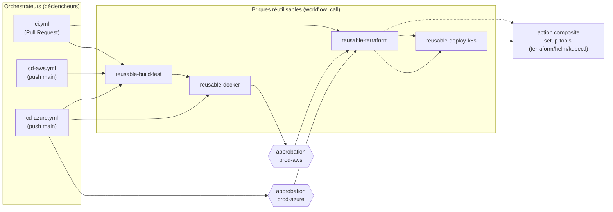

# Mise en place du CI/CD sur Azure et AWS

Ce tutoriel explique comment mettre en place l'intégration et la livraison continues (CI/CD) de la
solution `contractuelle_contrat` vers **Azure (AKS)** et **AWS (EKS)**, en suivant les bonnes
pratiques : **workflows modulaires** (pas de fichier monolithique), **orchestrateurs** appelant des
**briques réutilisables**, **authentification OIDC sans secret statique**, **plan/apply séparés**,
**portes d'approbation** et **analyses de sécurité**.

Il complète [`azure-terraform-integration.md`](../azure-terraform-integration.md) et
[`aws-terraform-integration.md`](../aws-terraform-integration.md).

---

## 1. Principe : orchestrateurs + briques réutilisables

Plutôt qu'un gros fichier par cloud, chaque **préoccupation** est isolée et **réutilisée** :



| Fichier | Type | Rôle |
|---|---|---|
| `workflows/ci.yml` | Orchestrateur | Sur **PR** : build/tests + `terraform plan` (AWS & Azure). Aucun déploiement. |
| `workflows/cd-aws.yml` | Orchestrateur | Sur **push main** : test → images → **approbation** → `apply` → déploiement EKS. |
| `workflows/cd-azure.yml` | Orchestrateur | Idem pour AKS. |
| `workflows/reusable-build-test.yml` | Réutilisable | Compile/teste backend (Maven+JaCoCo) et frontend (npm). |
| `workflows/reusable-docker.yml` | Réutilisable | Build & push images vers **ECR**/**ACR** (tag = SHA), scan Trivy. |
| `workflows/reusable-terraform.yml` | Réutilisable | `fmt`/`validate`/**TFLint**/**Checkov**/`plan`\|`apply`. |
| `workflows/reusable-deploy-k8s.yml` | Réutilisable | `helm upgrade` sur le cluster (rolling update multi-zone). |
| `actions/setup-tools/action.yml` | Action composite | Installe Terraform, Helm, kubectl (versions figées). |

**Azure DevOps** suit le même principe avec des **templates de stage** (`azure-devops/templates/`)
composés par `azure-devops/azure-pipelines.yml`.

---

## 2. Installation

### 2.1 GitHub Actions

Les workflows réutilisables et l'action composite doivent résider sous `.github/` du dépôt :

```bash
mkdir -p .github/workflows .github/actions
cp infra/cicd/github-actions/workflows/*.yml   .github/workflows/
cp -r infra/cicd/github-actions/actions/*        .github/actions/
git add .github && git commit -m "ci: pipelines CI/CD modulaires (Azure & AWS)"
```
> Les orchestrateurs référencent `./.github/workflows/reusable-*.yml` et `./.github/actions/setup-tools` :
> ils ne fonctionnent qu'une fois placés dans `.github/`.

### 2.2 Azure DevOps

Créer un pipeline pointant sur `infra/cicd/azure-devops/azure-pipelines.yml` (les templates sont
inclus automatiquement).

---

## 3. Prérequis d'authentification (OIDC — aucun secret statique)

### 3.1 GitHub → AWS

1. Créer un **fournisseur d'identité OIDC** GitHub dans IAM (`token.actions.githubusercontent.com`).
2. Créer un **rôle IAM** assumable par le dépôt (condition sur `sub = repo:<org>/<repo>:*`) avec les
   droits de déploiement.
3. Renseigner le secret GitHub **`AWS_DEPLOY_ROLE_ARN`** = ARN du rôle.

### 3.2 GitHub → Azure

1. Créer une **inscription d'application** (App registration) + principal de service.
2. Ajouter des **federated credentials** (OIDC) pour le dépôt/branche/environnement.
3. Attribuer les rôles Azure (`Contributor` + `User Access Administrator` sur le groupe de ressources).
4. Renseigner les secrets GitHub **`AZURE_CLIENT_ID`**, **`AZURE_TENANT_ID`**, **`AZURE_SUBSCRIPTION_ID`**.

### 3.3 Azure DevOps

Créer une **connexion de service ARM** `sc-azure-vina` en **fédération d'identité de charge de travail**
(workload identity federation) — pas de secret à gérer.

---

## 4. Environnements et portes d'approbation

- **GitHub** : créer les environnements **`prod-aws`** et **`prod-azure`** (Settings → Environments) et
  y activer *Required reviewers*. Le job `gate` des orchestrateurs CD s'y rattache → le déploiement
  **attend une approbation manuelle**.
- **Azure DevOps** : créer l'environnement **`prod-azure`** (Pipelines → Environments) avec une
  *approval check*.

---

## 5. Bonnes pratiques appliquées

| Pratique | Mise en œuvre |
|---|---|
| **Pas de monolithe** | Orchestrateurs minces + briques réutilisables + action composite. |
| **Sans secret statique** | OIDC (GitHub↔AWS/Azure), fédération d'identité (Azure DevOps). |
| **Moindre privilège** | Rôles dédiés au déploiement ; IRSA/Workload Identity pour les pods. |
| **Plan avant apply** | `terraform plan` sur PR (commenté), `apply` seulement après fusion + approbation. |
| **Qualité bloquante** | Tests + couverture JaCoCo, build frontend, `terraform validate`. |
| **Sécurité** | **TFLint** (lint IaC), **Checkov** (conformité IaC), **Trivy** (images). |
| **Traçabilité** | Tag d'image = **SHA du commit** (immuable), images `IMMUTABLE` sur ECR. |
| **Sûreté d'exécution** | `concurrency` (un déploiement à la fois, jamais annulé en cours). |
| **Rollback** | `helm rollback contrat` (versions Helm conservées) ; images précédentes disponibles. |
| **Durcissement** | Épingler les actions à un **SHA de commit** (au lieu d'un tag) — voir §7. |

---

## 6. Flux au quotidien

1. **Développement** → ouverture d'une **PR** : `ci.yml` lance build/tests + `terraform plan` (AWS & Azure) ; le plan est commenté dans la PR.
2. **Fusion sur `main`** : `cd-aws.yml` et `cd-azure.yml` construisent les images, s'arrêtent à la **porte d'approbation**.
3. **Approbation** d'un responsable → `terraform apply` puis `helm upgrade` (rolling update, sans interruption).
4. **Vérification** : `kubectl rollout status` + le canari/test de disponibilité confirme le SLA.

En cas de souci : `helm -n contrat rollback contrat` (retour à la version précédente).

---

## 7. Durcissement (recommandé pour la production)

- **Épingler par SHA** chaque `uses:` d'action tierce (ex. `actions/checkout@<sha>`), via Dependabot.
- Passer **Checkov** et **Trivy** en `soft_fail: false` / `exit-code: 1` une fois les exceptions triées.
- Restreindre le `paths:` et les branches ; exiger la revue de code + statuts requis sur `main`.
- Séparer les états Terraform par environnement (staging/prod) et activer le verrouillage.

---

## 8. Glossaire CI/CD (acronyme, définition, rôle ici)

| Terme | Acronyme / nom complet | Ce que c'est | Rôle ici |
|---|---|---|---|
| **CI/CD** | *Continuous Integration / Continuous Delivery* | Intégration continue (tests à chaque changement) + livraison continue (déploiement automatisé). | Pipeline test → build → infra → déploiement. |
| **GitHub Actions** | — | Plateforme d'automatisation de GitHub (workflows YAML déclenchés par événements). | Exécute CI (PR) et CD (main). |
| **Workflow** | — | Fichier YAML décrivant des *jobs* et *steps* déclenchés par un événement. | `ci.yml`, `cd-aws.yml`, `cd-azure.yml`. |
| **Reusable workflow** | Workflow réutilisable | Workflow appelé par un autre via `workflow_call` (factorisation). | Briques `reusable-*.yml`. |
| **Composite action** | Action composite | Action locale regroupant plusieurs étapes réutilisables. | `setup-tools` (Terraform/Helm/kubectl). |
| **Orchestrateur** | — | Workflow « chef d'orchestre » qui enchaîne les briques réutilisables. | `ci.yml`, `cd-*.yml`. |
| **Job / Step** | — | Un *job* s'exécute sur un runner ; un *step* est une commande/action. | Unités d'exécution des workflows. |
| **Runner** | — | Machine (hébergée par GitHub) qui exécute les jobs. | `ubuntu-latest`. |
| **OIDC** | *OpenID Connect* | Authentification fédérée : un jeton court remplace les clés statiques. | GitHub↔AWS/Azure sans secret. |
| **Environment** | Environnement | Cible de déploiement avec règles de protection (approbations). | `prod-aws`, `prod-azure` (portes d'approbation). |
| **Concurrency** | Concurrence | Contrôle des exécutions simultanées d'un workflow. | Un seul déploiement à la fois. |
| **Matrix** | Matrice | Exécution parallèle d'un job sur plusieurs variantes. | (Extensible : versions Java/Node.) |
| **Azure DevOps** | — | Suite CI/CD de Microsoft (Pipelines, Environments, Service Connections). | Pipeline Azure alternatif. |
| **Pipeline template** | Template | Fichier YAML réutilisable inséré via `- template:` (équivalent des reusables). | `azure-devops/templates/*`. |
| **Service Connection** | Connexion de service | Identité/permissions vers un service externe (ARM, ACR). | `sc-azure-vina` (OIDC). |
| **Helm** | — | Gestionnaire de paquets Kubernetes (charts, versions, rollback). | Déploie l'app ; `helm rollback` pour revenir en arrière. |
| **kubectl** | — | Client en ligne de commande de Kubernetes. | Vérifie le déploiement (`rollout status`). |
| **Terraform** | IaC (*Infrastructure as Code*) | Décrit l'infrastructure en fichiers versionnés (`plan`/`apply`). | Provisionne Azure et AWS. |
| **TFLint** | — | *Linter* Terraform (erreurs, conventions, règles par fournisseur). | Qualité de l'IaC en CI. |
| **Checkov** | — | Analyse statique de sécurité/conformité de l'IaC. | Détecte les mauvaises configurations. |
| **Trivy** | — | Scanner de vulnérabilités (images, dépendances, IaC). | Scanne les images Docker avant/après push. |
| **JaCoCo** | *Java Code Coverage* | Mesure de la couverture de tests Java. | Rapport de couverture backend. |
| **Artifact** | Artéfact | Fichier produit par un job et transmis/conservé. | Rapport JaCoCo, plan Terraform. |
| **Rolling update** | Mise à jour progressive | Remplacement graduel des pods (sans interruption). | Stratégie de déploiement Kubernetes. |
| **SHA** | *Secure Hash Algorithm* (empreinte de commit) | Identifiant unique et immuable d'un commit. | Tag des images = traçabilité. |
