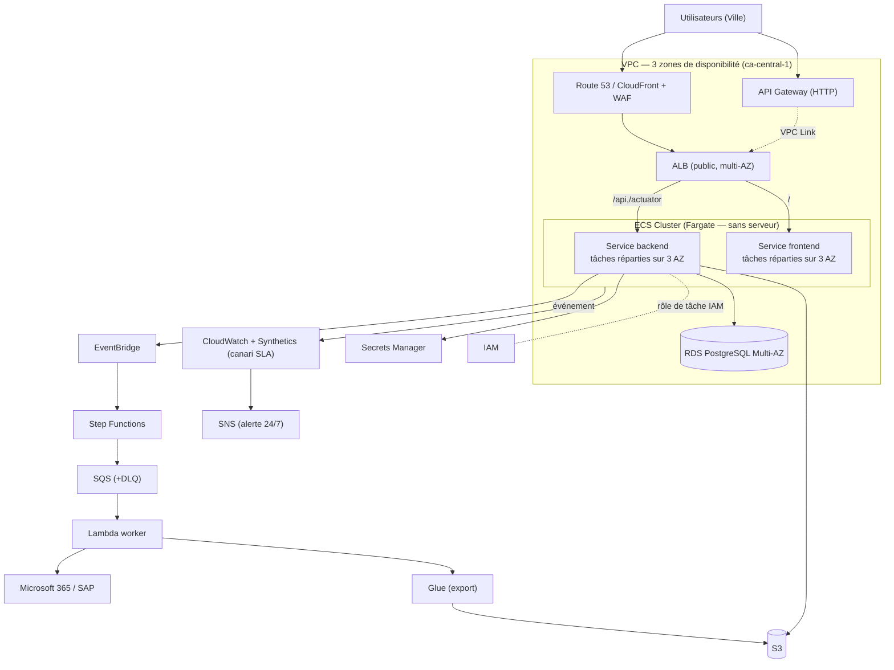
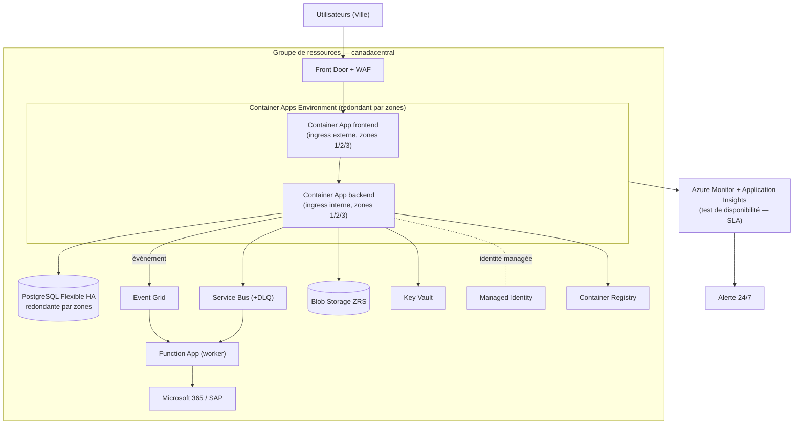

# Déploiement sur conteneurs managés sans Kubernetes — ECS & Azure Container Apps

Cette variante déploie `contractuelle_contrat` sur des **plateformes de conteneurs managés sans
serveur** — **Amazon ECS sur Fargate** (AWS) et **Azure Container Apps** (Azure) — au lieu de
Kubernetes (EKS / AKS). Elle vit dans un **dossier séparé** (`infra/serverless/`) et **ne modifie pas**
la variante Kubernetes de `infra/terraform/` (EKS/AKS).

**Pourquoi cette variante ?** Pas de plan de contrôle Kubernetes à administrer, mise à l'échelle et
facturation à l'usage, exploitation plus simple — tout en conservant la **haute disponibilité
multi-zone** exigée par le **SLA 99,99 %** et l'ensemble des services périphériques (base de données,
files, événements, orchestration, stockage, secrets, supervision).

Le **socle est identique** à la variante Kubernetes (VPC/VNet, PostgreSQL HA, S3/Blob, SQS/Service Bus,
Lambda/Functions, EventBridge/Event Grid, Step Functions, Glue, Secrets/Key Vault, CloudWatch/Monitor,
Front Door/API Gateway) ; **seule la brique de calcul change**.

---

## 1. Architecture AWS — ECS Fargate (multi-AZ)



## 2. Architecture Azure — Container Apps (multi-zone)



---

## 3. Services et rôles

| AWS (ECS) | Azure (ACA) | Rôle |
|---|---|---|
| **ECS + Fargate** | **Container Apps + Environment** | Exécute backend/frontend en conteneurs, sans Kubernetes, sur ≥ 3 zones. |
| **ALB** | Ingress de l'environnement + **Front Door** | Entrée HTTP, routage `/api` → backend, `/` → frontend. |
| **RDS PostgreSQL Multi-AZ** | **PostgreSQL Flexible HA** | Base de données à bascule automatique inter-zones. |
| **IAM (rôle de tâche)** | **Managed Identity** | Droits applicatifs sans clé statique. |
| **Secrets Manager** | **Key Vault** | Secrets injectés dans les conteneurs. |
| **ECR** | **ACR** | Registre d'images (tiré par l'identité managée). |
| SQS · Lambda · EventBridge · Step Functions · Glue · S3 | Service Bus · Functions · Event Grid · Blob | Chaîne asynchrone de publication + export (inchangée). |
| CloudWatch (+ Synthetics) | Azure Monitor (+ App Insights) | Supervision et **mesure du SLA**. |

---

## 4. Déploiement

```bash
# AWS (ECS Fargate)
cd infra/serverless/terraform/aws-ecs
cp terraform.tfvars.example terraform.tfvars
terraform init && terraform apply
# → sortie alb_dns_name : pointer Route 53/CloudFront dessus.

# Azure (Container Apps)
cd infra/serverless/terraform/azure-aca
cp terraform.tfvars.example terraform.tfvars
az login && terraform init && terraform apply
# → sortie frontend_fqdn : origine de Front Door.
```

Les images (mêmes Dockerfile que la variante K8s) sont poussées vers ECR/ACR par le CI ; le tag est le
SHA du commit. La mise à jour applicative se fait **sans Helm** :

```bash
# AWS : forcer un nouveau déploiement du service (nouvelle image)
aws ecs update-service --cluster vina-contrat-prod-ecs --service backend --force-new-deployment
# Azure : nouvelle révision de la Container App
az containerapp update -n backend -g vina-contrat-prod-rg \
  --image <acr>.azurecr.io/vina-contrat/backend:<sha>
```
> Pour le CI/CD, remplacer l'étape `reusable-deploy-k8s` (Helm) par ces commandes ECS/ACA ; le reste
> du pipeline (test → images → terraform apply → déploiement) est identique. Voir
> [`../cicd/ci-cd-integration.md`](../cicd/ci-cd-integration.md).

---

## 5. Haute disponibilité (SLA 99,99 %)

- **AWS** : services ECS avec `ordered_placement_strategy = spread` par **zone de disponibilité**,
  ALB et RDS multi-AZ ; mise à l'échelle automatique (CPU).
- **Azure** : `zone_redundancy_enabled = true` sur l'environnement Container Apps, PostgreSQL HA
  redondante par zones ; `min_replicas ≥ 3`.
- Dans les deux cas, la **disponibilité est mesurée indépendamment** (canari CloudWatch Synthetics /
  test Application Insights) — mécanisme qui atteste le taux servant au calcul du SLA.

---

## 6. Comparaison avec la variante Kubernetes (EKS/AKS)

| Critère | ECS / Container Apps (ce dossier) | EKS / AKS (`infra/terraform/`) |
|---|---|---|
| Complexité d'exploitation | **Faible** (pas de plan de contrôle K8s) | Élevée (mise à jour du cluster, add-ons) |
| Portabilité / standard | Spécifique au fournisseur | **Kubernetes standard** (portable) |
| Écosystème (Helm, opérateurs) | Limité | **Riche** |
| Mise à l'échelle | À l'usage, rapide | Fine mais à gérer |
| Idéal pour | Équipe réduite, temps de mise en marché | Besoins avancés, multi-charges |

> Les deux variantes coexistent : choisir ECS/ACA pour la **simplicité d'exploitation**, EKS/AKS pour
> la **standardisation Kubernetes**. Aucune ne modifie l'autre.

---

## 7. Glossaire (acronyme, définition, rôle ici)

| Terme | Acronyme / nom complet | Ce que c'est | Rôle ici |
|---|---|---|---|
| **ECS** | *Elastic Container Service* | Orchestrateur de conteneurs **propre à AWS** (sans Kubernetes). | Exécute backend/frontend en tâches. |
| **Fargate** | — | Moteur **sans serveur** d'ECS/EKS : conteneurs sans gérer de serveurs (VM). | Exécute les tâches ECS, facturation à l'usage. |
| **Task / Task Definition** | Tâche / définition de tâche | Gabarit (image, CPU, mémoire, ports, secrets) et son instance en exécution. | Décrit et lance chaque conteneur. |
| **Service ECS** | — | Maintient *N* tâches en exécution, les enregistre dans l'ALB, les recrée. | Backend/frontend, répartis sur 3 AZ. |
| **ALB** | *Application Load Balancer* | Équilibreur de charge HTTP (niveau 7). | Route `/api` → backend, `/` → frontend. |
| **Target Group** | Groupe de cibles | Ensemble de cibles (IP des tâches) derrière un ALB, avec sonde de santé. | Un par service (backend, frontend). |
| **AZ** | *Availability Zone* | Zone de disponibilité isolée. | ≥ 3 = haute disponibilité (SLA 99,99 %). |
| **IAM (rôle d'exécution)** | *Identity and Access Management* | Rôle utilisé par l'agent ECS (tirer l'image, journaux, secrets). | Démarrage sécurisé des tâches. |
| **IAM (rôle de tâche)** | — | Rôle **assumé par le conteneur** pour accéder aux services AWS. | Droits S3/SQS/Secrets/EventBridge du backend. |
| **ACA** | *Azure Container Apps* | Plateforme Azure de conteneurs managés **sans serveur** (bâtie sur K8s/KEDA, mais masquée). | Exécute backend/frontend. |
| **Container Apps Environment** | Environnement ACA | Frontière sécurisée/réseau partagée par les Container Apps (journaux, VNet, zones). | Héberge les deux apps, redondance par zones. |
| **Revision** | Révision | Version immuable d'une Container App ; le trafic se répartit entre révisions. | Déploiement par nouvelle révision (rollback facile). |
| **Ingress** | — | Point d'entrée HTTP d'une Container App (externe ou interne). | Frontend externe, backend interne. |
| **Managed Identity** | Identité managée | Identité Azure sans secret (cycle de vie géré par Azure). | Tirage ACR + lecture Key Vault. |
| **KEDA** | *Kubernetes Event-Driven Autoscaling* | Moteur d'autoscaling événementiel (sous-jacent à ACA). | Mise à l'échelle des Container Apps. |
| **Front Door** | *Azure Front Door* | Entrée mondiale (CDN + LB L7) + WAF. | Achemine le trafic vers le frontend (ingress externe). |
| **VPC / VNet** | *Virtual Private Cloud* / *Virtual Network* | Réseau privé isolé (AWS / Azure). | Cloisonne calcul et base de données. |
| **IaC** | *Infrastructure as Code* | Infrastructure décrite en code versionné (Terraform). | Provisionne ECS/ACA et le socle. |

> Les acronymes des services **périphériques** (RDS, S3, SQS, Lambda, EventBridge, Step Functions,
> Glue, Secrets Manager, CloudWatch, Key Vault, Service Bus, Event Grid, Application Insights…) sont
> définis dans [`../aws-terraform-integration.md`](../aws-terraform-integration.md) et
> [`../azure-terraform-integration.md`](../azure-terraform-integration.md) — ils sont identiques ici.
